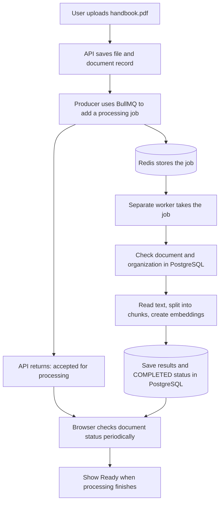
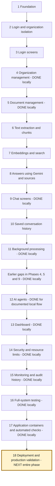
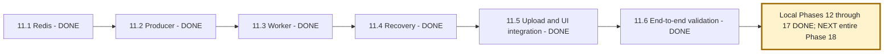
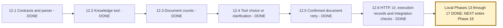
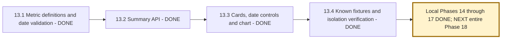

# NexaAI: learning guide, phase roadmap, and progress tracker

Last updated: **2026-10-27**.

## START HERE: where we are

**Current phase: Phase 18 - local implementation ready; hosted evidence pending.**
**Last completed phase: 17.1-17.5 - Containers, CI checks, configuration and release procedures.**
**Current implementation: Phase 18 production bundle is ready; external provisioning and live evidence remain.**

Phase 17 packages API/worker, migrations and frontend as non-root images; starts them
with PostgreSQL and Redis in dependency order; validates required configuration; and
adds GitHub Actions plus migration/rollback procedures. An isolated Compose journey
applied all migrations and processed a real uploaded TXT file to READY. The final
regression passed 346/346 backend tests, 15/15 frontend utility/config tests and
117/117 Chrome cases. [Phase 17 guide and evidence](backend/docs/phase-17-containers-and-delivery.md).
[Step-sized commit plan](backend/docs/phase-17-commit-plan.md).

Phase 16 provides one release workflow across backend, browser, recovery, security,
live Gemini quality and local performance checks. The final backend gate passed 343
tests from 45 files; Chrome passed 117/117; frontend utilities passed 13/13. Seven
live agent-routing cases and four live RAG cases passed using synthetic data. The
bounded local benchmark recorded its environment and limits rather than claiming
production capacity. [Phase 16 guide and evidence](backend/docs/phase-16-full-system-verification.md).
[Step-sized commit plan](backend/docs/phase-16-commit-plan.md).

Phase 15 connects HTTP requests to background jobs using server-generated identifiers,
records safe timings, separates liveness from dependency readiness, and adds an
owner/admin Operations screen with organization-scoped queue alerts and audit history.
Important action records commit with their database changes. A real failed job was
traced across three attempts without exposing the private content/path/secret canary.

Validation: the expanded backend gate passed 321 tests; final focused checks passed
following small refinements. Chrome regression passed 116 cases initially; its one
pagination-fixture failure was corrected and all four Operations cases then passed
(117 distinct cases covered). Twelve utility tests, both builds and changed-file
lint/type checks passed. The audit migration was applied locally. Retention remains
dry-run by default; no cleanup was applied. The phase was subsequently split into
five local commits (15.1-15.5) at the user's request; no push was performed.

[Phase 15 explanation, examples, diagrams and validation](backend/docs/phase-15-monitoring-and-audit.md).
[Step-sized commit plan](backend/docs/phase-15-commit-plan.md).
The [Phase 14 security evidence](backend/docs/security-step-6-combined-verification.md)
and [bounded question cache](backend/docs/security-step-5-measured-caching.md) remain
applicable. Phase 16 added bounded synthetic live-model evaluation and a small local
performance baseline; broad real-document quality, sustained load and production
deployment remain unverified. Previous Git history still contains earlier credential/upload copies.
PDF/ZIP signatures are admission checks; full parsing remains in the worker.

**Phase 11 is DONE for the verified local workflow.** A real Chrome journey passed:
queued upload, separate worker, automatic status updates, failed-file retry, a cited
Gemini answer, and reopening the saved answer after a new login. Organization-isolation
checks passed too. The planned local gaps in Phases 4, 5, and 9 are now complete.

| Phase 11 step | Status | What that means |
| --- | --- | --- |
| 11.1 Redis setup | DONE | Local Redis runs in Docker; the backend connects successfully. |
| 11.2 BullMQ producer | DONE | Code can store a processing instruction in Redis; tested with isolated jobs. |
| 11.3 Worker | DONE | Worker validates jobs and prepares documents; real Redis/database/embedding tests pass. |
| 11.4 Failure recovery and retries | DONE | Bounded retries, crash recovery, explicit retry, atomic results and job retention verified. |
| 11.5 Connect uploads and status UI | DONE | Upload/retry APIs queue work; the screen polls status and handles saved-file submission failures. |
| 11.6 Full verification | DONE | Real browser/services verified preparation, failure/retry, cited Gemini answer, saved history and isolation. |

**Current limitation:** the successful live journey used a fictional TXT handbook and
one generated answer; it is not a production load test or exhaustive format evaluation.
The library lists earlier uploads. Retried or explicitly refreshed cards now track
active processing automatically; Refresh library updates other entries. The latest
upload still checks automatically.

## 1. What are we building?

NexaAI lets a company upload its documents and ask questions about them.

Example: upload `employee-handbook.pdf`, which says employees receive 18 annual leave
days. Ask, "How many annual leave days do employees get?" NexaAI finds the relevant
passage, asks Gemini to answer using that passage, and shows the answer with its source.

There are two different activities:

```text
A. PREPARE A DOCUMENT
Upload -> Read its text -> Split text into pieces -> Create searchable numbers -> Save

B. ANSWER A QUESTION
Question -> Find relevant saved pieces -> Give them to Gemini -> Answer + sources -> Save chat
```

The searchable numbers are called **embeddings**. They help find text with a similar
meaning even when the question uses different words. We generate them locally.
**Gemini** writes answers using the retrieved text. **RAG** is the name for this
"retrieve useful text, then generate an answer" process.

The background queue we are building belongs to activity A: preparing documents.
It does not generate chat answers or replace Gemini.

## 2. Redis, BullMQ, and workers in simple language

Imagine a restaurant:

| Restaurant example | NexaAI component | What it does |
| --- | --- | --- |
| Customer gives an order | User uploads a document | Starts a request. |
| Waiter writes an order ticket | Producer code | Creates a small instruction to process the document. |
| Order-management rules/software | BullMQ | Adds jobs, tracks their state, and gives them to workers. |
| Board holding order tickets | Redis | Stores the queue's jobs and state. Our Redis also has disk persistence configured. |
| Cook | Worker | Runs the actual text extraction, chunking, and embedding code. |
| Order record and menu information | PostgreSQL | Stores users, document records, text chunks, vectors, and chat history. |

**BullMQ is a JavaScript/TypeScript library installed in our backend.** It provides
queue operations so we do not have to write all the queue-management logic ourselves.
It uses Redis to store its queue data. BullMQ does not know how to read our PDFs;
the worker must call our document-processing code to do that.

A **job** is one instruction. A **queue** is a collection of jobs awaiting or undergoing
work. A **producer** submits jobs. A **worker** performs them in a separate Node.js process.
**Docker** runs the Redis server in a container: a packaged environment for that service.

### Example: uploading a handbook

Suppose a large file takes 30 seconds to process. This is an illustration, not a measured time.

**Previous upload flow, before Step 11.5:**

```text
Browser sends handbook.pdf
       |
       v
API saves file and document record
       |
       v
API extracts text, splits it, generates embeddings, and saves results
       |   Browser waits for all this processing
       v
API returns "completed"
```

**Current upload flow, connected in Step 11.5:**



Plain-text version if your Markdown viewer cannot render Mermaid:

```text
UPLOAD -> API saves file -> BullMQ adds job -> Redis
                |                              |
                v                              v
        Return "processing"                 WORKER
                |                              |
                v                              v
        Browser checks status       Extract -> Chunk -> Embed -> Save
                |                              |
                +----- PostgreSQL status <-----+
                              |
                         Show "Ready"
```

The upload itself still takes time. The improvement is that the browser does not also
have to keep that same request open for all the document processing. Processing still
uses computing resources; a queue does not make a 30-second task instant.

### What is inside a job?

For illustration, use short labels (the real code requires UUID identifiers):

```json
{
  "documentId": "document-123",
  "organizationId": "company-456"
}
```

This means: "Prepare document 123 belonging to company 456." The worker will find
the file path in the database. The job does not contain the entire PDF or a Gemini key.

We tested five submissions for the same document and organization. Redis stored one
waiting job because all five used the same job ID. This protection lasts while that
job is retained. It does not guarantee that processing can never run twice after a failure.

**What exists today:** Redis + producer + worker + preparation/recovery + queued uploads
and automatic status checks, with latest-upload retry controls.
**What exists now:** Phase 14.3 limits repeated login/chat/upload actions and
shares document budgets with direct retries and agent confirmations. Phase 14.4
reviewed prompts, tools, tenant isolation and secrets. Phase 14.5 caches measured
repeated question embedding work while searching current documents each time.
Phase 14.6 verified combined security/recovery behavior. Phase 15 added safe logs,
request/job identifiers, timings, health checks and scoped audit history. The next
implementation covers the entire Phase 16.

## 3. How we will work from now on

Use this file as the main tracker. The original plan has several numbering schemes;
this file uses its final **18-phase Recommended Implementation Order**. Existing files
named `redis-step-1` and `redis-step-2` correspond to **11.1** and **11.2** here.
Older filenames keep their names. Their numbers are not new phase numbers.

**Workflow updated on 2026-10-27: implement one complete phase at a time.**
The numbered steps remain learning/review units and future commit topics; they
are no longer separate implementation stopping points.

For each phase:

1. State the phase and its included steps, and point to its position in the diagram.
2. Explain the problem in plain language with a document or chat example.
3. Define any new tool or term before using it.
4. Explain the input, the action, and the expected result.
5. Implement every planned step in that phase, with comments explaining important code.
6. Test it and explain what the test proves and what remains unverified.
7. Update this file's status, current pointer, and evidence links.
8. Give a validation walkthrough and step-sized commit plan, then stop before the next phase.
9. Do not commit automatically; commits can be created step by step later when requested.

Status meanings: **DONE** = implemented and verified for the stated scope;
**PARTIAL** = some features exist but listed work remains; **NEXT** = next step;
**PLANNED** = future work. These are not claims of production readiness.
Tests accompany every meaningful feature; Phase 16 is a final system-wide check.

## 4. Whole-project phase flow



Text route: **1 -> 2 -> 3 -> 4 -> 5 -> 6 -> 7 -> 8 -> 9 -> 10 -> 11 (done locally)
-> earlier gaps complete -> 12 (done for local flow) -> 13 (done for local flow) -> 14 (done for verified local flow) -> 15 (done for verified local flow) -> 16 (done for verified local flow) -> 17 (done for verified local/container flow) -> 18 (next: entire phase).**

Some work was implemented in a different chronological order. We keep the original
phase identities and explicitly return to unfinished features instead of hiding them.
Future steps are a working plan; explain and record changes before implementing them.

## 5. Phases 1–10: built foundations and visible gaps

| Phase | Status | Implemented scope | Remaining work or validation |
| --- | --- | --- | --- |
| 1 Foundation | DONE for local core | React, Express, TypeScript, Prisma, PostgreSQL/pgvector, health API and Phase 17 application containers. | Production hosting is Phase 18. |
| 2 Authentication and isolation | DONE for core flow | Register, password login, signed tokens, organization membership and scoped document/chat access. | Phase 14 local security gate passed; live-model evaluation and deployment configuration remain later. |
| 3 Authentication screens | DONE for core flow | Login/register, protected navigation, sign out, safe request handling. | Refresh still requires login again by the current in-memory session design; expiry/logout/recovery controls were verified in Phase 14. |
| 4 Organization management | DONE for planned local flow | Current-role permissions, profile editing, member screens, expiring invitations and organization switching. | Email delivery is manual; persistent sessions and global token revocation remain later work. |
| 5 Document management | DONE for planned local flow | Upload, background status, paginated library, coordinated owner/admin deletion, and retries for older saved files. | Pending deletion cleanup requires explicit Finish deletion. Cloud storage is Phase 18. |
| 6 Document processing | DONE for core flow | Extract text and split it into chunks; invoked by the worker and verified in the live 11.6 journey. | Broader document-format evaluation remains in Phase 16. |
| 7 Embeddings and search | DONE for core flow | Local embeddings, stored vectors, organization-scoped similarity search. | More retrieval evaluation remains in Phase 16. |
| 8 RAG answers | DONE for core flow | Retrieved evidence, Gemini answers, validated citations, missing/conflicting evidence handling. | Phase 16 added four live synthetic cases; broad real-document evaluation remains future work. |
| 9 Chat interface | DONE for planned local flow | Ask questions, answers/sources, loading/errors, new conversation, confirmed private conversation deletion, safe Markdown for new and saved answers. | Standard Markdown only; tables, syntax highlighting and conversational memory are outside this step. |
| 10 Conversation history | DONE for core flow | Save exchanges, list/read history, pagination, reopen and continue, backend live verification. | Earlier messages are NOT yet passed to Gemini as conversation context. |

### Earlier phase steps completed after Phase 11

| Step | Planned work | How you validate it |
| --- | --- | --- |
| 4.1 DONE | Enforce current membership and conservative role permissions; protect owners; serialize member changes. | Build and 10 tests passed, including stale-token denial, isolation and concurrent promotion/removal. [Evidence](backend/docs/organization-step-1-permissions.md). |
| 4.2 DONE | Current members view their profile; owners edit the display name; the current browser session reflects confirmed changes. | Both builds, lint, 16 backend and 32 browser tests passed. [Guide](backend/docs/organization-step-2-profile.md). |
| 4.3 DONE | Member screens with fresh role checks, registered-account addition, role changes and removal confirmation. | Owner protection, restricted roles, cancellation, stale access and response isolation tested. [Guide](backend/docs/organization-step-3-members.md). |
| 4.4 DONE | Add one-time, email-bound invitation creation, revocation, registration and acceptance, with expiry. | 22 backend organization tests and invitation browser flows passed. Email delivery remains manual. [Guide](backend/docs/organization-step-4-invitations.md). |
| 4.5 DONE | List current memberships, issue a scoped session for the selected team, verify its current role and reset workspace pages. | Real database document/history isolation and browser session/draft checks passed. [Guide](backend/docs/organization-step-5-switching.md). |
| 5.1 DONE | Paginated organization library with safe metadata, queue-aware status, refresh, Load more and upload synchronization. | 12 backend library/status and 15 browser library/upload tests passed. [Guide](backend/docs/document-step-1-library.md). |
| 5.2 DONE | Confirmed deletion with current-role checks, processing/submission locks, durable blocked state, queue/file cleanup and Finish deletion. | Real PostgreSQL/Redis/file tests and browser checks passed; saved citation snapshots preserved. [Guide](backend/docs/document-step-2-deletion.md). |
| 5.3 DONE | Retry/start saved library files, track progress, preserve pages and require a read after uncertain submissions; enforce current membership before retry. | 26 backend and 27 browser document tests passed. [Guide](backend/docs/document-step-3-library-retries.md). |
| 9.1 DONE | Confirmed private conversation deletion with current membership, ownership checks, cascaded messages/sources and late-answer protection. | 19 backend and 20 browser conversation/chat/history/switch tests passed. [Guide](backend/docs/chat-step-1-conversation-deletion.md). |
| 9.2 DONE | Format new and saved answers with safe Markdown, explicit web links, image descriptions and contained code scrolling. | Frontend build, changed-file lint and 25 browser tests passed, including unsafe HTML/URLs, images and narrow screens. [Guide](frontend/docs/chat-step-2-safe-markdown.md). |

Possible later extension: using earlier turns as model context. Decide its scope
separately; saved history alone does not implement conversational memory.

## 6. Phase 11: background processing, step by step

Goal: a user uploads a file, sees processing status, and can ask questions once it is ready.



| Step | What we do and why | Example and validation |
| --- | --- | --- |
| 11.1 DONE | Run Redis, configure persistence, verify a connection. We need somewhere to store waiting jobs. | Backend sends PING and receives PONG. [Evidence](backend/docs/redis-step-1-connection.md). |
| 11.2 DONE | Add BullMQ producer, small job payloads, and duplicate protection. We need to submit instructions reliably. | Five equivalent submissions create one waiting test job. [Evidence](backend/docs/redis-step-2-document-queue.md). |
| 11.3 DONE | Added a worker entry point; validate job data and organization association; call existing processing code; close connections on shutdown. | Real worker tests produced two chunks with 384-dimensional vectors, rejected invalid jobs, and verified idle shutdown. [Evidence](backend/docs/redis-step-3-document-worker.md). |
| 11.4 DONE | Three attempts with backoff; database locking and atomic results; stalled-job recovery and failure reconciliation; explicit failed-job retry; bounded terminal-job retention. | 19 tests passed, including two killed child workers, Redis redelivery, manual recovery and unchanged completed chunks. [Explanation and evidence](backend/docs/redis-step-4-document-recovery.md). |
| 11.5 DONE | Upload/retry APIs return 202 after queue acceptance; status combines database and Redis; UI polls and offers scoped retry; uncertain submissions retain saved IDs. | 29 backend, 9 browser and 10 utility tests passed. Queuing with no worker and recovery without re-upload were verified. [Explanation and walkthrough](backend/docs/redis-step-5-background-uploads.md). |
| 11.6 DONE | Verified real Chrome, actual frontend/API, isolated Redis queue, separate worker, PostgreSQL, local embeddings and one Gemini answer. | Handbook produced three vectors; answer said 18 days with its source; new login reopened identical saved text/sources. Failed-file retry and isolation passed. [Live evidence and explanation](backend/docs/redis-step-6-live-user-journey.md). |

**Phase completion gate: PASSED on 2026-10-24.** Phase 11 is DONE for the documented
local core flow. Broader evaluation, production operation and earlier feature gaps remain.

Two statuses exist: **job status** in Redis describes the queue's work;
**document status** in PostgreSQL describes whether a document is ready for questions.
They must agree appropriately, but they are not the same record.

Step 11.4 currently uses a three-minute processing transaction and one job per worker.
A database outage can prevent the failure callback from updating document status;
retrying after service restoration can recover it. Upload/reprocess HTTP requests now
queue work and return 202. Lost responses without a received document ID still need
future library recovery. See the evidence guides for retention and recovery limits.

## 7. Future phases and steps

### Phase 12 — AI agents: choose and use an appropriate tool

An agent combines a model with permitted tools. Example: a policy question uses document
search; a question about upload counts uses an approved data query. Tools and boundaries
are implemented explicitly; the model does not get unrestricted application access.

Flow: **request -> choose allowed tool -> validate permission -> run tool -> explain result**.

Initial tool catalog: `knowledge_answer`, `document_counts`, and `retry_document`.
The data tool uses a query written in backend code and returns saved document counts
by status; the action tool reuses background processing after separate confirmation.
The model cannot submit arbitrary SQL or choose the signed user's organization.



- [x] **12.1 DONE** Define exact tool inputs/outputs and permission requirements; implement strict tool-call validation. Backend build and 11 contract tests passed. [Guide](backend/docs/agent-step-1-tool-contracts.md). These tests validate shapes and declared policy, not executor authorization.
- [x] **12.2 DONE** Connect the knowledge executor to existing RAG with current membership checks before retrieval and after generation, strict inputs and server-owned settings. Backend build and 21 contract/integration tests passed, including real scoped vector retrieval and revoked access. [Guide](backend/docs/agent-step-2-knowledge-tool.md). Routing/UI were subsequently delivered in 12.4/12.6.
- [x] **12.3 DONE** Add document counts with current membership and a scoped aggregate in one read-only snapshot, zero-filled status totals and database/transaction timeouts. Backend build and 32 agent tests passed, including real write rejection, slow-query cancellation and concurrent-insert consistency. [Guide](backend/docs/agent-step-3-document-counts.md). Counts describe saved database status, not live Redis state.
- [x] **12.4 DONE** Connect validated Gemini selection to one read executor or clarification/unsupported output. Preserve original questions, reject forged arguments/actions, and recheck access after selection. Backend build and 59 scoped tests passed with controlled model decisions and real executor/database integration. [Guide](backend/docs/agent-step-4-tool-routing.md). Phase 16 subsequently passed seven live synthetic intent cases; HTTP/UI were delivered in 12.6.
- [x] **12.5 DONE** Add durable owned/version-bound five-minute retry proposals, separate confirmation/cancel/receipt functions, atomic single-use claims and existing queue/lock coordination. Migration, Prisma validation, backend build and 86 scoped tests passed. [Guide](backend/docs/agent-step-5-confirmed-retry.md). Routing requires one explicit document ID; filename-only requests need clarification. HTTP/UI confirmation was delivered in 12.6.
- [x] **12.6 DONE** Add authenticated Agent endpoints/screen, typed results, separate confirmation/cancel/status controls, private metadata records and proposal recovery. Migration, both builds, changed-file lint, Prisma validation, 100 backend and 37 distinct browser tests passed, including a real-auth/API/PostgreSQL/Redis Chrome journey with controlled model output. [Guide](backend/docs/agent-step-6-api-ui-verification.md).

Validation: a document question and a data question use their intended tools;
an unauthorized action is blocked. Real external actions require explicit authorization.

**Phase 12 completion gate: PASSED on 2026-10-26 for the documented local flow.**
Provider decisions/output and embeddings were controlled in the integrated journey;
Phase 16 later added bounded live routing/RAG evaluation. Broad production evaluation remains future work. Execution records
store metadata, not recoverable agent answer bodies. The broader audit/retention system
was delivered in Phase 15. Local session/rate-limit controls passed Phase 14 verification;
production configuration remains deployment work.

### Phase 13 — Dashboard and analytics: show useful counts

Flow: **organization records -> count by date/status -> dashboard cards and charts**.

Shared metrics describe current non-deleting organization documents and retained
uploads. Personal metrics describe your own retained USER messages and REQUEST
executions; even owners/admins do not get a teammate's private usage. Current document
snapshots ignore activity dates; daily activity uses UTC, defaults to seven days and
is capped at 90. Deleted records cannot support lifetime or immutable history totals.



- [x] **13.1 DONE** Define current document totals/statuses, retained uploads, private saved questions and agent REQUEST outcomes; specify sources, UTC/exclusive dates, deletion limits and response scopes. Backend build and 10 contract/date tests passed. [Guide](backend/docs/analytics-step-1-metric-definitions.md). No API/database aggregation is implemented in this step.
- [x] **13.2 DONE** Add authenticated summary API with current membership, shared documents, private user activity, one read-only snapshot, parameterized daily aggregates, zero-filled groups, bounded date ranges, timeouts and safe uncached errors. Backend build and 23 reported contract/integration tests passed against real PostgreSQL and HTTP. [Guide](backend/docs/analytics-step-2-summary-api.md). Response groups are bounded; large-organization performance is not benchmarked.
- [x] **13.3 DONE** Connect protected dashboard to summary API with scoped cards, inclusive UTC date filters, last-seven-days/reset/refresh controls, daily SVG chart and exact-values table. Validate response counts/dates, clear stale/error data, abort late reads, and reset on workspace changes. Frontend build, changed-file lint, new test type checks and 97 isolated Chrome tests passed, including 10 dashboard checks with controlled API responses. [Guide](frontend/docs/analytics-step-3-dashboard-screen.md).
- [x] **13.4 DONE** Verified actual dashboard/login/API/PostgreSQL against isolated records with exact card/daily counts, UTC boundaries, shared uploads, private owner/member activity, switching, refreshed writes, retained-record deletion, role changes, override rejection and revoked-access recovery. Both builds, new test lint/type checks, 23 backend tests and 13 Chrome tests passed; all three live fixture cleanups verified. Desktop/mobile screenshots inspected. [Guide](frontend/docs/analytics-step-4-live-dashboard-verification.md).

Example: uploading three documents, with one failure, shows three total and one failed.
Token/cost estimates require actual usage data; they should not be invented from message counts.

**Phase 13 completion gate: PASSED on 2026-10-26 for the documented local workflow.**
Known records matched real authenticated API results and rendered cards/table. The
new verification seeded database records directly; it did not rerun upload extraction,
model generation or Redis processing. Large-organization performance remains unmeasured.

### Phase 14 — Security, limits, and caching

Flow: **request -> identity -> current permissions -> input/usage limits -> allowed operation**.

```mermaid
flowchart LR
    A[14.1 Session expiry, sign-out and membership - DONE] --> B[14.2 Validation, errors, headers and origins - DONE]
    B --> C[14.3 Rate limits and budgets - DONE]
    C --> D[14.4 Tool, prompt and tenant review - DONE]
    D --> E[14.5 Measured scoped caching - DONE]
    E --> F[14.6 Security verification - DONE]
    F --> G[15 Monitoring and audit history - DONE]
    G --> H[16 Full-system testing - DONE]
    H --> I[17 Containers and CI/CD - DONE locally]
    I --> J[18 Production deployment - NEXT entire phase]
    style C fill:#d1e7dd,stroke:#146c43,color:#222
    style D fill:#d1e7dd,stroke:#146c43,color:#222
    style E fill:#d1e7dd,stroke:#146c43,color:#222
    style F fill:#d1e7dd,stroke:#146c43,color:#222
    style J fill:#fff3cd,stroke:#9a6700,stroke-width:3px,color:#222
```



- [x] **14.1 DONE** Add unique token issuance/expiry metadata, idle expiry checks, immediate browser clearance and pending-request cancellation, durable per-token fingerprint revocation, current-role authorization and restricted membership recovery. Applied additive migration and generated client; schema/status, both builds, lint/type checks, 114 backend tests and 108 distinct browser cases across regression/focused checks passed. Final focused browser run: 10/10, including real logout receipt/replay denial. [Guide](backend/docs/security-step-1-session-lifecycle.md). Expired-revocation pruning remains retention work; already-accepted writes are not rolled back by sign-out.
- [x] **14.2 DONE** Add production API factory/shared headers, exact CORS origins, bounded JSON, safe parser/fallback/auth errors, field allowlists, typed/byte-bounded auth inputs, multipart limits/type/content admission, current document-read/upload membership and serialized save/cleanup reconciliation. Both builds, lint/type/whitespace checks, 153 distinct backend tests, 10 utility tests and 110 distinct Chrome cases passed across regression/focused runs; real TXT worker/vector pipeline passed. [Guide](backend/docs/security-step-2-api-boundaries.md). Content signatures do not certify full PDF/DOCX validity or malware safety; ambiguous files require later operational reconciliation.
- [x] **14.3 DONE** Add atomic shared Redis attempt limits and user/organization/application request budgets before public auth and costly AI/document actions, including search and agent retry confirmation. Safe 429 wait guidance, closed admission during Redis outages, continued read/logout recovery, retained drafts/files and manual retry only after explicit rejection. Both builds, lint/type/whitespace checks, 64 backend tests, 11 utility tests and 29 distinct browser cases across regression/focused runs passed. [Guide](backend/docs/security-step-3-rate-limits.md). Budgets count admitted requests, not tokens/costs; worker resource limits, lifetime storage quotas and trusted deployment ingress remain separate work.
- [x] **14.4 DONE** Review prompt/evidence separation, exact tool permissions, confirmation/owner/tenant checks, scoped SQL, worker receipts and browser output. Add post-retrieval search membership recheck, fixed embedding logs/new saved failure messages, ignored local Compose credentials, shared env/upload ignore rules, and removal of ten tracked uploads from the index while verifying unchanged local bytes. Both builds, 116 backend tests, 16 Chrome checks, Compose/current-credential compatibility and whitespace checks passed. [Guide](backend/docs/security-step-4-trust-boundaries.md). Controlled attacks verify code boundaries, not live-model intent or factual grounding. Earlier Git history/retained errors remain; production rotation, privilege/network hardening and parser resource controls need later work.
- [x] **14.5 DONE** Measure repeated local inference and add organization/profile/exact-question vector reuse: 128-entry process-local LRU, five-minute non-sliding expiry, bounded single-flight bookkeeping, defensive copies and failure/invalid-vector rejection. Document-derived results, answers and permissions remain uncached; fresh scoped SQL handles document changes. No cache keys share durable Redis queue storage. Backend build, 73 tests, real embedding benchmark (10.943 ms uncached median, 0.040 ms warm lookup; one inference for 13 cached requests) and whitespace checks passed. [Guide](backend/docs/security-step-5-measured-caching.md). This is a small embedding-stage improvement; cache hit rate and whole-answer production latency remain unmeasured.
- [x] **14.6 DONE** Add a deduplicated 36-suite security runner and full-API/real-Redis combined scenarios for warm-cache authorization, current roles, private/racing confirmations, session replay, cross-tenant denial, limits/outages and recovery. Upgrade the Chrome agent journey to shipped middleware and real scoped admission. Correct the short-TTL timing assumption and use fresh proxy connections without replay; enforce fixture cleanup success. Final gate: 311 backend tests passed in one complete rerun, 113 distinct Chrome cases passed across regression/focused checks (affected journey passed three repeats), 11 utility tests, both builds, changed-test lint/type and whitespace checks passed. [Guide](backend/docs/security-step-6-combined-verification.md).

Example: an employee cannot obtain another company's document by changing its ID in a request.
Security checks needed by an earlier feature are done with that feature; this phase is the broader review.

**Phase 14 completion gate: PASSED on 2026-10-26 for the documented local workflow.**
Combined authorization/admission/tool/cache boundaries and recovery were verified.
Controlled model tests do not certify live-model grounding; previous Git history,
production credential/network configuration, parser resource controls and operational
retention retain the limitations documented in the step guides. Phase 15 subsequently
added local monitoring and a dry-run-first retention command; production operation remains later.

### Phase 15 — Monitoring and audit history: understand what happened

Monitoring tells developers whether the system is healthy. Audit history records important
user actions, such as a role change, for an authorized reviewer.

Flow: **request/job -> identifier -> structured logs and timings -> metrics/audit view**.

```mermaid
flowchart LR
    A[15.1 Safe logs and request/job IDs - DONE] --> B[15.2 Stage timings - DONE]
    B --> C[15.3 Health and scoped alerts - DONE]
    C --> D[15.4 Atomic audit records and Operations screen - DONE]
    D --> E[15.5 Failure diagnosis and retention verification - DONE]
    E --> F[16 Full-system testing - DONE]
    F --> G[17 Containers and CI/CD - DONE locally]
    G --> H[18 Production deployment - NEXT entire phase]
    style H fill:#fff3cd,stroke:#9a6700,stroke-width:3px,color:#222
```



- [x] **15.1 DONE** Server-generated request IDs, context-safe structured logs and submission/worker correlation; no arbitrary payload logging.
- [x] **15.2 DONE** Database, retrieval, embedding, generation, extraction, chunking, queue-wait and worker timings.
- [x] **15.3 DONE** Liveness/readiness endpoints, bounded scoped queue inspection and alert conditions, including unknown worker status.
- [x] **15.4 DONE** Transactional organization audit records and a paginated owner/admin Operations screen with current-permission checks.
- [x] **15.5 DONE** Real failed-job diagnosis across three attempts, private-data canary checks, atomic audit rollback and dry-run retention verification.

**Phase 15 completion gate: PASSED on 2026-10-27 for the documented local workflow.**
[Guide and evidence](backend/docs/phase-15-monitoring-and-audit.md) and
[future step-sized commits](backend/docs/phase-15-commit-plan.md).
Queue state samples cover at most 50 documents; alerts are evaluated on reads.
There is no external notification service, historical metrics aggregation or live
model evaluation in this phase. Retention cleanup was not applied.

Example: identify whether a slow upload is waiting in the queue or generating embeddings.

### Phase 16 - Full-system testing: prove the pieces work together (DONE locally)

Flow: **known test data -> full user journeys -> failure scenarios -> release checklist**.

- [x] **16.1 DONE** Root commands consolidate backend, frontend, browser, benchmark and opt-in live checks; ordinary backend test files are discovered once.
- [x] **16.2 DONE** One Chrome run passed all 117 isolated and integrated browser cases using real shipped pages and scoped backend fixtures.
- [x] **16.3 DONE** The consolidated gate covers concurrent submissions, uncertain acknowledgements, disconnected producers, killed workers, stalled redelivery and explicit recovery.
- [x] **16.4 DONE** Live Gemini passed seven routing cases and four grounded RAG cases for citations, missing/partial evidence, conflicts and tenant isolation.
- [x] **16.5 DONE** The 343-test backend gate passed and a bounded local PostgreSQL/Redis/API profile recorded median/p95 values and concurrency limits.

**Phase 16 completion gate: PASSED on 2026-10-27 for the documented local workflow.**
[Guide, commands, results and limitations](backend/docs/phase-16-full-system-verification.md).
The profile is not a production load test; provider quota, large corpora, sustained
traffic, container reproducibility and deployment remain outside this completion gate.

### Phase 17 — App containers and CI/CD: make builds repeatable (DONE locally)

CI means automated checks when code changes. CD means a controlled deployment process.
The Redis container already exists; this phase packages the application and its worker.

Flow: **code change -> install -> build/test -> package -> approved deployment**.

- [x] **17.1 DONE** Add non-root production images for the shared API/worker runtime, dedicated migration runner and validated static frontend/Nginx build.
- [x] **17.2 DONE** Compose PostgreSQL, Redis, migrations, API, worker and frontend with health-ordered startup, configurable host ports, shared uploads and a writable model cache.
- [x] **17.3 DONE** Add GitHub Actions application and image-build jobs with isolated pgvector/PostgreSQL and Redis services. The first hosted run remains external evidence.
- [x] **17.4 DONE** Validate role-specific backend settings and frontend API URLs; keep secrets out of images and committed configuration; production dependency audits reported zero known vulnerabilities.
- [x] **17.5 DONE** Document migration-first releases, health verification, application rollback, schema recovery and explicit limitations.

**Phase 17 completion gate: PASSED on 2026-10-27 for the documented local/container workflow.**
All images built. An isolated six-service stack applied 21 migrations, then a real
upload crossed the shared volume and separate worker to READY. Backend passed 346/346,
frontend utilities 15/15 and Chrome 117/117. The disposable stack and test volumes
were removed. [Guide and evidence](backend/docs/phase-17-containers-and-delivery.md) and
[future step-sized commits](backend/docs/phase-17-commit-plan.md).

The first hosted GitHub Actions run, registry publication, production secrets, TLS,
backups, object storage and public deployment remain Phase 18 work.

### Phase 18 — Deployment: run the application for real users

Hosting choices and budget are decided here before provisioning paid resources.

Flow: **choose hosting -> database/Redis/files -> deploy API and worker -> frontend/HTTPS -> verify**.

- [x] **18.1 IMPLEMENTED** Select a bounded pilot: one x86 VPS, private R2 buckets, 1-20 users, 10 GB documents and an infrastructure alert at EUR 25/month before tax. No resource purchased yet.
- [ ] **18.2 READY FOR LIVE EVIDENCE** Private pgvector/PostgreSQL, daily encrypted Restic backups and a temporary-database restore drill are defined; provider backup and one live drill remain.
- [ ] **18.3 READY FOR LIVE EVIDENCE** Redis is private, authenticated, AOF-persistent and no-eviction in production Compose; the hosted instance remains to be checked.
- [x] **18.4 IMPLEMENTED LOCALLY** API and worker use one tenant-validated local/S3-compatible storage boundary with private temporary parsing and idempotent deletion. The 349-test backend gate passed; R2 integration remains live evidence.
- [ ] **18.5 READY FOR LIVE EVIDENCE** Immutable SHA image publishing, migration-first startup, least-secret worker settings and dependency health are implemented; registry/server execution remains.
- [ ] **18.6 READY FOR LIVE EVIDENCE** Caddy HTTPS, same-origin API routing and SPA fallback are configured; domain/DNS/certificate issuance remain.
- [ ] **18.7 READY FOR LIVE EVIDENCE** A production verifier covers HTTPS signup -> upload -> worker -> grounded question -> history plus tenant isolation; it needs the deployed URL.
- [x] **18.8 IMPLEMENTED LOCALLY** Monitoring thresholds, backup/restore/rollback commands and the operating guide are written; external alerts and a restore result remain live evidence.

Validation: the complete user journey works over HTTPS, isolation checks pass, and recovery
procedures have been exercised. Deployment is not complete merely because a homepage loads.

**Phase 18 completion gate: AWAITING EXTERNAL PROVISIONING.** The reviewable local
implementation is documented in [the Phase 18 operating guide](backend/docs/phase-18-production-deployment.md)
and [step-sized commit plan](backend/docs/phase-18-commit-plan.md). Paid resources,
DNS, secrets, hosted images, an off-site restore drill and HTTPS journey are not
claimed as complete.

## 8. Progress evidence and review checklist

Useful existing evidence:

- [Upload UI](frontend/docs/step-4-document-upload.md)
- [Chat UI](frontend/docs/step-5-chat-page.md)
- [Conversation schema](backend/docs/conversation-step-1-schema.md)
- [Saving exchanges](backend/docs/conversation-step-2-save-exchanges.md)
- [History read APIs](backend/docs/conversation-step-3-read-history.md)
- [History UI](frontend/docs/conversation-step-4-history-ui.md)
- [Live backend conversation verification](backend/docs/conversation-step-5-live-verification.md)
- [11.1 Redis connection](backend/docs/redis-step-1-connection.md)
- [11.2 BullMQ queue](backend/docs/redis-step-2-document-queue.md)
- [11.3 Document worker](backend/docs/redis-step-3-document-worker.md)
- [11.4 Recovery, retries, and crash verification](backend/docs/redis-step-4-document-recovery.md)
- [11.5 Background uploads, status polling, and saved-file retry](backend/docs/redis-step-5-background-uploads.md)
- [11.6 Complete live browser journey and Phase 11 completion](backend/docs/redis-step-6-live-user-journey.md)
- [4.1 Organization member permission rules and verification](backend/docs/organization-step-1-permissions.md)
- [4.2 Organization profile API, screen, and validation](backend/docs/organization-step-2-profile.md)
- [4.3 Member-management screen, examples, and confirmation flow](backend/docs/organization-step-3-members.md)
- [4.4 Expiring invitation flow, security model, and examples](backend/docs/organization-step-4-invitations.md)
- [4.5 Organization switching, scoped sessions, and workspace isolation](backend/docs/organization-step-5-switching.md)
- [5.1 Document library, pagination, processing status and examples](backend/docs/document-step-1-library.md)
- [5.2 Document deletion, recovery, worker coordination and saved citations](backend/docs/document-step-2-deletion.md)
- [5.3 Library retry controls, automatic progress, and uncertain submissions](backend/docs/document-step-3-library-retries.md)
- [9.1 Private conversation deletion, ownership, cascades, and late answers](backend/docs/chat-step-1-conversation-deletion.md)
- [9.2 Safe Markdown, formatting examples, URL restrictions and browser verification](frontend/docs/chat-step-2-safe-markdown.md)
- [12.1 Agent tool contracts, permissions, confirmation requirements and validation](backend/docs/agent-step-1-tool-contracts.md)
- [12.2 Knowledge executor, current access checks, scoped retrieval and citation verification](backend/docs/agent-step-2-knowledge-tool.md)
- [12.3 Document counts, read-only snapshots, saved statuses and timeout verification](backend/docs/agent-step-3-document-counts.md)
- [12.4 Gemini tool selection, strict decision parsing, orchestration and verification limits](backend/docs/agent-step-4-tool-routing.md)
- [12.5 Durable retry proposals, separate confirmation, expiry and uncertain queue outcomes](backend/docs/agent-step-5-confirmed-retry.md)
- [12.6 Agent screen/API, private execution records, integrated Chrome verification and Phase 12 completion](backend/docs/agent-step-6-api-ui-verification.md)
- [13.1 Metric definitions, privacy scopes, retained-data limits, UTC dates and worked examples](backend/docs/analytics-step-1-metric-definitions.md)
- [13.2 Summary API, database aggregation, shared/private counts, snapshot consistency and verification](backend/docs/analytics-step-2-summary-api.md)
- [13.3 Dashboard cards, inclusive UTC dates, activity chart, exact values and browser verification](frontend/docs/analytics-step-3-dashboard-screen.md)
- [13.4 Actual login/API/database dashboard verification, private activity, switching, revoked access and cleanup](frontend/docs/analytics-step-4-live-dashboard-verification.md)
- [14.1 Session lifetime, server logout fingerprints, current roles, membership recovery and verification](backend/docs/security-step-1-session-lifecycle.md)
- [14.2 API inputs, bounded uploads, safe errors, exact origins, headers and uncertainty-aware cleanup](backend/docs/security-step-2-api-boundaries.md)
- [14.3 Shared rate counters, user/team/application budgets, safe waits and Redis outage behavior](backend/docs/security-step-3-rate-limits.md)
- [14.4 Prompt/tool/tenant trust boundaries, attack examples, secret configuration and verified fixes](backend/docs/security-step-4-trust-boundaries.md)
- [14.5 Measured question embedding cache, tenant keys, expiry, current-document reads and benchmark](backend/docs/security-step-5-measured-caching.md)
- [14.6 Combined security gate, real API/Redis scenarios, browser verification and recovery](backend/docs/security-step-6-combined-verification.md)

- [15 Monitoring, audit history, failure diagnosis and operating guide](backend/docs/phase-15-monitoring-and-audit.md)
- [15 Step-sized commit plan](backend/docs/phase-15-commit-plan.md)
- [16 Full-system verification, live evaluation and measured limits](backend/docs/phase-16-full-system-verification.md)
- [16 Step-sized commit plan](backend/docs/phase-16-commit-plan.md)
- [17 Containers, CI checks, configuration and release procedures](backend/docs/phase-17-containers-and-delivery.md)
- [17 Step-sized commit plan](backend/docs/phase-17-commit-plan.md)
- [18 Production deployment and operating guide](backend/docs/phase-18-production-deployment.md)
- [18 Step-sized commit plan](backend/docs/phase-18-commit-plan.md)

Before advancing a phase, check:

- [ ] I can locate the current step in the diagram.
- [ ] I understand the problem this step solves and the new terms it introduces.
- [ ] I can explain its input and output using the handbook example.
- [ ] The implementation and validation match the claimed status.
- [ ] Any remaining limitation is visible here.
- [ ] The tracker has been updated and I know the next step.

**Next implementation: the entire Phase 18 (18.1-18.8). Choose hosting and budget,
then configure production data services, object storage, API/worker, frontend/HTTPS,
the live user journey, monitoring and recovery. Step labels remain available for
later commits.**
