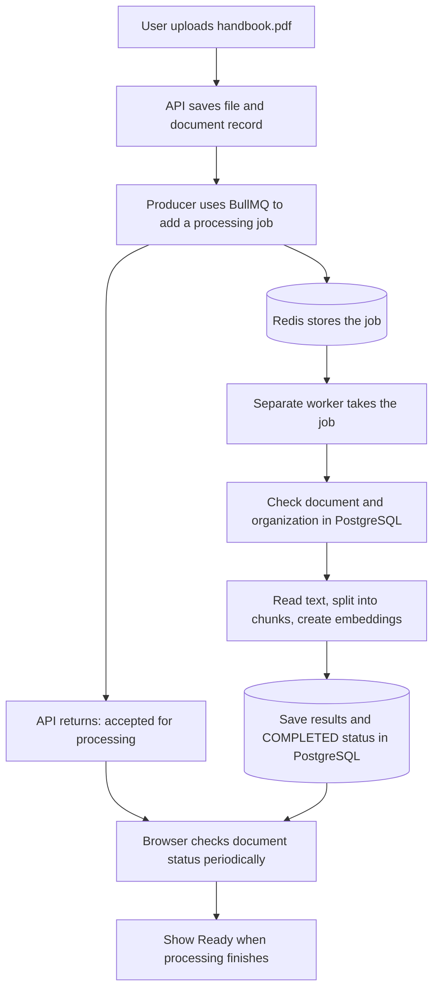
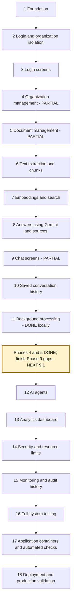
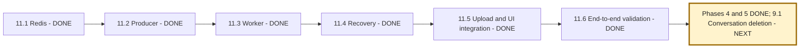

# NexaAI: learning guide, phase roadmap, and progress tracker

Last updated: **2026-10-25**.

## START HERE: where we are

**Current phase: Phase 5 complete; next is Phase 9 — remaining chat features.**
**Last completed step: 5.3 — Retry controls for older library documents.**
**Next implementation step: 9.1 — Private conversation deletion.**

Step 5.3 retries failed or unqueued saved files directly from their library cards,
tracks progress, preserves older loaded pages and requires a status read after an
uncertain submission. [Library retry flow and evidence](backend/docs/document-step-3-library-retries.md).
Both builds, changed-file lint, 26 backend document tests and all 27 browser document tests passed.

**Phase 11 is DONE for the verified local workflow.** A real Chrome journey passed:
queued upload, separate worker, automatic status updates, failed-file retry, a cited
Gemini answer, and reopening the saved answer after a new login. Organization-isolation
checks passed too. We now return to the earlier gaps in Phases 4, 5, and 9, as planned.

| Phase 11 step | Status | What that means |
| --- | --- | --- |
| 11.1 Redis setup | DONE | Local Redis runs in Docker; the backend connects successfully. |
| 11.2 BullMQ producer | DONE | Code can store a processing instruction in Redis; tested with isolated jobs. |
| 11.3 Worker | DONE | Worker validates jobs and prepares documents; real Redis/database/embedding tests pass. |
| 11.4 Failure recovery and retries | DONE | Bounded retries, crash recovery, explicit retry, atomic results and job retention verified. |
| 11.5 Connect uploads and status UI | DONE | Upload/retry APIs queue work; the screen polls status and handles saved-file submission failures. |
| 11.6 Full verification | DONE | Real browser/services verified preparation, failure/retry, cited Gemini answer, saved history and isolation. |

**Current limitation:** the successful live journey used a fictional TXT handbook and
one generated answer; it is not a production load test or exhaustive format evaluation.
The library lists earlier uploads. Retried or explicitly refreshed cards now track
active processing automatically; Refresh library updates other entries. The latest
upload still checks automatically.

## 1. What are we building?

NexaAI lets a company upload its documents and ask questions about them.

Example: upload `employee-handbook.pdf`, which says employees receive 18 annual leave
days. Ask, "How many annual leave days do employees get?" NexaAI finds the relevant
passage, asks Gemini to answer using that passage, and shows the answer with its source.

There are two different activities:

```text
A. PREPARE A DOCUMENT
Upload -> Read its text -> Split text into pieces -> Create searchable numbers -> Save

B. ANSWER A QUESTION
Question -> Find relevant saved pieces -> Give them to Gemini -> Answer + sources -> Save chat
```

The searchable numbers are called **embeddings**. They help find text with a similar
meaning even when the question uses different words. We generate them locally.
**Gemini** writes answers using the retrieved text. **RAG** is the name for this
"retrieve useful text, then generate an answer" process.

The background queue we are building belongs to activity A: preparing documents.
It does not generate chat answers or replace Gemini.

## 2. Redis, BullMQ, and workers in simple language

Imagine a restaurant:

| Restaurant example | NexaAI component | What it does |
| --- | --- | --- |
| Customer gives an order | User uploads a document | Starts a request. |
| Waiter writes an order ticket | Producer code | Creates a small instruction to process the document. |
| Order-management rules/software | BullMQ | Adds jobs, tracks their state, and gives them to workers. |
| Board holding order tickets | Redis | Stores the queue's jobs and state. Our Redis also has disk persistence configured. |
| Cook | Worker | Runs the actual text extraction, chunking, and embedding code. |
| Order record and menu information | PostgreSQL | Stores users, document records, text chunks, vectors, and chat history. |

**BullMQ is a JavaScript/TypeScript library installed in our backend.** It provides
queue operations so we do not have to write all the queue-management logic ourselves.
It uses Redis to store its queue data. BullMQ does not know how to read our PDFs;
the worker must call our document-processing code to do that.

A **job** is one instruction. A **queue** is a collection of jobs awaiting or undergoing
work. A **producer** submits jobs. A **worker** performs them in a separate Node.js process.
**Docker** runs the Redis server in a container: a packaged environment for that service.

### Example: uploading a handbook

Suppose a large file takes 30 seconds to process. This is an illustration, not a measured time.

**Previous upload flow, before Step 11.5:**

```text
Browser sends handbook.pdf
       |
       v
API saves file and document record
       |
       v
API extracts text, splits it, generates embeddings, and saves results
       |   Browser waits for all this processing
       v
API returns "completed"
```

**Current upload flow, connected in Step 11.5:**



Plain-text version if your Markdown viewer cannot render Mermaid:

```text
UPLOAD -> API saves file -> BullMQ adds job -> Redis
                |                              |
                v                              v
        Return "processing"                 WORKER
                |                              |
                v                              v
        Browser checks status       Extract -> Chunk -> Embed -> Save
                |                              |
                +----- PostgreSQL status <-----+
                              |
                         Show "Ready"
```

The upload itself still takes time. The improvement is that the browser does not also
have to keep that same request open for all the document processing. Processing still
uses computing resources; a queue does not make a 30-second task instant.

### What is inside a job?

For illustration, use short labels (the real code requires UUID identifiers):

```json
{
  "documentId": "document-123",
  "organizationId": "company-456"
}
```

This means: "Prepare document 123 belonging to company 456." The worker will find
the file path in the database. The job does not contain the entire PDF or a Gemini key.

We tested five submissions for the same document and organization. Redis stored one
waiting job because all five used the same job ID. This protection lasts while that
job is retained. It does not guarantee that processing can never run twice after a failure.

**What exists today:** Redis + producer + worker + preparation/recovery + queued uploads
and automatic status checks, with latest-upload retry controls.
**What comes next:** return to unfinished organization, document-library, and chat features,
continuing with private conversation deletion in Step 9.1 after completing Phase 5.

## 3. How we will work from now on

Use this file as the main tracker. The original plan has several numbering schemes;
this file uses its final **18-phase Recommended Implementation Order**. Existing files
named `redis-step-1` and `redis-step-2` correspond to **11.1** and **11.2** here.
Older filenames keep their names. Their numbers are not new phase numbers.

For each step:

1. State the phase and step number, and point to its position in the diagram.
2. Explain the problem in plain language with a document or chat example.
3. Define any new tool or term before using it.
4. Explain the input, the action, and the expected result.
5. Implement only that step, with comments explaining important code.
6. Test it and explain what the test proves and what remains unverified.
7. Update this file's status, current pointer, and evidence links.
8. Give a simple validation walkthrough, then stop for review before the next step.

Status meanings: **DONE** = implemented and verified for the stated scope;
**PARTIAL** = some features exist but listed work remains; **NEXT** = next step;
**PLANNED** = future work. These are not claims of production readiness.
Tests accompany every meaningful feature; Phase 16 is a final system-wide check.

## 4. Whole-project phase flow



Text route: **1 -> 2 -> 3 -> 4 -> 5 -> 6 -> 7 -> 8 -> 9 -> 10 -> 11 (done locally)
-> finish earlier gaps (current: 9.1) -> 12 -> 13 -> 14 -> 15 -> 16 -> 17 -> 18.**

Some work was implemented in a different chronological order. We keep the original
phase identities and explicitly return to unfinished features instead of hiding them.
Future steps are a working plan; explain and record changes before implementing them.

## 5. Phases 1–10: built foundations and visible gaps

| Phase | Status | Implemented scope | Remaining work or validation |
| --- | --- | --- | --- |
| 1 Foundation | DONE for local core | React, Express, TypeScript, Prisma, PostgreSQL/pgvector, health API. | Full app containers are Phase 17. |
| 2 Authentication and isolation | DONE for core flow | Register, password login, signed tokens, organization membership and scoped document/chat access. | Broader security review remains in Phase 14. |
| 3 Authentication screens | DONE for core flow | Login/register, protected navigation, sign out, safe request handling. | Refresh currently requires login again; production session design is Phase 14. |
| 4 Organization management | DONE for planned local flow | Current-role permissions, profile editing, member screens, expiring invitations and organization switching. | Email delivery is manual; persistent sessions and global token revocation remain later work. |
| 5 Document management | DONE for planned local flow | Upload, background status, paginated library, coordinated owner/admin deletion, and retries for older saved files. | Pending deletion cleanup requires explicit Finish deletion. Cloud storage is Phase 18. |
| 6 Document processing | DONE for core flow | Extract text and split it into chunks; invoked by the worker and verified in the live 11.6 journey. | Broader document-format evaluation remains in Phase 16. |
| 7 Embeddings and search | DONE for core flow | Local embeddings, stored vectors, organization-scoped similarity search. | More retrieval evaluation remains in Phase 16. |
| 8 RAG answers | DONE for core flow | Retrieved evidence, Gemini answers, validated citations, missing/conflicting evidence handling. | More answer-quality cases remain in Phase 16. |
| 9 Chat interface | PARTIAL | Ask questions, answers/sources, loading/errors, new conversation. | Conversation deletion and safe Markdown rendering. |
| 10 Conversation history | DONE for core flow | Save exchanges, list/read history, pagination, reopen and continue, backend live verification. | Earlier messages are NOT yet passed to Gemini as conversation context. |

### Return to these earlier phase steps now that Phase 11 is complete

| Step | Planned work | How you validate it |
| --- | --- | --- |
| 4.1 DONE | Enforce current membership and conservative role permissions; protect owners; serialize member changes. | Build and 10 tests passed, including stale-token denial, isolation and concurrent promotion/removal. [Evidence](backend/docs/organization-step-1-permissions.md). |
| 4.2 DONE | Current members view their profile; owners edit the display name; the current browser session reflects confirmed changes. | Both builds, lint, 16 backend and 32 browser tests passed. [Guide](backend/docs/organization-step-2-profile.md). |
| 4.3 DONE | Member screens with fresh role checks, registered-account addition, role changes and removal confirmation. | Owner protection, restricted roles, cancellation, stale access and response isolation tested. [Guide](backend/docs/organization-step-3-members.md). |
| 4.4 DONE | Add one-time, email-bound invitation creation, revocation, registration and acceptance, with expiry. | 22 backend organization tests and invitation browser flows passed. Email delivery remains manual. [Guide](backend/docs/organization-step-4-invitations.md). |
| 4.5 DONE | List current memberships, issue a scoped session for the selected team, verify its current role and reset workspace pages. | Real database document/history isolation and browser session/draft checks passed. [Guide](backend/docs/organization-step-5-switching.md). |
| 5.1 DONE | Paginated organization library with safe metadata, queue-aware status, refresh, Load more and upload synchronization. | 12 backend library/status and 15 browser library/upload tests passed. [Guide](backend/docs/document-step-1-library.md). |
| 5.2 DONE | Confirmed deletion with current-role checks, processing/submission locks, durable blocked state, queue/file cleanup and Finish deletion. | Real PostgreSQL/Redis/file tests and browser checks passed; saved citation snapshots preserved. [Guide](backend/docs/document-step-2-deletion.md). |
| 5.3 DONE | Retry/start saved library files, track progress, preserve pages and require a read after uncertain submissions; enforce current membership before retry. | 26 backend and 27 browser document tests passed. [Guide](backend/docs/document-step-3-library-retries.md). |
| 9.1 NEXT | Add private conversation deletion. | Delete your own conversation; another user's conversation remains inaccessible. |
| 9.2 | Render answer Markdown safely. | Lists/code display clearly and embedded unsafe HTML does not execute. |

Possible later extension: using earlier turns as model context. Decide its scope
separately; saved history alone does not implement conversational memory.

## 6. Phase 11: background processing, step by step

Goal: a user uploads a file, sees processing status, and can ask questions once it is ready.



| Step | What we do and why | Example and validation |
| --- | --- | --- |
| 11.1 DONE | Run Redis, configure persistence, verify a connection. We need somewhere to store waiting jobs. | Backend sends PING and receives PONG. [Evidence](backend/docs/redis-step-1-connection.md). |
| 11.2 DONE | Add BullMQ producer, small job payloads, and duplicate protection. We need to submit instructions reliably. | Five equivalent submissions create one waiting test job. [Evidence](backend/docs/redis-step-2-document-queue.md). |
| 11.3 DONE | Added a worker entry point; validate job data and organization association; call existing processing code; close connections on shutdown. | Real worker tests produced two chunks with 384-dimensional vectors, rejected invalid jobs, and verified idle shutdown. [Evidence](backend/docs/redis-step-3-document-worker.md). |
| 11.4 DONE | Three attempts with backoff; database locking and atomic results; stalled-job recovery and failure reconciliation; explicit failed-job retry; bounded terminal-job retention. | 19 tests passed, including two killed child workers, Redis redelivery, manual recovery and unchanged completed chunks. [Explanation and evidence](backend/docs/redis-step-4-document-recovery.md). |
| 11.5 DONE | Upload/retry APIs return 202 after queue acceptance; status combines database and Redis; UI polls and offers scoped retry; uncertain submissions retain saved IDs. | 29 backend, 9 browser and 10 utility tests passed. Queuing with no worker and recovery without re-upload were verified. [Explanation and walkthrough](backend/docs/redis-step-5-background-uploads.md). |
| 11.6 DONE | Verified real Chrome, actual frontend/API, isolated Redis queue, separate worker, PostgreSQL, local embeddings and one Gemini answer. | Handbook produced three vectors; answer said 18 days with its source; new login reopened identical saved text/sources. Failed-file retry and isolation passed. [Live evidence and explanation](backend/docs/redis-step-6-live-user-journey.md). |

**Phase completion gate: PASSED on 2026-10-24.** Phase 11 is DONE for the documented
local core flow. Broader evaluation, production operation and earlier feature gaps remain.

Two statuses exist: **job status** in Redis describes the queue's work;
**document status** in PostgreSQL describes whether a document is ready for questions.
They must agree appropriately, but they are not the same record.

Step 11.4 currently uses a three-minute processing transaction and one job per worker.
A database outage can prevent the failure callback from updating document status;
retrying after service restoration can recover it. Upload/reprocess HTTP requests now
queue work and return 202. Lost responses without a received document ID still need
future library recovery. See the evidence guides for retention and recovery limits.

## 7. Future phases and steps

### Phase 12 — AI agents: choose and use an appropriate tool

An agent combines a model with permitted tools. Example: a policy question uses document
search; a question about upload counts uses an approved data query. Tools and boundaries
are implemented explicitly; the model does not get unrestricted application access.

Flow: **request -> choose allowed tool -> validate permission -> run tool -> explain result**.

- [ ] **12.1** Define allowed requests, tool inputs, outputs, and organization boundaries.
- [ ] **12.2** Wrap the existing document-answer flow as the knowledge tool.
- [ ] **12.3** Add a data-analysis tool with read-only, scoped queries and result limits.
- [ ] **12.4** Add routing that selects a tool or asks for clarification.
- [ ] **12.5** Add one limited action workflow, showing the proposed action before user confirmation and execution.
- [ ] **12.6** Add UI/results, execution records, and tests for disallowed tool calls.

Validation: a document question and a data question use their intended tools;
an unauthorized action is blocked. Real external actions require explicit authorization.

### Phase 13 — Dashboard and analytics: show useful counts

Flow: **organization records -> count by date/status -> dashboard cards and charts**.

- [ ] **13.1** Define metrics and the event data needed to calculate them.
- [ ] **13.2** Add organization-scoped summary APIs for documents, failures, and questions.
- [ ] **13.3** Add dashboard cards, date filtering, and usage charts.
- [ ] **13.4** Validate counts against known fixtures and exclude other organizations.

Example: uploading three documents, with one failure, shows three total and one failed.
Token/cost estimates require actual usage data; they should not be invented from message counts.

### Phase 14 — Security, limits, and caching

Flow: **request -> identity -> current permissions -> input/usage limits -> allowed operation**.

- [ ] **14.1** Review and improve session expiry, sign out, and revoked-membership handling.
- [ ] **14.2** Apply consistent validation, upload limits, safe errors, headers, and allowed frontend origins.
- [ ] **14.3** Add login/chat/upload rate limits and appropriate usage budgets.
- [ ] **14.4** Review document prompt injection, tool permissions, tenant isolation, and secret handling.
- [ ] **14.5** Add caching only for measured repeated work, with organization-specific keys and invalidation when documents change. Separate cache eviction needs from durable queue data.
- [ ] **14.6** Verify attacks, expired credentials, role changes, and cross-organization requests are handled safely.

Example: an employee cannot obtain another company's document by changing its ID in a request.
Security checks needed by an earlier feature are done with that feature; this phase is the broader review.

### Phase 15 — Monitoring and audit history: understand what happened

Monitoring tells developers whether the system is healthy. Audit history records important
user actions, such as a role change, for an authorized reviewer.

Flow: **request/job -> identifier -> structured logs and timings -> metrics/audit view**.

- [ ] **15.1** Add safe structured logs and identifiers linking requests to jobs.
- [ ] **15.2** Trace database, retrieval, generation, and worker timings.
- [ ] **15.3** Add health/readiness checks, queue failure counts, and alert conditions.
- [ ] **15.4** Store organization-scoped audit events for important actions and add an authorized view.
- [ ] **15.5** Verify a failed job can be diagnosed without exposing document contents or secrets.

Example: identify whether a slow upload is waiting in the queue or generating embeddings.

### Phase 16 — Full-system testing: prove the pieces work together

Flow: **known test data -> full user journeys -> failure scenarios -> release checklist**.

- [ ] **16.1** Consolidate unit, API/database, Redis, and browser tests into repeatable commands.
- [ ] **16.2** Test the real browser-to-backend flow with isolated accounts and documents.
- [ ] **16.3** Test concurrent uploads, lost connections, stopped workers, and retry recovery.
- [ ] **16.4** Evaluate answer correctness, citations, missing evidence, and conflicting documents.
- [ ] **16.5** Run isolation/security checks and measure realistic performance limits.

Validation: repeatable passing results and documented limits. Existing tests remain useful;
we do not defer feature-level testing until this phase.

### Phase 17 — App containers and CI/CD: make builds repeatable

CI means automated checks when code changes. CD means a controlled deployment process.
The Redis container already exists; this phase packages the application and its worker.

Flow: **code change -> install -> build/test -> package -> approved deployment**.

- [ ] **17.1** Add production build images for the API and worker, and a frontend build strategy.
- [ ] **17.2** Add a local multi-service setup with shared file access for API/worker where needed.
- [ ] **17.3** Add GitHub Actions checks with isolated PostgreSQL/Redis test services.
- [ ] **17.4** Validate required settings and keep secrets outside committed configuration.
- [ ] **17.5** Prepare deployment, database-migration, and rollback procedures.

Validation: a clean checkout can build and test; a failed check prevents release.

### Phase 18 — Deployment: run the application for real users

Hosting choices and budget are decided here before provisioning paid resources.

Flow: **choose hosting -> database/Redis/files -> deploy API and worker -> frontend/HTTPS -> verify**.

- [ ] **18.1** Choose hosting, expected usage, and spending limits.
- [ ] **18.2** Configure production PostgreSQL with pgvector, backups, and restricted access.
- [ ] **18.3** Configure queue-compatible Redis with persistence and authenticated access.
- [ ] **18.4** Move files to shared object storage so both API and worker can access them.
- [ ] **18.5** Deploy API and worker, apply migrations, and verify production settings.
- [ ] **18.6** Deploy frontend, configure its API URL, domain, HTTPS, and browser route handling.
- [ ] **18.7** Verify signup -> upload -> background processing -> question -> saved history in production.
- [ ] **18.8** Validate monitoring, restore/rollback procedures, and write the final operating guide.

Validation: the complete user journey works over HTTPS, isolation checks pass, and recovery
procedures have been exercised. Deployment is not complete merely because a homepage loads.

## 8. Progress evidence and review checklist

Useful existing evidence:

- [Upload UI](frontend/docs/step-4-document-upload.md)
- [Chat UI](frontend/docs/step-5-chat-page.md)
- [Conversation schema](backend/docs/conversation-step-1-schema.md)
- [Saving exchanges](backend/docs/conversation-step-2-save-exchanges.md)
- [History read APIs](backend/docs/conversation-step-3-read-history.md)
- [History UI](frontend/docs/conversation-step-4-history-ui.md)
- [Live backend conversation verification](backend/docs/conversation-step-5-live-verification.md)
- [11.1 Redis connection](backend/docs/redis-step-1-connection.md)
- [11.2 BullMQ queue](backend/docs/redis-step-2-document-queue.md)
- [11.3 Document worker](backend/docs/redis-step-3-document-worker.md)
- [11.4 Recovery, retries, and crash verification](backend/docs/redis-step-4-document-recovery.md)
- [11.5 Background uploads, status polling, and saved-file retry](backend/docs/redis-step-5-background-uploads.md)
- [11.6 Complete live browser journey and Phase 11 completion](backend/docs/redis-step-6-live-user-journey.md)
- [4.1 Organization member permission rules and verification](backend/docs/organization-step-1-permissions.md)
- [4.2 Organization profile API, screen, and validation](backend/docs/organization-step-2-profile.md)
- [4.3 Member-management screen, examples, and confirmation flow](backend/docs/organization-step-3-members.md)
- [4.4 Expiring invitation flow, security model, and examples](backend/docs/organization-step-4-invitations.md)
- [4.5 Organization switching, scoped sessions, and workspace isolation](backend/docs/organization-step-5-switching.md)
- [5.1 Document library, pagination, processing status and examples](backend/docs/document-step-1-library.md)
- [5.2 Document deletion, recovery, worker coordination and saved citations](backend/docs/document-step-2-deletion.md)
- [5.3 Library retry controls, automatic progress, and uncertain submissions](backend/docs/document-step-3-library-retries.md)

Before advancing a step, check:

- [ ] I can locate the current step in the diagram.
- [ ] I understand the problem this step solves and the new terms it introduces.
- [ ] I can explain its input and output using the handbook example.
- [ ] The implementation and validation match the claimed status.
- [ ] Any remaining limitation is visible here.
- [ ] The tracker has been updated and I know the next step.

**Next lesson: 9.1 — delete one of your own private conversations, with confirmation
and ownership checks that prevent deleting another person's conversation.**
