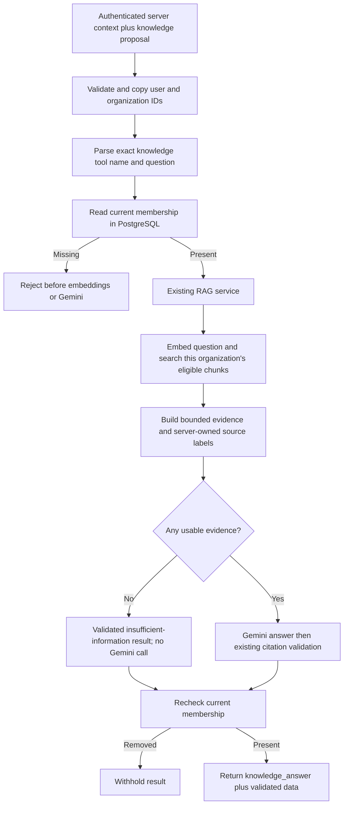

# Phase 12, Step 12.2: connect the knowledge-answer tool

Completed: **2026-10-26**.

## Where we are

```text
12.1 Tool contracts DONE -> 12.2 Knowledge executor DONE
  -> 12.3 Document counts NEXT -> 12.4 Tool selection
  -> 12.5 Confirmed retry -> 12.6 Agent UI and execution records
```

## The problem, with an example

Suppose Asha asks, “How many annual leave days do employees receive?” Her company's
handbook says 18 days. The existing RAG service can retrieve the passage, send it to
Gemini, and validate the answer's citations. Step 12.1 defined a tool request for
this question. This step connects that request to the existing service.

An **executor** is the function that actually runs a requested tool. Our executor
accepts a knowledge-tool proposal, checks access, runs RAG, and returns its result.
An **orchestrator**, added later, will choose which executor to call.

The connection is an internal backend function in this step. There is no new agent
endpoint or screen yet. Existing chat continues through its existing route; model
tool selection is Step 12.4 and the agent interface is Step 12.6.

## Input, work, and output

The backend supplies authenticated context separately from model arguments:

```text
Server context: { userId: signed-in user, organizationId: active organization }
Tool proposal: { tool: "knowledge_answer", input: { question: "How much leave?" } }
```

The context must come from authenticated server code. A structurally valid UUID is
not proof of authentication; future controllers must never copy context from a
request body or a model response. The helper copies these IDs before awaiting work,
so a caller mutating its original object cannot change an in-flight request's scope.

The tool proposal is parsed again at the executor boundary, even if a future router
has already parsed it. It must be exactly the knowledge tool, with a question of
1–1,000 trimmed characters. Extra arguments, a different organization, retrieval
settings, or a request for another tool are rejected.



Plain-text flow:

```text
Validate context and proposal -> current membership -> scoped RAG
  -> validated answer/sources -> membership recheck -> tool result
```

## Why do we check membership twice?

The signed token identifies the user and active organization. A token can still
exist after an administrator removes that membership. We therefore look up the
current membership in PostgreSQL before performing expensive work.

Answer generation takes time. Imagine this sequence:

1. Asha is a member, so the first check succeeds.
2. Gemini starts generating an answer.
3. An administrator removes Asha from the organization.
4. Generation finishes.
5. The second membership check fails, so the executor does not return the answer.

There is no database transaction or membership lock held across embeddings or the
provider request. Administrators can remove membership while generation runs.
The final check does not cancel work already sent to a provider and cannot prevent
a later membership change after the check. It verifies access again before return.

All three current roles—MEMBER, ADMIN, and OWNER—can read shared organization
knowledge. The executor does not rely on an old token role assertion.

## What keeps Company B's handbook out of Company A's answer?

The executor passes the copied, authenticated organization ID to
`answerDocumentQuestion`. Its existing search query filters documents by that ID
before selecting passages. A question mentioning another organization does not
change the filter.

Search also excludes documents awaiting deletion, unfinished or failed documents,
unfinished embeddings, missing vectors, zero vectors, and results below the existing
similarity cutoff. The executor fixes retrieval at five matches and the existing
server similarity threshold, currently 0.35. These settings are not model arguments.

The context builder retains the existing 8,000-character evidence budget. The RAG
validator checks status, answer size, citation labels, and their correspondence to
the actual retrieved source map. A citation such as `[S99]` is rejected if that source
was not supplied. This validation checks structure and source references; it is not
a proof that every generated factual claim is correct.

## Understand the result

An illustrative result is:

```json
{
  "tool": "knowledge_answer",
  "data": {
    "status": "answered",
    "answer": "Employees receive 18 days [S1].",
    "citations": ["S1"],
    "sources": [
      {
        "sourceId": "S1",
        "documentId": "document-uuid",
        "chunkId": "chunk-uuid",
        "documentName": "handbook.txt",
        "chunkIndex": 0,
        "similarity": 0.8
      }
    ]
  }
}
```

`chunkIndex` identifies a searchable passage, not a PDF page. The result uses the
same answer/status/citation shape as existing RAG. It exposes source metadata, not
storage paths, document records, or private chat history.

If there is no usable evidence, the existing flow returns `insufficient_information`
with empty citations and sources, without spending a Gemini request. Provider errors
and citation-validation failures propagate to the caller. The executor does not
silently replace them with a successful answer or automatically repeat generation.

The executor does not save conversations or messages. Saving an agent interaction
and presenting different tool-result types remain orchestration/interface work.

## Code and comments

- `src/agents/agent.access.ts`: safe identity copying, current membership lookup, and
  fixed identity/membership errors. These helpers can be reused by later tools.
- `src/agents/knowledge.tool.ts`: strict tool boundary, server-owned search settings,
  existing RAG call, and membership recheck.
- `tests/agent.knowledge.integration.test.cjs`: isolated real database fixtures,
  vector retrieval, controlled model output, and access/failure cases.

Comments explain why the IDs are copied, why validation occurs again, why the checks
do not hold long-lived locks, and why access is checked after generation.

## Verification and how you can validate this step

Run from `backend`:

```powershell
npm.cmd run test:agent-knowledge
```

This command builds TypeScript and runs the previous contract tests plus the new
knowledge integration suite. The build and **all 21 tests passed** on 2026-10-26
(11 contract tests and 10 integration entries, including the parent test).
The integration tests use real PostgreSQL/pgvector,
the real search SQL, context builder, prompt builder, and citation validator. Only
the embedding generator and provider transport are controlled. Fixtures contain
matching vectors in two organizations to prove that similarity cannot cross the
organization filter.

The checks cover current roles, removed membership before retrieval and during
generation, invalid identity/arguments, copied context, empty evidence, five-passage
limits, excluded documents/vectors, provider failures, invalid citations, and unchanged
documents/private history. Test records are removed using their exact fixture IDs.

This does not exercise an HTTP agent route, real embedding-model inference, live
Gemini generation, or browser UI. Those are outside this step. The roadmap records
the completed run and test count.

For understanding, follow Asha's question through the diagram. Then explain what
changes if her membership is removed at step 1 versus while Gemini is answering.
In the first case, generation never starts. In the second, its result is withheld.

**Next: 12.3 — count saved organization documents by database processing status,
using a bounded read-only query and current membership checks.**
