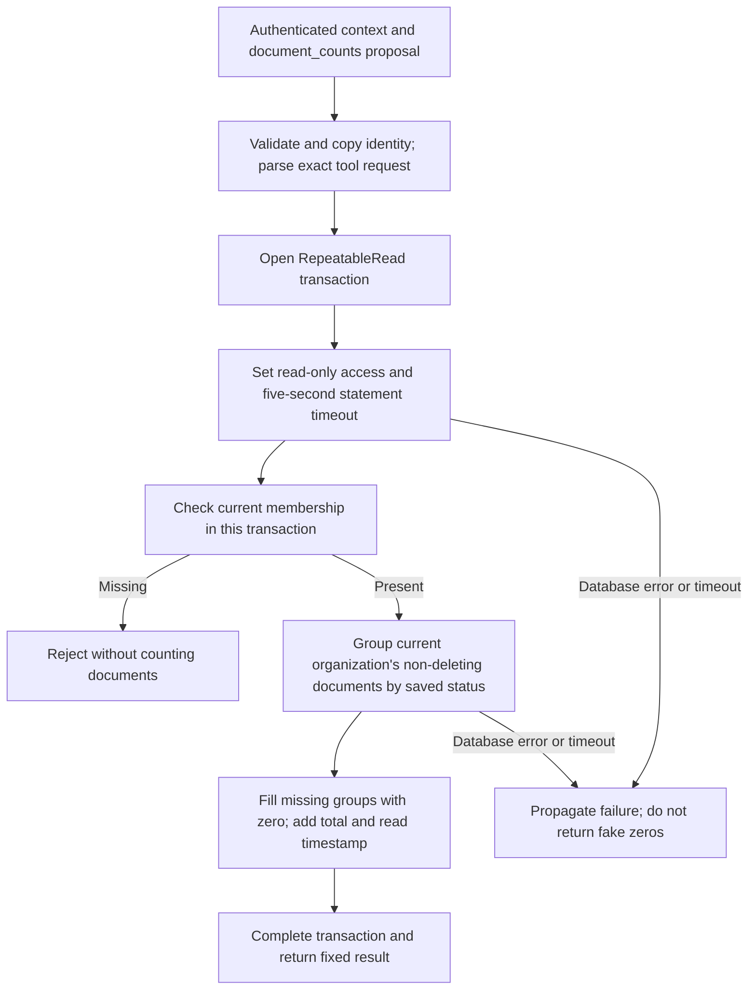

# Phase 12, Step 12.3: count organization documents

Completed: **2026-10-26**.

## Where we are

```text
12.1 Contracts DONE -> 12.2 Knowledge tool DONE -> 12.3 Document counts DONE
  -> 12.4 Tool selection or clarification NEXT
  -> 12.5 Confirmed document retry -> 12.6 Agent UI and execution records
```

## 1. What problem does this solve?

“What does our handbook say about leave?” requires searching document text.
“How many documents failed processing?” requires counting document records.

The second question has an exact answer in PostgreSQL. This step adds an executor
for the `document_counts` tool. An **executor** is the backend function that runs
the requested operation. It reads the active organization's saved document statuses
and returns numbers. It does not need embeddings, Gemini, Redis, or document text.

For example, imagine these saved records:

| Organization | Saved status | Marked for deletion? | Included for Company A? |
| --- | --- | --- | --- |
| Company A | UPLOADED | No | Yes |
| Company A | PROCESSING | No | Yes |
| Company A | COMPLETED, two documents | No | Yes, both |
| Company A | FAILED | No | Yes |
| Company A | FAILED | Yes | No |
| Company B | FAILED | No | No |

Company A's result is five documents: one uploaded, one processing, two completed,
and one failed. Another company's records cannot increase its count. A pending
deletion is excluded even if cleanup has not finished.

## 2. Input and output

The backend supplies authenticated context separately:

```text
Context from the server: { userId, organizationId }
Tool proposal: { tool: "document_counts", input: {} }
```

The empty input is intentional. The tool always returns the same four counters.
The model cannot supply SQL, a table name, another organization, date filters, or
an unlimited list of records. Unexpected arguments are rejected before opening a
transaction. The executor also rejects proposals for other tools.

Example output with fictional data:

```json
{
  "tool": "document_counts",
  "data": {
    "asOf": "2026-10-26T10:00:00.000Z",
    "total": 5,
    "byStatus": {
      "UPLOADED": 1,
      "PROCESSING": 1,
      "COMPLETED": 2,
      "FAILED": 1
    }
  }
}
```

All four counters are always present, including zeros. `total` is their sum. An
empty organization returns zero for every counter. `asOf` is the server's read
timestamp; records can change after the snapshot is taken.

This is a structured data result. It has no RAG answer status, document citations,
filenames, user IDs, extracted text, storage paths, or private chat contents.
Later orchestration can explain these numbers without presenting them as handbook
evidence. “This month” and historical upload-attempt counts are not supported filters.

## 3. How does counting work?

A **database transaction** groups related operations. **Repeatable Read** is an
isolation setting: queries within this transaction see the same database snapshot.
A **snapshot** is a consistent view of records, rather than a new view for each query.



Plain-text version:

```text
Validate -> read-only snapshot -> current membership -> scoped grouped count
         -> four counters + total + timestamp -> result
```

The membership query and aggregate use the same transaction client. All existing
roles—MEMBER, ADMIN, and OWNER—can read these organization counts because they
already have access to the shared document library. An old token's role assertion
cannot substitute for an existing membership.

If another connection inserts a document after the membership read, that document
is not included halfway through this snapshot. A subsequent call sees the new record.
The membership decision also belongs to this snapshot; a later removal does not
retroactively change a completed read. This short operation does not hold membership
locks while doing model generation, because it does no model generation at all.

## 4. What makes it read-only and bounded?

The data query uses Prisma's `document.groupBy` method. It groups by the existing
four-value status enum and requests counts, so it returns at most four groups.
It does not fetch a page of document records and count them in JavaScript.

Two fixed SQL control statements configure the transaction:

```sql
SET TRANSACTION READ ONLY;
SET LOCAL statement_timeout = '5s';
```

These are configuration statements, not model-generated data queries. Prisma exposes
transaction isolation and deadline options, but no corresponding read-only or SQL
statement-timeout option. Comments beside the statements explain this use of raw SQL.
No user or model text is interpolated into either statement.

- PostgreSQL's read-only setting rejects an accidental write within this transaction.
- The statement timeout cancels a slow database statement after five seconds.
- Prisma also applies a five-second transaction deadline and a two-second maximum
  wait to acquire the transaction. These are database limits, not a promise that an
  entire future HTTP request completes in exactly five seconds under every failure.
- These settings are transaction-local; later operations use their normal settings.

The number of scanned records can grow with the organization, but the response size
is fixed and database work is subject to the timeout. This is not a production-scale
performance benchmark.

## 5. Saved status versus live queue state

| Saved PostgreSQL status | What it describes |
| --- | --- |
| UPLOADED | The saved file has not recorded processing progress yet; it may already be queued. |
| PROCESSING | The database records that preparation is in progress. |
| COMPLETED | Document preparation completed. |
| FAILED | A preparation failure was recorded; a retry may already be waiting. |

Redis has additional job states such as waiting, active, and delayed. The document
status/library flow combines those with PostgreSQL to show live retry progress.
This count tool does not contact Redis or claim that `FAILED` means “no retry exists.”

Deleting a record removes it from later totals. Retrying the same file does not add
a new document. Therefore `total` means current saved, non-deleting documents, not
lifetime upload attempts. The future router must explain or clarify unsupported
questions instead of pretending that these counters answer a different metric.

## 6. Code changes

- `src/agents/document-counts.tool.ts`: strict request validation, read-only snapshot,
  fixed aggregate, zero filling, total, timestamp, and timeout settings.
- `src/agents/agent.access.ts`: the membership helper now accepts a transaction client
  so count authorization and data use the same snapshot. Its default behavior for
  the knowledge tool remains unchanged.
- `tests/agent.document-counts.integration.test.cjs`: real database tests for counts,
  authorization, snapshots, write rejection, timeout, and unchanged records.
- `package.json`: the `test:agent-counts` command runs these and previous agent tests.

Errors propagate to the future router for safe response mapping. An outage must not
be reported as zero documents. The tool does not automatically retry after failure.

## 7. Verification and your validation step

Run from `backend`:

```powershell
npm.cmd run test:agent-counts
```

The backend build and **all 32 tests passed** on 2026-10-26: 11 contract tests,
10 knowledge entries, and 11 count entries, including the integration parent tests.

The count tests use real PostgreSQL. They prove exact counts, organization isolation,
deletion exclusions, all current roles, zero values, rejection before aggregation
for removed members, strict arguments, consistent reads during a concurrent insert,
and unchanged documents/private history. Instrumented aggregate calls deliberately
attempt a write and run a slow read: PostgreSQL rejects the write and cancels the
slow operation at about five seconds. The test does not lock shared document tables.
Controlled read failures propagate once, without invented zero results or retries.
Only exact fixture IDs are cleaned up afterward.

No new HTTP route or screen is enabled yet. To understand this step, follow the
five-document example through the diagram, then explain why a foreign document and
a file marked for deletion cannot increase the total. The command above verifies
that behavior without calling Gemini or changing your existing documents.

**Next: 12.4 — choose between the knowledge and count tools, or ask for clarification
when the request does not match an available operation.**
