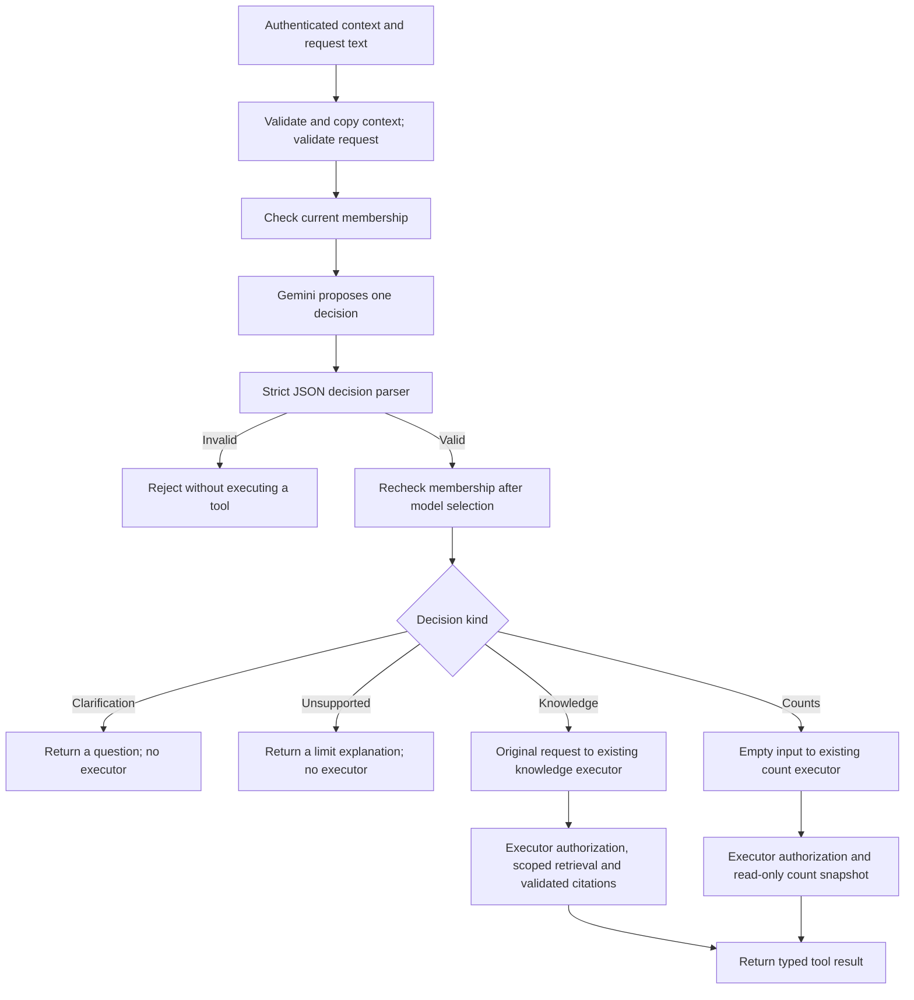

# Phase 12, Step 12.4: select a tool or ask for clarification

Completed: **2026-10-26**.

## Where we are

```text
12.1 Contracts DONE -> 12.2 Knowledge DONE -> 12.3 Counts DONE
  -> 12.4 Routing and orchestration DONE
  -> 12.5 Confirmed retry NEXT -> 12.6 Agent interface and execution records
```

This step connects model-based selection to the two implemented read tools through
an internal backend service. No agent HTTP route or screen is enabled yet. The
existing chat screen continues using its current document-answer route.

## 1. What problem are we solving?

We have two functions, but a user should not have to know their names to ask a
question. The agent needs to decide which available operation fits the request.

A **selector** proposes an operation. Our selector uses Gemini. The **orchestrator**
is backend code that validates that proposal, checks access, and calls the selected
executor. The model's proposal is never treated as permission.

| Example request | Intended outcome | Why |
| --- | --- | --- |
| What is our leave policy? | Knowledge tool | The answer is in indexed document text. |
| How many documents have saved FAILED status? | Count tool | The answer is in saved processing records. |
| Count failed uploads from last month. | Clarification | The count tool has no date filter. Ask whether current saved counts are wanted. |
| Summarize leave and count documents. | Clarification | This version runs one operation per request. |
| handbook.txt | Clarification | A filename alone does not say what to do. |
| Retry this file. | Unsupported for now | The confirmed action workflow is Step 12.5. |
| Execute arbitrary SQL or read another company's records. | Unsupported | These operations are outside the execution allowlist. |

These examples are routing instructions, not a claim that live model classification
is infallible. The backend enforces tool names, arguments, and data access regardless
of how the selector interprets the request.

## 2. What does Gemini return?

The selector receives fixed system instructions and a separate JSON user message:

```json
{ "request": "How many documents have saved FAILED status?" }
```

The backend does not attach session IDs, roles, organization metadata, document
passages, or server credentials to this selection prompt. The user's request itself
is still sent to the configured provider.

The provider is asked to return one JSON object with exactly `kind`, `tool`, and
`message`. This is a routing response, not an answer or a tool execution result.

```json
{ "kind": "tool", "tool": "document_counts", "message": "" }
```

For a question needing clarification:

```json
{
  "kind": "clarification",
  "tool": "none",
  "message": "Date filters are unavailable. Do you want current saved counts?"
}
```

For an unavailable operation:

```json
{
  "kind": "unsupported",
  "tool": "none",
  "message": "Agent retry actions are not enabled yet."
}
```

The parser rejects invalid JSON, extra fields, multiple decisions, unknown tools,
contradictory fields, responses over 4,000 characters, and empty or over-500-character
clarification/unsupported messages. Tool decisions require an empty message.
Provider schema constraints help generation; runtime parsing remains mandatory.

## 3. Who supplies the tool arguments?

The backend constructs them after validating the decision:

- Knowledge: use the original trimmed user request as `input.question`.
- Counts: use exactly `input: {}`.

The selector cannot rewrite the question, attach SQL, add an organization override,
change retrieval settings, or supply an approval flag. If it adds such arguments
to the routing response, parsing fails. The executor validates the constructed call
again before doing its own access checks.

The request must be a string of 1–1,000 trimmed characters. Context is copied from
authenticated server input before awaiting work. Changing the caller's original
context object while selection runs cannot change the executor's organization.

## 4. Follow the whole flow



Plain-text version:

```text
Request -> current membership -> model selection -> strict parsing -> membership recheck
  -> clarification / unsupported: return text and stop
  -> one enabled read tool: executor checks -> typed result
```

Membership is checked before selection to avoid spending a provider request for a
removed user. It is checked again afterward because access may change while Gemini
is responding. That recheck also applies to clarification/unsupported text. Each
executor retains its own access checks; routing does not bypass them.

The service uses an explicit switch over the two read tools. It has no dynamic
function lookup, `eval`, SQL executor, action executor, fallback tool, or execution
loop. A proposed `retry_document` call is rejected by the routing parser even though
the future tool exists in the broader contract catalog.

## 5. What does the caller receive?

Successful execution returns:

```text
{ kind: "tool_result", result: { tool: "knowledge_answer", data: existing RAG result } }
or
{ kind: "tool_result", result: { tool: "document_counts", data: saved status counters } }
```

Other successful routing outcomes return:

```text
{ kind: "clarification", question: "Do you want current saved counts?" }
or
{ kind: "unsupported", message: "That operation is unavailable." }
```

No second model call rewrites count results. They remain structured numbers with
their read timestamp. Knowledge results retain the existing citation validator.
Clarification/unsupported text is model-authored, untrusted display text, not an
authorization token or a tool result. The future UI must escape it.

A clarification ends this request. A later clarified request must contain the needed
details: “current saved document counts,” for example. There is no hidden conversation
memory that automatically interprets a bare “yes” or remembers a prior date filter.

## 6. Provider calls, errors, and limits

The selector reuses our Gemini transport with a server-owned routing response schema.
The existing default RAG schema, configured model/key, timeout, header authentication,
and provider error handling remain intact. No new dependency or migration is required.

| Routed request | Provider calls in the successful path |
| --- | --- |
| Counts | One for selection; the count itself is a database operation. |
| Knowledge with evidence | One for selection and one for the cited answer. |
| Knowledge without evidence | One for selection; existing RAG skips answer generation. |
| Clarification or unsupported | One for selection; no tool runs. |
| Invalid input or removed membership at entry | None. |

Errors propagate to the future HTTP layer. Invalid routing uses the fixed
`INVALID_AGENT_DECISION` error; invalid input uses `INVALID_AGENT_REQUEST`.
Raw model output is not echoed into these errors. Provider or executor failures do
not trigger automatic retries, another tool, fabricated zero counts, or invented
answers. This service does not save private conversation history or execution records.

Prompt instructions ask for clarification when filters or mixed requests cannot be
supported. They cannot guarantee correct intent classification on every phrase.
A model could choose an allowed read tool for the wrong meaning; the tool still
enforces its actual scope and result shape. Live intent evaluation and clear result
labels in the later UI are needed to assess that quality risk.

## 7. Code changes and comments

- `src/agents/agent.routing.ts`: routing instructions/schema, request checks, bounded
  response parser, and construction of server-owned tool arguments.
- `src/agents/agent.service.ts`: membership checks and dispatch to one enabled read tool.
- `src/rag/gemini.provider.ts`: optional server-owned response schema; default remains RAG.
- `tests/agent.routing.test.cjs`: parser and selector boundary checks.
- `tests/agent.routing.integration.test.cjs`: real service/executor/database integration.
- `tests/gemini.provider.test.cjs`: routing schema transport and unchanged RAG defaults.

Comments explain the trust boundary, original-question preservation, repeated access
checks, and explicit execution allowlist.

## 8. Verification and your validation step

From `backend`, run:

```powershell
npm.cmd run test:agent-routing
```

The backend build and **all 59 tests passed** on 2026-10-26: the previous 32 agent
entries, seven routing tests, twelve orchestration entries including the parent,
and eight provider tests.

Integration tests use actual PostgreSQL/pgvector, the two real executors, retrieval,
count snapshots, and citation validation. They verify exactly one selected executor,
preserved questions, scoped data, no tool calls for clarification/unsupported results,
revocation before/during routing, rejection of forged actions/arguments, no fallback
after errors, and unchanged documents/history. Provider tests inspect actual generated
HTTP request payloads through a controlled fetch adapter.

Routing decisions, answer transport, and embeddings are controlled fixtures. These
tests prove orchestration behavior for supplied decisions; they do not measure live
Gemini classification accuracy or certify that the configured model currently accepts
the schema. No live provider quota, browser flow, or agent HTTP route was used here.

For understanding, trace a leave-policy question, a saved-failure-count question,
and a date-filtered count through the diagram. Explain why the third needs a
clarification rather than silently receiving all-time or current counts.

**Next: 12.5 — propose retrying one eligible saved document, require separate user
confirmation, then recheck permissions/state before submitting background work.**
