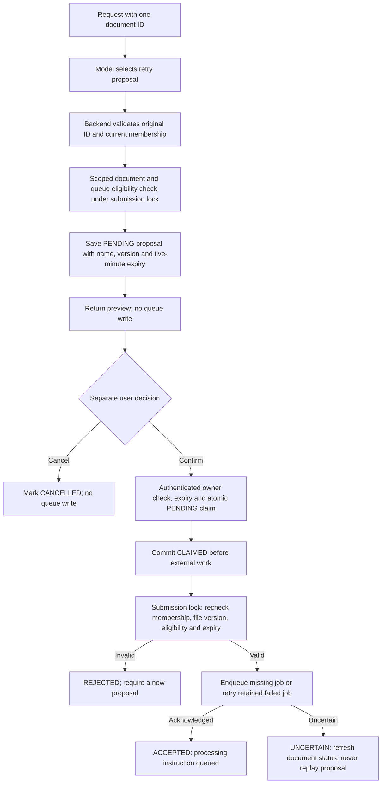

# Phase 12, Step 12.5: propose and confirm one document retry

Completed: **2026-10-26**.

## Where we are

```text
12.1 Contracts DONE -> 12.2 Knowledge DONE -> 12.3 Counts DONE
  -> 12.4 Routing DONE -> 12.5 Confirmed retry backend DONE
  -> 12.6 Agent HTTP/UI, execution records and integration checks NEXT
```

This step implements the internal backend workflow. The existing document library
retry buttons keep working as before. The agent's HTTP endpoints and visible
proposal/confirmation controls are part of 12.6; no agent screen is enabled yet.

## 1. The problem, with an example

Your handbook upload failed. You ask the agent to retry it. Queuing work changes
application state and consumes worker resources, so a model decision should first
create a proposal that you can review. It must not act as your confirmation.

The workflow now has two separate operations:

1. **Propose:** verify the target and show its name, action, and expiry. No job is submitted.
2. **Confirm:** consume that proposal, check access and document state again, then submit work.

A **proposal** is a database record of the specific action awaiting your decision.
It is bound to one user, one organization, one document ID/version, the retry action,
and a five-minute expiry. A teammate cannot confirm your proposal, even in the same
organization. All current roles can retry eligible shared documents, consistent
with the existing library retry permission.

## 2. How do we identify the file?

For the initial agent version, the request must include exactly one explicit document
UUID. For example, using an illustrative ID:

```text
Retry document 11111111-1111-4111-8111-111111111111
```

The model may select `retry_document`, but the backend extracts the ID from the
original request. The model cannot invent an ID through extra arguments. If the
request contains only `handbook.txt`, no ID, or multiple IDs, the backend asks for
exactly one ID rather than guessing or performing a bulk operation.

The proposal service resolves that ID inside the authenticated organization. Foreign
and missing document IDs return the same unavailable response without accessing
Redis. An accessible proposal shows the actual filename so the user can check it.

This is a deliberate first-version limit. Filename search/selection can be added
explicitly later. Do not interpret “yes” in a new model request as confirmation of
an earlier proposal; the router has no hidden conversation memory.

## 3. Follow the flow



Plain-text version:

```text
Request -> exact target -> safe preview -> save proposal
        -> cancel: consume without work
        -> separate confirmation: claim once -> recheck -> queue instruction
```

Routing can reach `proposeDocumentRetry` only. It cannot call the confirmation
function. Confirmation and cancellation accept exactly `{ proposalId }`; extra
`confirmed`, document IDs, organization IDs, or model-made approval fields are rejected.
The future controller must call confirmation only from the dedicated authenticated
user-confirmation request, not automatically after model selection.

## 4. Why a database table?

An in-memory “already confirmed” flag disappears when the API restarts. The new
`AgentRetryProposal` table stores the decision state durably in PostgreSQL. Its owner
uses the same composite user/organization membership relation as private history.
Removing that membership also deletes its proposals. Rejoining does not restore an
old proposal ID.

There is no document foreign key: the record keeps a snapshot of the file ID, name,
and `updatedAt` version. Deleting or changing the file makes confirmation fail; it
does not silently redirect the action to another file. The table and functions
authorize only `retry_document`, not an arbitrary tool name stored by a model.

| Stored state | Meaning |
| --- | --- |
| PENDING | Not used; confirm only before expiry. |
| CLAIMED | Confirmation consumed; a submission may be in flight or interrupted. Never replay. |
| ACCEPTED | Queue submission was acknowledged. This does not mean processing completed. |
| REJECTED | A consumed attempt failed before the queue write began. Review a new proposal after checking status. |
| UNCERTAIN | A write began but its final acknowledgement could not be confirmed. Check document status. |
| CANCELLED | User cancelled; confirmation cannot run it. |

Expiry is checked from `expiresAt`; an expired row may still have state PENDING.
Proposal rows are retained until membership cleanup or a future retention policy.
This step adds an expiry index but no automatic cleanup job.

## 5. What happens if two confirmations arrive together?

Inside a short transaction, the backend changes the owned proposal from PENDING to
CLAIMED only if it is still pending and unexpired. This conditional update is atomic:
two simultaneous confirmations cannot both win. A used/cancelled proposal cannot be
confirmed again, even if its old Redis job has since disappeared.

Two different proposals for the same document also do not bypass eligibility. After
claiming, each must acquire the existing document submission lock and read current
state. The first queues a job; the second sees it already queued and is rejected.
Worker and deletion operations share this document lock. An active worker/deletion
operation prevents the confirmation from submitting against changing state.

The submission helper also acquires the existing organization lock and rechecks
membership before the queue operation. This coordinates with membership removal.
If the document name or version differs from the reviewed snapshot, confirmation
fails and requires a new proposal. Expiry is checked again after lock acquisition.

## 6. PostgreSQL and Redis cannot commit together

PostgreSQL stores proposals; Redis stores BullMQ jobs. They do not share one atomic
transaction. A queue command might succeed while its acknowledgement is lost, or
the API might stop after writing the job but before saving ACCEPTED.

To prevent a replay, the proposal's CLAIMED state commits **before** the queue write.
If a queue write starts and the result cannot be confirmed, the service attempts to
record UNCERTAIN and returns `SUBMISSION_UNCONFIRMED`. If that receipt update also
fails, the durable CLAIMED state still prevents reuse. No automatic repeat occurs.

The user must read current document status before requesting a new proposal. If a
file is already queued, active, ready, or deleting, it is not eligible. An interrupted
CLAIMED receipt is not automatically repaired or resubmitted. This provides
single-use confirmation; it is not a claim that a worker can execute a job only once.

The existing queue flow handles both missing jobs and retained failed jobs. Failed
jobs use BullMQ's retry operation and reset their attempt budget. The API does not
extract text or generate embeddings while confirming; the separate worker does that.

## 7. Internal functions and results

`src/agents/retry.tool.ts` provides:

- `proposeDocumentRetry(context, toolCall)`: return a safe named preview with proposal
  ID, document ID, expiry, and state; no queue write.
- `readRetryProposal(context, { proposalId })`: read only an owned proposal's safe receipt.
- `cancelRetryProposal(context, { proposalId })`: atomically consume a pending proposal
  as CANCELLED.
- `confirmDocumentRetry(context, { proposalId })`: claim once, recheck, and submit work.

Successful confirmation returns:

```json
{
  "tool": "retry_document",
  "data": {
    "documentId": "11111111-1111-4111-8111-111111111111",
    "state": "accepted"
  }
}
```

The orchestrator now has an `action_proposal` result, separate from a completed
`tool_result`. The model selector still returns only a tool name with empty message
for a tool decision. Other actions, arbitrary SQL/code, emails, and bulk retries remain
unsupported. Comments explain these boundaries, the claim commit, and uncertain outcomes.

## 8. Migration and validation

Added and applied locally:

```text
20261026090000_add_agent_retry_proposals
```

For another checkout using the updated code, from `backend`:

```powershell
node node_modules/prisma/build/index.js migrate deploy --config prisma7.config.ts
node node_modules/prisma/build/index.js generate --config prisma7.config.ts
npm.cmd run test:agent-actions
```

The local migration and client generation succeeded. The backend build and **all 86
tests passed** on 2026-10-26: 61 agent/provider/routing entries and 25 proposal/direct
retry entries, including integration parent tests.

Tests use real PostgreSQL and isolated Redis queues. They verify preview without
submission, separate confirmation, all current roles, ownership, revocation, expiry,
changed versions, deleted/deleting/ready/queued files, cancellation, concurrent claims,
different proposals for one file, retained failed-job retry, lost acknowledgements,
queue read failure, a durable interrupted CLAIMED state, and the advisory lock.
The routed proposal test uses controlled model output and verifies zero queue writes.
Existing direct retry HTTP/JWT tests also pass.

The interrupted-claim test constructs the persisted crash state; it does not kill and
restart an API process. A tiny isolated worker deliberately fails a fixture job to
exercise retained-job retry; no real document is processed. Fixtures and isolated
queues are cleaned up. No live Gemini classification or browser confirmation journey
was exercised in this step.

For understanding: explain why a proposal queues nothing, why a changed file requires
another preview, and why a lost response must lead to a status read rather than
repeating the same confirmation.

**Next: 12.6 — connect the agent HTTP routes and screen, show tool results and
proposal controls, record executions, and verify the complete integrated flow.**
