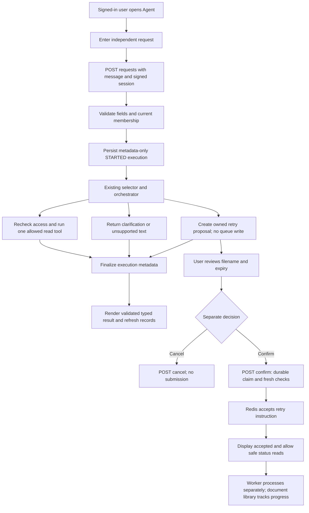

# Phase 12, Step 12.6: use the agent through the API and screen

Completed: **2026-10-26**.

## Where we are

```text
12.1 Contracts DONE -> 12.2 Knowledge DONE -> 12.3 Counts DONE
  -> 12.4 Routing DONE -> 12.5 Confirmed retry DONE
  -> 12.6 API, screen, records and integrated verification DONE
  -> Phase 13.1 Define dashboard metrics NEXT
```

Phase 12 is complete for the documented local workflow. Integration was verified
with controlled provider decisions/output, real application services, and Chrome.
Live Gemini intent accuracy, broad retrieval evaluation, load testing, and production
operation remain later work. This is not a claim of production readiness.

## 1. What can you do now?

Sign in and open **Agent** in the workspace navigation. Enter a request such as:

- “What is our leave policy?” to use indexed document knowledge.
- “How many documents have saved FAILED status?” to count saved processing records.
- “Retry document DOCUMENT-UUID” to review a proposal for one eligible saved file.

A **tool result** is the actual output of a backend operation. The page labels which
tool handled the request. Knowledge answers show validated citations and the existing
safe Markdown formatting. Counts show a table, a total, and the read timestamp.
Clarification and unsupported messages appear as plain escaped text.

An **action proposal** is a preview awaiting a separate decision. Creating it submits
no job. The page shows the resolved filename, document ID, expiry, and readable state.
Only **Confirm retry** invokes the confirmation endpoint. **Cancel proposal** consumes
the proposal without submitting work. An accepted retry is queued; it has not
necessarily finished processing.

Document library cards now show their document ID so you can copy the exact target.
A filename alone still needs clarification; the agent does not guess which file you mean.

## 2. Follow a request from the screen to the backend



Plain-text version:

```text
Form -> authenticated API -> execution metadata -> selector -> executor/proposal
     -> safe result display
Proposal -> separate Confirm/Cancel request -> receipt and document status
```

Each request is independent. A bare “yes” is not an API confirmation or an automatic
answer to a previous clarification. Restate the details when submitting another request.

## 3. API endpoints

All paths below are under `/api/v1/agents`. All require a signed session; service
functions check current membership and ownership. Responses use `Cache-Control: no-store`.

| Method and path | Input | Purpose |
| --- | --- | --- |
| POST `/requests` | Exactly `{ "message": "..." }` | Run selection and return a typed result/proposal. |
| POST `/proposals/:proposalId/confirm` | No body | Explicitly confirm an owned proposal. |
| POST `/proposals/:proposalId/cancel` | No body | Cancel an owned pending proposal. |
| GET `/proposals/:proposalId` | No body/query | Read a safe owned proposal receipt. |
| GET `/proposals/:proposalId/document-status` | No body/query | Read document status through current proposal ownership/membership. |
| GET `/executions` | No body/query | Read your latest 20 execution records in the active organization. |

The API obtains user/organization context from authentication, never submitted IDs
or model arguments. Unknown fields and query overrides are rejected. Confirmation
does not accept `confirmed: true`, a replacement document ID, or tool arguments.

Request/confirmation/cancellation success includes an execution ID and a typed result:

```json
{
  "success": true,
  "data": {
    "executionId": "execution-uuid",
    "result": {
      "kind": "clarification",
      "question": "Date filters are unavailable. Do you want current saved counts?"
    }
  }
}
```

Confirmation success uses HTTP 202 and the existing retry acknowledgement shape.
Safe fixed errors cover invalid input, membership loss, unavailable resources,
changed/expired/used proposals, rejected model output, and provider failures.
Malformed/oversized JSON is also converted to a safe JSON error instead of an HTML
error page or stack trace.

## 4. What is an execution record?

An **execution record** tells us which operation ran and how it ended. The new
`AgentExecution` table stores only:

- A server-generated execution ID and scoped user/organization ownership.
- Operation: REQUEST, CONFIRM, or CANCEL.
- Selected tool name and proposal reference when available.
- Outcome: STARTED, SUCCEEDED, FAILED, or UNCONFIRMED.
- Start/finish timestamps, work duration, and a controlled error code when needed.

It has no columns for the submitted request, answer, extracted passages, raw model
output, provider credentials, or arbitrary error messages. The selected tool is
recorded before executor work begins. If the initial record cannot be created, the
API does not run selection or a tool.

SUCCEEDED on a retry-proposal request means the preview was created, not that the
retry was confirmed or processing completed. The screen labels that operation as
“Retry proposal.” Confirmation has its own execution record.

If the API stops mid-operation, a STARTED row may remain. The screen says “Started
or interrupted” rather than claiming it is definitely still running. If work completes
but final record persistence fails, the service attempts to mark UNCONFIRMED and
returns a failure. In particular, it never tells the client to repeat a queue write.
The durable proposal receipt remains the source for confirmation recovery.

Records are private to the signed-in user in the current organization, including
for owners/admins. Membership removal cascades their records and proposals. A broader
organization audit system, retention policy, and operational tracing remain Phase 15.

## 5. Screen behavior when something goes wrong

- A pending operation disables duplicate submissions. Nothing is automatically retried.
- Navigation/sign-out/organization switching aborts browser requests and clears page
  state; late results cannot populate another workspace. This does not cancel work
  already accepted by the backend.
- Starting a new request clears the old result. If the new request fails, it keeps
  the draft without displaying the old answer as though it answered the new question.
- An uncertain Confirm/Cancel attempt disables that proposal's action controls.
  **Refresh proposal and document status** performs reads only. It never submits work.
- Even a pending-looking receipt cannot silently re-enable an uncertain confirmation
  in the same workspace page, including after viewing another result and reopening
  it from records. Backend single-use claims protect consumed proposals across restarts.
- Expired proposals cannot be confirmed in the UI, and the backend checks expiry again.
- Read results are validated before display. Inconsistent count totals, unknown tools,
  invalid citations, wrong-document acknowledgements, and malformed receipts are rejected.
- Source names, proposal filenames, and clarification text remain escaped React text.
  The existing Markdown renderer is reused for validated knowledge answers.

Use **Review proposal** in recent executions to reopen a receipt after navigation
or a new login. Consumed, cancelled, or expired proposals remain unavailable for confirmation.
For queued work, the document library remains the place to follow processing progress.

Agent answer bodies are shown on the current page and are not stored as conversation
history. Existing Chat continues to save its conversations. Agent records retain
metadata and proposal references, so reopening a record does not recover an old
knowledge answer or regenerate it automatically.

## 6. Code and migration

- `src/agents/agent.routes.ts`: strict authenticated endpoints, safe errors, no-store
  responses, metadata tracking, private record reads, and proposal-scoped status reads.
- `src/agents/agent.service.ts`: optional server-owned selected-tool observer for tracking.
- `src/app.ts`: mount agent routes and their JSON-parser error handler.
- `prisma/schema.prisma`: metadata-only execution model and membership ownership.
- `../../frontend/src/features/agents/AgentPage.tsx`: form, typed results, proposal
  actions/status reads, uncertain-attempt controls, execution list and receipt review.
- `../../frontend/src/features/agents/agent.types.ts`: runtime response validation.
- `../../frontend/src/App.tsx`: guarded Agent route and navigation.
- Existing `AnswerView` is shared with the agent; document cards expose copyable IDs.

Added and applied locally: `20261026100000_add_agent_execution_records`.
Comments explain the trust boundaries, tracking order, uncertain states, and cleanup.

For another checkout, from `backend`:

```powershell
node node_modules/prisma/build/index.js migrate deploy --config prisma7.config.ts
node node_modules/prisma/build/index.js generate --config prisma7.config.ts
npm.cmd run test:agent-ui
```

## 7. Verification and its limits

The migration and client generation succeeded. Backend/frontend builds, changed-file
frontend lint, and Prisma schema validation passed. **100 backend tests** passed:
the previous 86 scoped checks plus 14 HTTP integration entries, including parent tests.

**37 distinct Chrome tests** cover the new page and affected navigation, chat,
Markdown, library, and organization switching, including one integrated journey.
The page cases cover typed results, separate confirmation/cancellation, uncertain
acknowledgements, expired/changed/missing resources, invalid responses, literal unsafe
text, duplicate prevention, narrow screens, stale responses, and organization resets.

HTTP tests use real authentication/JWT, PostgreSQL, and isolated Redis/BullMQ queues.
They verify scoped/private reads, strict payloads, safe JSON errors, metadata without
request/answer contents, expiry/state failures, record-store failure before work, and
record finalization failure after a real queue acceptance.

The integrated Chrome journey used the actual frontend and a test proxy to real local
API routes. It verified real password login, scoped counts, a cited Markdown answer,
proposal cancellation, a separate confirmed queue submission, library queue status,
then a fresh login and recovery of the persisted accepted proposal through records.
Only provider text/decisions and embeddings were controlled. The remaining browser
cases use mocked HTTP responses for deterministic failure scenarios.

The fixture's queued document is not processed in that journey; the separate worker
pipeline was covered in Phase 11. These tests do not measure live Gemini intent
accuracy, provider schema acceptance, production performance, or broad document quality.
Phase 16 must evaluate live routing and retrieval/answer behavior. Records/proposals
have no automated retention cleanup in this step; Phase 15 will address lifecycle.

From `frontend`, the scoped browser command is:

```powershell
node node_modules/@playwright/test/cli.js test tests/browser/agent.spec.ts tests/browser/agent-integrated.spec.ts tests/browser/chat.spec.ts tests/browser/markdown.spec.ts tests/browser/switch.spec.ts tests/browser/library.spec.ts tests/browser/navigation.spec.ts --workers=2
```

The integrated test needs the compiled backend, local PostgreSQL and Redis. All its
accounts/documents and queue names are isolated fixtures, cleaned up after the run.
Test-only provider controls are under `tests/helpers`; production routes do not use them.

## 8. Validate the feature yourself

Restart the backend and reload the frontend to pick up the new routes. Keep Redis
and, when checking actual preparation, the separate document worker running as set
up in Phase 11. The worker command remains `npm.cmd run worker:documents` from backend
after a build.

1. Sign in and open **Agent**. Ask “How many documents have saved FAILED status?”
   Check the saved-status label, four counters, total, and read timestamp.
2. With a ready handbook uploaded, ask “What is our leave policy?” Check the selected
   tool, answer formatting, and sources. These live requests use your configured Gemini.
3. Ask for a last-month count. The intended response explains the unsupported date
   filter and asks whether current saved counts are wanted. Restate the full request;
   a bare “yes” is not remembered as context.
4. Copy an eligible test file's document ID from Documents. Ask “Retry document ID”.
   Check its resolved name and expiry, then Cancel. No retry should be queued.
5. Request a new proposal for that same test file. Review it and Confirm once. Read
   the accepted message, refresh status, and follow preparation in Documents.
6. Reopen Agent after a new login. Review the accepted proposal from Recent executions;
   it must remain unavailable for another confirmation.

**Next: Phase 13, Step 13.1 — define dashboard metrics, what each number means,
and which stored records can support it before building the dashboard.**
