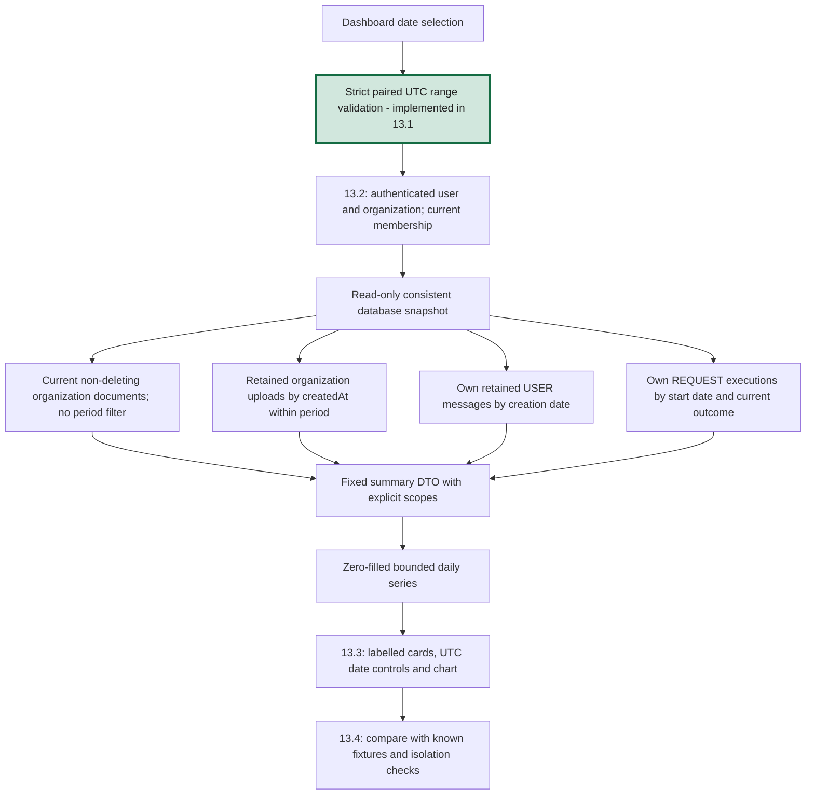

# Phase 13, Step 13.1: define what the dashboard numbers mean

Completed: **2026-10-26**.

## Where we are

```text
Phase 12 DONE -> Phase 13 Dashboard and analytics
  13.1 Metric definitions, response contract and date validation DONE
  13.2 Scoped summary API NEXT
  13.3 Dashboard cards, date controls and chart
  13.4 Known-fixture and organization-isolation verification
```

This step defines the first dashboard and implements its date-range validation.
It does not add a summary endpoint, query the database, change a screen, or create
new event tables. The contract module is safe to load without database/AI/Redis access.

## 1. What is a metric?

A **metric** is a number with a clear meaning and counting rule. “Failures: 3” is
unclear: three failed documents, three failed jobs, or three unsuccessful requests?

Our first dashboard separates those concepts. It shows shared document information
and your own retained activity. Every figure has an explicit source, scope, and time rule.

A **snapshot** describes records as they exist during the current read. **Activity**
counts retained records whose timestamps fall within a selected period. A date picker
must not make a current snapshot look like a historical snapshot.

## 2. Who can see which numbers?

All current organization roles—MEMBER, ADMIN, and OWNER—will have the same scope rules:

| Panel or series | Scope | Why |
| --- | --- | --- |
| Current saved document totals/statuses | Active organization | These documents are shared through the library already. |
| Uploads still saved, by day | Active organization | Counts the shared organization's retained uploads. |
| Your saved chat questions | Current user in active organization | Conversations remain private to their owner. |
| Your agent requests/outcomes | Current user in active organization | Execution records remain private to their owner. |

An owner does not gain another person's usage history through this dashboard.
There is no member selector, user breakdown, foreign organization argument, prompt
text, filename list, or private conversation link in the summary response.

Step 13.2 must derive identity from authentication and check current membership in
the same database snapshot as the summary. This step's date parser rejects identity
overrides, but parsing dates alone is not an authentication or authorization check.

## 3. The first metrics

| Metric | Existing source and exact counting rule | Time rule |
| --- | --- | --- |
| Current saved documents | `Document` in the active organization with `deletionRequestedAt = null` | Current snapshot; ignores selected activity dates. |
| Saved document status counts | Same document set, grouped by UPLOADED, PROCESSING, COMPLETED, FAILED; include zero groups | Current snapshot; sum equals current total. |
| Uploads still saved | Same retained document set, filtered by `createdAt`, grouped by UTC day | Selected period. Includes uploads by all organization members. |
| Your saved chat questions | Retained `Message` rows with role USER, matching the active organization and a conversation owned by the signed-in user | Filter `Message.createdAt` by selected period. |
| Your agent requests | Retained `AgentExecution` rows with operation REQUEST and matching signed-in user/organization | Filter `startedAt` by selected period. |
| Your request outcomes | Same REQUEST set grouped by STARTED, SUCCEEDED, FAILED, UNCONFIRMED; include zero groups | Outcome at the current snapshot, grouped by request start date. |

The initial screen can show current document cards, your saved-question and request
totals, a saved document-status breakdown, and daily series for retained uploads,
your saved questions, and your agent requests. Labels must make the mixed scopes clear.

### Example: a document retry is not another upload

You upload a handbook once, processing fails, and then you retry it twice. There is
still one Document record. The saved-upload metric counts one file, not three attempts.
Redis job attempts are a different metric and are not included in this dashboard.

### Example: saved FAILED does not describe live queue state

A document may still have saved status FAILED while a retry waits in Redis. The
dashboard labels these as database status counts. It does not call that number
“currently failed jobs,” “waiting jobs,” or “files with no retry.” Live processing
state remains in the document library/status flow.

### Example: counting questions

One completed chat exchange stores a USER message and an ASSISTANT message. It adds
one saved question, not two. Use the user message's creation timestamp rather than
the conversation's latest update timestamp. The existing save happens after answer
generation, so this is the time the question was saved, not necessarily submitted.

Agent knowledge questions are not currently persisted as Message records. They
contribute to your agent-request count, not saved-chat-question count. Do not combine
those into a supposedly exhaustive count of “all questions ever asked.”

### Example: counting agent requests and failures

Asking for a retry creates a REQUEST execution. Confirming it creates a separate
CONFIRM execution; cancelling creates CANCEL. Only REQUEST is counted here, so the
three operation types cannot inflate the agent-request metric.

SUCCEEDED can mean a valid clarification, unsupported response, or proposal preview.
It does not measure factual answer accuracy or completed retry processing. FAILED
means a request operation failed; UNCONFIRMED is reported separately. STARTED can
mean work is in progress or was interrupted. No “active jobs” or success-rate claim
is inferred from these values.

## 4. Retained data is not a lifetime event log

Deleting a chat cascades its messages. Removing membership cascades its conversations
and execution records. Document deletion removes its document record; setting deletion
intent excludes it before final cleanup. Therefore old daily counts can decrease
when records are deleted or cleaned up.

Use labels such as **Your saved chat questions** and **Uploads still saved**. They
describe retained records available at read time. We cannot reconstruct deleted data
or historical status transitions from the current schema.

| Proposed future number | Why the initial dashboard cannot report it honestly |
| --- | --- |
| Lifetime upload attempts or permanently preserved question totals | Requires a separately designed event/retention policy. |
| Failed worker attempts or queue backlog history | Not represented by current Document status; Redis history also has retention. |
| Current document status at the end of a past date range | Status transitions are not stored as historical snapshots. |
| Gemini token counts, model-call totals, or cost | Actual usage/cost data is not recorded; one agent request may use multiple provider calls. |
| Factual answer accuracy | Requires evaluated answers, not a SUCCEEDED execution flag. |

These are unavailable metrics, not zero values. No new event schema is needed for
the first dashboard. Broader immutable audit/retention work remains Phase 15.

## 5. Date rules

The planned summary query accepts only `from` and `to`, both date strings in
`YYYY-MM-DD` format. Both must be supplied together, or both omitted.

```text
from = included UTC midnight
to   = excluded UTC midnight

Include a row when timestamp >= from AND timestamp < to.
```

This **exclusive end** avoids double counting a midnight record when adjacent periods
meet. For example, `from=2026-10-25&to=2026-10-27` includes October 25 and 26, not 27.
The UI can offer an inclusive “Through” date and convert it to the next day's exclusive
end before calling the API. It must label chart dates as UTC.

- Default: seven UTC calendar days including today's partial day.
- Maximum: 90 days. Minimum: one day.
- `to` may reach tomorrow's UTC midnight to include today, but not beyond it.
- Date-only inputs are required; timestamps, arrays, whitespace, invalid calendar
  dates, inverted/empty ranges, and unknown query fields are rejected.
- One daily bucket is returned for each included UTC date, even with zero activity.
- Counts and activity use the same database snapshot in the future summary API.
  `asOf` identifies the read time; today's bucket is partial and records may change later.

Example default with server time `2026-10-26T10:00:00Z`:

```text
from=2026-10-20, to=2026-10-27
Buckets: Oct 20, 21, 22, 23, 24, 25, 26
```

UTC is explicit rather than the browser's local date. At 00:15 on October 26 in
India, UTC is still October 25; the default period includes the partial UTC day 25.
The page may display the read timestamp locally, but must preserve the UTC bucket dates.

Current document cards ignore this filter. They remain a current snapshot and must
be visually labelled separately from period activity. This prevents a past date range
from implying that today's saved document status existed at that past time.

## 6. A worked example to validate later

Assume the signed-in user is Asha in Company A and the selected UTC days are October
25 and 26 (`from=2026-10-25&to=2026-10-27`). All data below is fictional.

Documents:

- Company A: one completed file uploaded Oct 24, one failed file uploaded Oct 25,
  and one uploaded-status file uploaded Oct 26; all three are still saved.
- Another Company A file uploaded Oct 25 is marked for deletion: exclude it.
- A Company B failed file is excluded from all Company A numbers.

Private activity:

- Asha has one retained USER message on each selected day: two saved questions.
- A teammate's message and ASSISTANT messages do not increase Asha's count.
- Asha has one SUCCEEDED REQUEST on Oct 25; one FAILED, one STARTED, and one
  UNCONFIRMED REQUEST on Oct 26: four requests.
- Her CONFIRM/CANCEL records and another person's REQUEST records are excluded.

Expected contract-shaped result:

```json
{
  "definitionVersion": 1,
  "asOf": "2026-10-26T10:00:00.000Z",
  "range": { "from": "2026-10-25", "to": "2026-10-27", "timezone": "UTC", "days": 2 },
  "currentDocuments": {
    "scope": "organization", "total": 3,
    "byStatus": { "UPLOADED": 1, "PROCESSING": 0, "COMPLETED": 1, "FAILED": 1 }
  },
  "personalActivity": {
    "scope": "current_user", "savedChatQuestions": 2,
    "agentRequests": {
      "total": 4,
      "byOutcome": { "STARTED": 1, "SUCCEEDED": 1, "FAILED": 1, "UNCONFIRMED": 1 }
    }
  },
  "daily": [
    { "date": "2026-10-25", "organizationUploads": 1, "ownSavedChatQuestions": 1, "ownAgentRequests": 1 },
    { "date": "2026-10-26", "organizationUploads": 1, "ownSavedChatQuestions": 1, "ownAgentRequests": 3 }
  ]
}
```

The period's two retained uploads do not have to equal the current three-document
snapshot: one current file was uploaded before the selected period. Daily personal
question/request sums do equal their corresponding period totals.

## 7. Planned data flow and implementation boundary



DTO means **data transfer object**: a defined response shape that the API sends to
the screen. `DashboardSummary` documents that shape and explicit scope labels.
It returns bounded aggregates, not raw messages, executions, user lists, or document text.

Step 13.2 will expose a summary API, enforce current membership and snapshot scope,
apply query timeouts, and aggregate in the database rather than loading an unbounded
list into application memory. It must never run model-generated SQL. No Redis or AI
request is needed to calculate these metrics. API errors must not be presented as zeros.

## 8. Code and verification

- `src/analytics/dashboard.contracts.ts`: response types, strict range parser, 7/90-day
  limits, UTC boundaries, and bounded calendar-day expansion. Comments explain scope
  and timestamp semantics. Existing document-status result types are reused through
  type-only imports; loading contracts does not load services.
- `tests/dashboard.contracts.test.cjs`: ten cases covering defaults, exclusive dates,
  leap/year boundaries, invalid dates/shapes, identity overrides, range limits,
  UTC versus India dates, daylight-saving boundaries, immutability and service-free loading.
- `package.json`: `test:dashboard-contracts` builds and runs those tests.

Run from `backend`:

```powershell
npm.cmd run test:dashboard-contracts
```

The backend build and all **10 contract tests passed**. No migration or dependency
was added. These tests validate input/calendar behavior, not database counts or
permissions; those are verified with the 13.2 API and 13.4 system checks.

For your learning check, calculate the worked example by hand. Explain why it has
three current documents but two period uploads, why two chat exchanges count as two
questions, and why a confirmation is not another agent request. Then locate 13.1 and
13.2 in the roadmap before continuing.

**Next: 13.2 — implement the summary API using these scope and counting rules,
with real database fixtures, strict inputs, and current-membership checks.**
