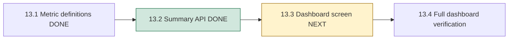
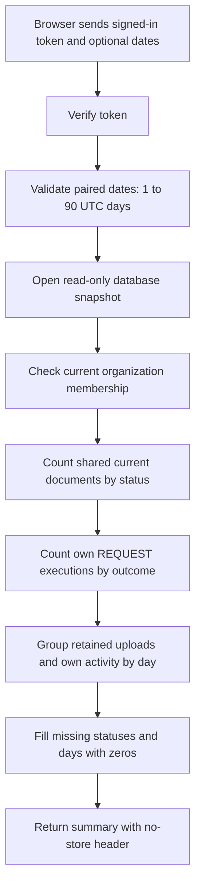

# Phase 13, Step 13.2: dashboard summary API

Completed: 2026-10-26. Next: **13.3, dashboard cards, date controls and chart**.

## What problem does this solve?

The dashboard needs numbers such as “3 documents” and “2 questions asked by me.”
The browser should not download everyone's documents or conversations to count
them. We now have one backend endpoint that checks access, calculates the numbers
in PostgreSQL, and returns a small summary.

An **API endpoint** is an address the frontend calls to request something. Here:

```http
GET /api/v1/analytics/summary?from=2026-10-24&to=2026-10-27
Authorization: Bearer <your signed-in session token>
```

The token supplies the signed-in user and selected organization. Query parameters
can select dates; they cannot select someone else's identity or organization.
With no dates, the endpoint uses seven UTC days, including the partial current day.

## Where we are in the phase



The endpoint is available when the backend runs with the updated build. Connecting
its response to the frontend is the next step; this step does not change the screen.

## How a request works



A **snapshot** is a consistent view of saved data. Imagine taking a photograph of
the records: all numbers come from that same photograph. If another person uploads
a file while the request is running, this response does not mix an earlier total
with a later daily count. A subsequent request can see the new file.

`RepeatableRead` is PostgreSQL's transaction setting that provides this consistency.
Membership is read in that same transaction. A membership removed before its snapshot
is denied; a removal committed after the snapshot applies to subsequent reads.
This is snapshot authorization, not a promise to interrupt an already-running read.

**Read-only** means this transaction can read but cannot change records. PostgreSQL
enforces it, so an accidentally added write fails. A five-second statement timeout
and transaction deadline prevent a slow summary from waiting indefinitely; acquiring
a transaction has a two-second maximum wait.

## A worked example

Suppose your company retains these documents:

| Document | Upload date | Current status | Included? |
| --- | --- | --- | --- |
| Handbook | October 23 | COMPLETED | Yes |
| Policy | October 25 | FAILED | Yes |
| Benefits | October 26 | UPLOADED | Yes |
| Old draft | October 25 | FAILED, deletion requested | No |

You select October 24 through October 26. The request uses `from=2026-10-24`
and **exclusive** `to=2026-10-27`: midnight on October 27 ends the interval.
You saved one question on each of October 25 and 26. Your four agent REQUEST records
have outcomes SUCCEEDED, FAILED, STARTED and UNCONFIRMED. Three started October 26.

The important response values are:

```json
{
  "currentDocuments": {
    "scope": "organization",
    "total": 3,
    "byStatus": { "UPLOADED": 1, "PROCESSING": 0, "COMPLETED": 1, "FAILED": 1 }
  },
  "personalActivity": {
    "scope": "current_user",
    "savedChatQuestions": 2,
    "agentRequests": {
      "total": 4,
      "byOutcome": { "STARTED": 1, "SUCCEEDED": 1, "FAILED": 1, "UNCONFIRMED": 1 }
    }
  },
  "daily": [
    { "date": "2026-10-24", "organizationUploads": 0, "ownSavedChatQuestions": 0, "ownAgentRequests": 0 },
    { "date": "2026-10-25", "organizationUploads": 1, "ownSavedChatQuestions": 1, "ownAgentRequests": 1 },
    { "date": "2026-10-26", "organizationUploads": 1, "ownSavedChatQuestions": 1, "ownAgentRequests": 3 }
  ]
}
```

This excerpt omits the outer `{ success, data }` wrapper and the `definitionVersion`,
`asOf` and `range` fields. The actual response includes all of them.

Why is the document total three when only two uploads appear in the selected dates?
The total answers **“what documents exist now?”** The daily rows answer **“what retained
activity happened in these dates?”** The older handbook is still a current document.

Teammates' uploads contribute to the shared document numbers. Their questions and
agent records contribute only to their own personal summaries. OWNER and ADMIN roles
do not expand private activity access. ASSISTANT messages and CONFIRM/CANCEL operations
are excluded from question/request counts.

## Why use Prisma methods and some raw SQL?

An **aggregate** summarizes rows, such as counting documents for each status.
`document.groupBy()` and `agentExecution.groupBy()` express the fixed status/outcome
counts directly, so we use Prisma methods for those operations.

For daily activity, timestamps such as `2026-10-25 09:30` and `2026-10-25 17:00`
must belong to the same calendar day. Prisma's `groupBy()` cannot directly express
that date transformation. A fixed `$queryRaw` query lets PostgreSQL group by date,
join conversation ownership, and combine the three daily series. It returns at most
90 grouped rows; it never returns prompts, answers, filenames or document text.

All user/organization/date values are bound parameters in a tagged template.
They are data, not SQL instructions. No incoming text becomes a table name or a
SQL fragment. `$executeRaw` is used only for fixed read-only and timeout settings.

The database stores these timestamps as UTC `timestamp(3)` values. SQL date boundaries
explicitly use the same timestamp type, avoiding dependence on the session timezone.
The backend fills missing days/statuses with zeros and converts PostgreSQL bigint
counts into safe JSON numbers. Failed reads produce an error, never invented zeros.

## Access and failure behavior

| Situation | Response |
| --- | --- |
| Missing/invalid session or invalid identity | 401 |
| Valid token but no current membership | 403 |
| Invalid dates, unknown filters or nonempty GET body | 400 |
| Malformed JSON / JSON above the parser limit | 400 / 413 |
| Database unavailable, query failure or timeout | 503, safe message |
| Successful read | 200 with scoped summary |

Responses use `Cache-Control: no-store`, including authentication/parser failures.
This asks browsers and intermediaries not to retain private summaries. The endpoint
does not call Gemini, calculate embeddings, contact Redis, or create agent records.

## Verification and limits

Run from `backend`:

```powershell
npm.cmd run test:dashboard-summary
```

The TypeScript build and **23 reported tests** passed: 10 existing contract tests,
12 integration checks, and their enclosing integration test. The integration checks
use the actual HTTP router and isolated real PostgreSQL fixtures, then remove them.
They cover exact counts for all roles, cross-user/organization isolation, UTC boundary
inclusion/exclusion, empty days, maximum/default ranges, invalid input, revoked access,
concurrent inserts across all metrics, enforced read-only behavior, actual slow-query
cancellation, safe failure responses and deletion of retained questions. No provider
or Redis runtime is loaded by this API path.

The response size is bounded by 90 days and fixed status/outcome groups. Database
work still depends on the number of matching retained records; this is not a large
organization performance benchmark. Existing indexes and timeouts apply. Current
document counts intentionally cover all retained documents, not just recent uploads.

Deleting records can lower earlier daily counts. Outcome counts describe saved current
outcomes, not historical outcomes as of the date filter, answer accuracy, token usage,
cost or document-job completion. End-to-end screen validation remains Step 13.4.

Next lesson: **13.3** will request this summary from the frontend and display cards,
date controls and a chart, with clear labels for shared versus personal counts.
