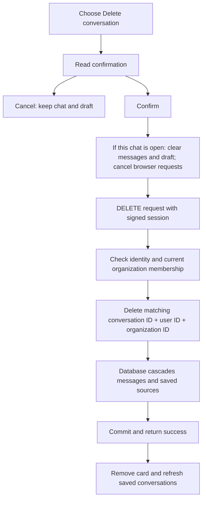

# Phase 9, Step 9.1: delete your own private conversation

Completed: **2026-10-25**.

## Where we are

```text
Phases 4 and 5 DONE -> 9.1 Private conversation deletion DONE
                   -> 9.2 Safe answer Markdown NEXT -> Phase 12
```

## The problem, with an example

You uploaded an employee handbook and asked about leave. NexaAI saved a conversation
containing your question, the answer, and its source details. You want to remove that
chat from your history. The company still needs the handbook for future questions.

This step adds a confirmed deletion of your saved chat. It removes the conversation,
its messages, and the source details saved with those messages. The uploaded handbook
and its searchable chunks remain available. Other people's chats remain unchanged.

Conversations are private to a user inside an organization. Being an organization
owner or administrator does not grant permission to delete a teammate's private chat.

## Understand the records

| Record | Meaning | Deleted here? |
| --- | --- | --- |
| Conversation | The saved chat title and owner | Yes, for the selected chat |
| Message | A question or answer inside that chat | Yes |
| MessageSource | Saved details identifying the evidence cited by an answer | Yes |
| Document and document chunks | The uploaded company knowledge and searchable passages | No |

A **database transaction** groups changes so they succeed together or roll back
together. A **cascade** is a database relationship rule: deleting a parent also removes
its dependent records. Our existing schema already cascades Conversation -> Message
-> MessageSource. This step uses those rules; no database migration is needed.

All these changes happen in PostgreSQL. There is no file or Redis job to clean up
when deleting a conversation, so the operation can finish in one short transaction.

## What happens when you click Delete



The browser calls `DELETE /api/v1/chat/conversations/:conversationId`. It sends no
body. The backend obtains the user and organization from authenticated context;
the caller cannot supply a different owner in the body or query string.

The service uses Prisma's `deleteMany` method with all three conditions: conversation
ID, user ID, and organization ID. A zero count means the chat is unavailable. A
missing chat and somebody else's chat both return the same 404 response, so the API
does not reveal whether somebody else's private chat exists.

The service briefly locks the current membership row using parameterized SQL. A
**lock** makes conflicting database changes wait for each other. Prisma does not
provide this row-lock option through its usual query methods. The actual conversation
deletion uses a Prisma method. Comments beside the locks explain why they are needed.

| Outcome | Response and screen behavior |
| --- | --- |
| Deleted | 200; remove card and refresh history |
| Missing or inaccessible chat | 404; refresh before another deletion |
| Membership removed | 403; refresh to check access |
| Invalid input or identity | Controlled 400 or 401 response |
| Connection failure or uncertain result | Show an error; require a fresh list read before another deletion |

An uncertain result means the server might have deleted the chat even though the
browser did not receive confirmation. The browser does not automatically repeat
the deletion. Refresh conversations reads the current saved state first.

## What if Gemini is still answering?

Imagine you ask a follow-up question and delete the conversation while the answer
is being generated. Generation happens outside a database transaction. When it
finishes, the save code checks and locks the conversation again.

- If saving finishes first, deletion removes that new exchange along with the chat.
- If deletion finishes first, saving finds no conversation and fails. It cannot
  recreate the deleted chat.

The browser also cancels its pending requests and ignores late results when the open
chat is cleared. Cancelling a browser request does not guarantee that a provider
stops generating; the backend's final check prevents saving into the deleted chat.

Confirming deletion clears an open chat and its unsaved draft immediately, including
when the DELETE later fails. After refreshing, you can reopen a chat that still
exists. Cancelling the confirmation preserves the draft. Deleting a different chat
preserves the currently open chat and its draft.

## Try this step yourself

Restart the backend to load the new route, and reload the frontend.

1. Sign in and create a disposable saved chat using a ready document.
2. Open the chat, type an unsent follow-up, and choose its Delete conversation button.
3. Cancel. The messages and draft should remain.
4. Choose Delete again, read the confirmation, and confirm. The chat card, messages,
   and draft should disappear.
5. Refresh conversations. The deleted chat should stay absent.
6. Open the document library. The original uploaded document should still be there.
7. Create two disposable chats. Open one and delete the other; the open chat should
   remain usable.

Deletion is permanent, so use disposable chats for this walkthrough.

## Code and verification

- `src/conversation/conversation.service.ts`: current membership, scoped deletion,
  transaction, and coordination with exchange saving.
- `src/conversation/conversation.controller.ts` and `src/rag/rag.routes.ts`: input
  validation, authenticated DELETE route, safe errors, and no-store responses.
- `../../frontend/src/features/chat/ConversationList.tsx`: confirmation, request,
  refresh, failure handling, and accessible feedback.
- `../../frontend/src/features/chat/ChatPage.tsx`: clear only the selected chat when
  its deletion is confirmed; keep list refreshes from interrupting a pending DELETE.

Validation completed:

- Backend and frontend production builds passed; changed frontend TypeScript files
  and the new browser test passed ESLint.
- `npm.cmd run test:conversation-deletion` in `backend` passed **19 tests**, covering
  deletion plus existing history and persistence behavior.
- The relevant Playwright deletion, history, chat, and organization-switch suites
  passed **20 browser tests**, including cancellation, uncertain results, pending
  answers, navigation, pagination, and a narrow screen.

Backend tests use real PostgreSQL and authenticated HTTP requests with isolated
fixtures. They verify ownership, cascaded cleanup, unchanged documents and peer
chats, concurrent deletions, removed membership, and a delayed answer after deletion.
Generation is a controlled fixture; these tests do not call Gemini. Browser tests
mock API responses to exercise screen behavior. This step did not run a new live
browser-to-Gemini journey or a production load test.

**Next: Step 9.2 — render answer Markdown safely**, so lists and code are readable
while embedded unsafe HTML cannot execute.
