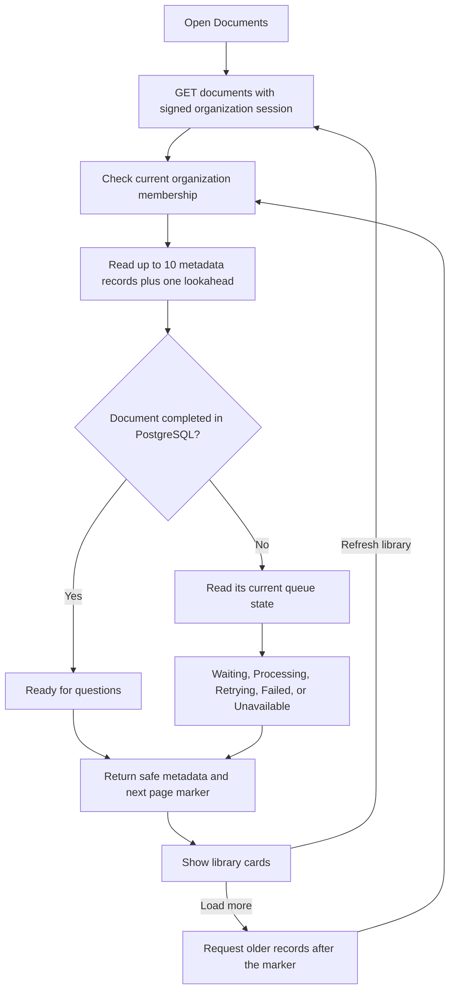

# Phase 5, Step 5.1: the document library

## Where we are

```text
Phase 4: Organization management DONE
  -> Phase 5: Document management
       5.1 Paginated document library DONE (this lesson)
       5.2 Document deletion NEXT
       5.3 Library retry controls PLANNED
```

## What problem does this solve?

Before this step, Documents showed only the latest upload while that page remained
open. Leaving and returning lost that display even though PostgreSQL still held the
uploaded file's record.

Now Documents includes a library of the selected organization's saved uploads.
Each card shows filename, file type, size, upload time, last database update time,
and the processing status observed during the read. The library returns when you
reopen the page after navigating away or signing in again.

For example, Support uploaded `handbook.txt` yesterday and `leave-policy.pdf` today.
Support's library shows both, with today's upload first. Switching to Sales loads
Sales' own library. Support's documents are not included in the Sales response.

## How the list works



The **API** is the backend interface the screen calls. This step adds
`GET /api/v1/documents?limit=10`. It accepts `limit` (1 to 50; default 10) and an
optional `cursor`. The browser normally requests 10 documents at a time.

The backend checks the current database membership. A correctly signed but outdated
token belonging to someone removed from the team cannot list that team's documents.
The organization comes from the token. An `organizationId` query override is rejected.

## Pagination, explained with a small example

**Pagination** means reading a limited part of a list instead of loading everything.
Imagine there are 24 saved documents:

```text
First request:  documents 1–10  -> hasMore=true, cursor=A
Load more:      documents 11–20 -> hasMore=true, cursor=B
Load more:      documents 21–24 -> hasMore=false, no cursor
Refresh:        return to the newest 10 documents
```

A **cursor** is the next-page marker. It contains the last visible document's
creation time, ID, and organization ID, encoded for transport. It is not a secret
or an authorization credential. Every query still filters by the signed organization.
The backend rejects reuse of a marker from a different organization.

Documents are ordered by creation time, then ID, newest first. Two uploads can share
the same timestamp, so ID breaks the tie. We use creation time rather than last update
time because background processing changes `updatedAt`: processing should not make a
document jump between pages. Deleting the boundary record also does not invalidate
the next page because its values, rather than the continued existence of the record,
define where to continue.

New uploads can arrive while you read older pages. Refresh the library to see those
at the top. This is a live list, not a frozen snapshot covering every page request.

## Why PostgreSQL and Redis are both consulted

PostgreSQL stores the saved document record and completed result. Redis holds the
background job's current state. The library shares the same interpretation used by
the existing single-document status endpoint:

| Evidence | Display |
| --- | --- |
| Database says COMPLETED | Ready for questions; Redis is not needed |
| Queue says waiting | Waiting for processing |
| Queue says active | Processing |
| Queue says delayed | Retrying automatically |
| Queue says failed | Processing failed |
| No retained queue job | Saved — processing not queued |
| Queue status cannot be confirmed | Processing status temporarily unavailable |

A worker may temporarily write FAILED before another attempt is scheduled. The queue's
delayed state means the screen should say Retrying automatically rather than final failure.
A queue outage must not hide saved files or invent a final processing result.

The backend reads metadata in one bounded database query. It reuses one queue connection
per page, and checks queue state only for the visible unfinished documents. A new database
index on organization, creation time and ID supports this list's lookup and ordering.

## Refreshing and failures

**Refresh library** rereads the newest page. **Load more documents** appends an older
page. If a request fails, existing cards remain visible with a message explaining that
they came from a previous successful read. **Retry library** retries the failed page,
including its cursor, without repeating an upload.

Successful uploads refresh the newest library page. A saved-but-not-queued response
also triggers a refresh. If the upload response is uncertain, the library is reread
because the server may already have saved the file.

The latest upload continues its automatic status checks; its fresher state is shared
with the matching library card. Other cards show the status from the last library read.
Refresh to update them. Last updated is the database record's timestamp; it is not a
promise that a queue-only change altered that timestamp.

Leaving the page aborts pending browser reads and ignores late results. Organization
switching resets page state. The response parser checks both the page's and each
document's organization ID before displaying data, as well as metadata and pagination shape.

## Scope and safe output

The endpoint returns selected metadata only. It does not return storage paths,
extracted text, embeddings, internal worker errors, or user passwords. Error text is
controlled by the application. Reading the library does not enqueue or retry jobs.

This step adds browsing. Document deletion is Step 5.2; retrying older library entries
is Step 5.3. The existing latest-upload retry controls continue to work.

## Validate it yourself

1. Select an organization and open Documents.
2. Upload a disposable TXT document and wait for its latest-upload status.
3. Check that it appears in the library; navigate to Dashboard, then back to Documents.
4. Select Refresh library to read current processing states.
5. With more than 10 saved documents, select Load more documents to see older records.
6. Switch organizations. Check that the library shows only the selected team's uploads.

## Code and verification evidence

- `backend/src/document/document.library.ts`: membership check, cursor validation,
  metadata query, safe status mapping, and next cursor.
- `backend/src/document/document.service.ts`: shared status resolver for individual
  documents and library cards.
- `backend/src/document/document.controller.ts` and `document.routes.ts`: authenticated
  library endpoint and controlled failures.
- `frontend/src/features/documents/DocumentLibrary.tsx`: pagination, refresh, error
  recovery, request cancellation and safe card rendering.
- `frontend/src/features/documents/DocumentsPage.tsx`: refresh after uploads and share
  the latest upload's progress with the library.
- `frontend/src/features/documents/document.types.ts`: validated metadata/page responses
  and shared processing labels.

Verified on 2026-10-25: both builds, changed-file lint, 12 backend library/status tests,
and 15 browser library/upload tests passed. The additive index migration applied to
the local database. Backend tests use real PostgreSQL and HTTP/JWT with controlled
queue states; browser tests use mocked HTTP. No combined live browser/Redis upload
journey was run for this step.

Checks cover tied timestamps, new insertions while paging, a deleted boundary record,
membership removal, foreign cursor/response rejection, queue outages, safe metadata,
failed-page retry, reopening the library, upload refresh, organization switching,
mobile layout and ignoring late responses. Tests create and clean isolated fixtures.
