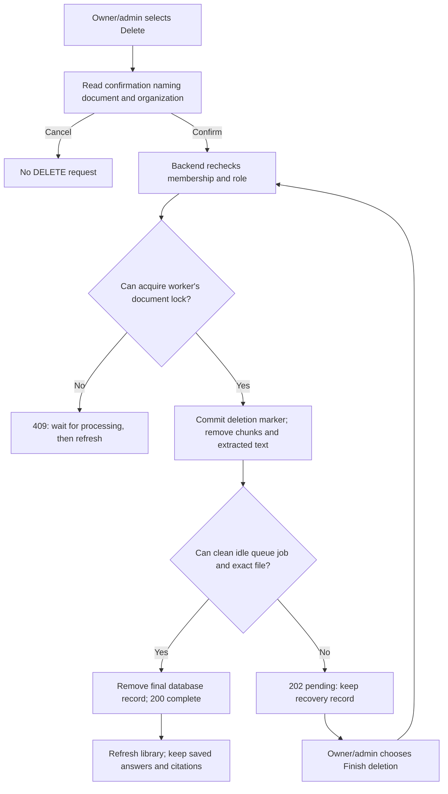

# Phase 5, Step 5.2: coordinated document deletion

## Where we are

```text
Phase 4: Organization management DONE
  -> Phase 5: Document management
       5.1 Paginated library DONE
       5.2 Document deletion DONE (this lesson)
       5.3 Retry controls for older library files NEXT
```

## What deletion must accomplish

Suppose Support uploaded `handbook.txt`. NexaAI saved its file, split its text into
searchable chunks, and used it to answer a leave-policy question. Clicking Delete
must remove the knowledge from future searches and clean up its storage. Simply
hiding the card would leave the knowledge available to later questions.

There are four connected things:

| Component | What deletion does |
| --- | --- |
| PostgreSQL document record | Mark deletion intent, then remove the record after cleanup |
| Searchable chunks and vectors | Remove when deletion intent is committed |
| Redis job | Remove an idle retained job; never force-remove an active job |
| Uploaded file | Remove the exact file inside this organization's upload folder |

Saved answers and their source details are separate historical records. They stay
unchanged. A source snapshot records the name and IDs used for that answer; it does
not have a foreign key requiring the original document to remain forever.

## Who can delete?

Current owners and administrators can delete organization documents. Regular members
can view the library but have no deletion control. The backend checks the database
role again on every DELETE, even if an old login token claims OWNER.

The library receives a `canDelete` capability from its authorized server read. The
screen uses that to show controls, but the server still enforces the actual rule.
Foreign and missing document IDs both return the same 404. Request bodies cannot
override the organization or target file path.

## Why there are two stages

PostgreSQL, Redis and the filesystem cannot participate in a single shared transaction.
For example, removing a file can succeed just before the API process crashes. We need
a saved recovery point so a later request can finish the remaining cleanup safely.

The new nullable field `deletionRequestedAt` records deletion intent. A record with
that marker is permanently blocked from processing and retrieval. It is shown as
**Deletion pending — blocked from questions** until cleanup finishes.



**Stage 1: stop future use.** Under the organization's permission lock and the worker's
document lock, mark intent and delete chunks in one database transaction. Search
explicitly excludes marked documents, and the processor refuses to load them.

**Stage 2: finish external cleanup.** Recheck authorization and locks, remove the idle
queue job, validate and unlink the file, then delete the final document record.
Redis or filesystem failure leaves Stage 1 committed. Finish deletion retries cleanup.

A missing file counts as already cleaned. This handles a crash after file removal
but before the final database commit. A failed commit cannot make the document
searchable again: Stage 1 was committed separately.

## What happens to active processing?

A worker holds a PostgreSQL advisory lock for the duration of processing. Deletion
uses the same lock and refuses to proceed while that transaction owns it. The file
is not removed underneath extraction or embedding work. A PROCESSING label alone
is not enough to identify a live worker; locks distinguish live from interrupted work.

A Redis job can be active before its processing transaction starts. After deletion
intent is saved, that worker observes the marker and refuses to process the document.
Its Redis job is not force-removed. Finish deletion can remove the retained job after
it leaves the active state.

Upload/retry queue submissions use the same document lock and check for the absence
of a deletion marker. A request that read an old status cannot enqueue work after
deletion finishes. Redelivery of an old Redis instruction cannot recreate a missing
or marked document.

An answer request that already retrieved text before deletion may still finish using
its earlier evidence. Deletion blocks subsequent retrieval; it does not retract an
in-flight model request or rewrite saved answers.

## File safety and pending cleanup

The path comes from the scoped database record, never from the DELETE body. The
target must be a direct child of `uploads/documents/<organizationId>`. Directory
components are checked for symlinks/junctions, and the target must be a regular file.
The operation unlinks one exact file; it never recursively removes a directory.
Unsafe locations are refused, and cleanup failures never expose raw paths to the browser.

Finish deletion is an explicit recovery action. There is no automatic cleanup sweeper
in this step. If storage permissions or an unsafe directory need repair, restore them
before retrying. Until cleanup finishes, the physical file may remain on disk, while
the document is excluded from processing and questions.

## Screen behavior

Open Documents and choose Delete on a library card. The confirmation names the file
and organization and explains the effect on everyone in that organization. Cancellation
sends no request. Confirmation disables repeated clicks while the operation runs.

For a completed deletion, the card is removed and the library refreshes. For pending
cleanup, the card shows its blocked state and Finish deletion. If the target was also
the latest upload, that panel and its polling are cleared.

An uncertain response is not retried automatically. Refresh the library to check its
saved state first. A changed permission removes deletion controls until a fresh read.
Leaving the page aborts the browser's wait and ignores its late result; it does not
guarantee the server rolled back an accepted deletion.

## Try it with a disposable document

Restart the backend and document worker after loading this code so both understand
the deletion marker. The additive database migration must be applied first; it was
applied to the local `nexaai` database during this step.

1. Sign in as a current owner/admin and upload a disposable TXT file.
2. Wait for processing to finish. Locate it in the library.
3. Choose Delete, read the confirmation, then Cancel deletion. The file remains listed.
4. Choose Delete again and confirm. The card disappears after complete cleanup.
5. If cleanup is pending, restore Redis/storage access, refresh, and use Finish deletion.
6. If an answer previously cited this file, reopen it: its saved answer and source
   details remain. The original file is no longer available for future retrieval.

## Code and validation

- `backend/src/document/document.deletion.ts`: current-role checks, locking, durable
  intent, exact-path validation, idempotent cleanup and safe submission locking.
- `backend/src/document/document.queue.ts`: remove idle jobs without forcing active jobs.
- Processing, search, status and library services: recognize and exclude deletion intent.
- `frontend/src/features/documents/DocumentLibrary.tsx`: server capability, confirmation,
  pending cleanup, refresh and request cancellation.
- `DocumentsPage.tsx`: clear deleted latest-upload state and stop its polling.

Verified on 2026-10-25: both builds and changed-file lint passed; 25 backend deletion,
library, status and retry tests passed; 21 browser deletion/library/upload tests passed.
Backend deletion tests use real PostgreSQL, Redis/BullMQ and disposable local files,
with deterministic embedding/extraction fixtures. Retrieval SQL is exercised before
and after deletion, and saved citation records are compared unchanged. Browser tests
use mocked HTTP. All 19 existing processing/queue/worker/recovery tests passed too,
including actual worker crashes, redelivery and real local embeddings. The two
backend suites overlap on the six retry tests; these are separate suite totals.

Tests cover stale roles, foreign IDs, active processing, active Redis jobs, queue
outages, file cleanup failure, missing files, unsafe paths, blocked reprocessing,
confirmation cancellation, duplicate submission, pending cleanup and late responses.
All destructive test actions target isolated fixtures, which are cleaned afterward.
