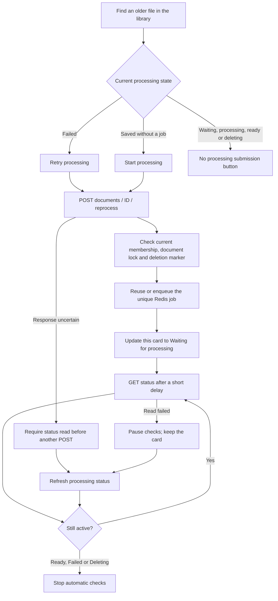

# Phase 5, Step 5.3: retry older documents from the library

## Where we are

```text
Phase 4: Organization management DONE
  -> Phase 5: Document management
       5.1 Paginated library DONE
       5.2 Coordinated deletion DONE
       5.3 Library retry controls DONE (this lesson)
  -> Phase 9, Step 9.1: private conversation deletion NEXT
```

## The problem and an example

Suppose yesterday's `handbook.txt` failed to process while a service was unavailable.
The file is still saved. Previously you could retry only the latest upload displayed
on its upload page. Now you can find yesterday's file in the library and select
**Retry processing handbook.txt**. You do not have to upload a second copy.

If the file is saved but has no queue job, the button says **Start processing**.
Both actions reuse the existing document ID and saved file.

## What the button actually does



**POST** asks the backend to change processing state by submitting an instruction.
**GET** asks what happened. These are different actions. We may repeat GET to monitor
progress, but we must not automatically repeat a POST after losing its response.
Redis might already have accepted the job even if the browser did not receive its acknowledgement.

The worker then reads the saved file, extracts its text, rebuilds chunks and embeddings,
and records the outcome. Pressing Retry does not itself parse a document in the API request.

## When each control appears

| State observed by the screen | Available action |
| --- | --- |
| FAILED and server says canRetry | Retry processing |
| NOT_QUEUED and server says canRetry | Start processing |
| QUEUED, PROCESSING, RETRYING | Refresh status; no duplicate submission |
| READY | Refresh status; no reprocessing |
| UNAVAILABLE | Refresh status; no unconfirmed submission |
| DELETING | No processing controls; deletion cleanup remains separate |

The screen requires both an eligible state and the backend's `canRetry` flag. A stale
or inconsistent flag cannot expose retry for a deleting document. The backend also
checks again before changing Redis.

## Membership and duplicate protection

All current organization members can process saved documents, consistent with the
existing upload/retry workflow. Deletion remains limited to owners and administrators.
The retry endpoint now checks current membership before looking up queue state and
again under the organization lock before submission. An old token does not restore
a removed membership.

Submission shares the document lock with deletion. It rechecks that the record is
not marked for deletion and is not already completed. A stale status read cannot
override those checks. Document IDs and organization IDs define unique Redis job IDs;
the existing queue protects against duplicate processing instructions. A retained
failed job is retried atomically instead of creating another job.

The file remains in its current library position. Retrying an entry loaded through
Load more does not discard earlier pages or return to the newest page.

## Automatic checks and recovery

After a successful retry, the card begins status reads about two seconds apart.
Each next read is scheduled after the prior response. Status temporarily unavailable
uses a five-second interval. Terminal outcomes stop the checks.

Documents explicitly refreshed from their cards also start monitoring if active.
Opening the library alone does not start polling every saved file. Refresh library
still updates the full newly loaded page.

A failed read pauses monitoring and preserves the last successful card. Select
**Refresh processing status for ...** to resume. A failed retry acknowledgement
disables another submission until a successful status read confirms the current state.
Navigation or organization switching aborts browser requests and ignores late results.
The saved job can continue in the background.

If the same document appears in the latest-upload panel, a library action also updates
that panel so it does not keep showing its earlier failed state. Latest-upload polling
remains available as before.

## A retry cannot repair every file

A temporary outage may be solved by trying again once the service is available. A
malformed PDF, scanned file without extractable text, or missing stored file can fail
again. Retrying reuses that same input; it does not repair the document. Where the
input is the problem, obtain a usable document and upload it. An owner/admin can
delete an unwanted broken entry through the confirmed deletion workflow.

## Try it yourself

1. Restart the backend and reload the frontend to use the current code. Keep Redis
   and the document worker running.
2. Open Documents and locate a saved FAILED or NOT_QUEUED file; use Load more if needed.
3. Select Retry processing or Start processing on that card.
4. Observe Waiting, Processing, and the final outcome without selecting the file again.
5. If checks pause, use that card's Refresh processing status button.
6. Confirm that a ready or deleting file has no processing submission button.

## Implementation and verification

- `frontend/src/features/documents/LibraryProcessingActions.tsx`: per-document retry,
  refresh, polling, controlled errors and cancellation.
- `DocumentLibrary.tsx`: in-place status updates and eligible processing controls.
- `DocumentsPage.tsx`: synchronize changes with the latest-upload panel.
- `backend/src/document/document.controller.ts`: current-membership check before retry.
- `backend/src/document/document.deletion.ts`: recheck membership and completed/deleting
  state under the shared submission lock.
- Existing retry integration fixtures now create actual memberships. A new case checks
  that removing a member prevents an old signed token from submitting work.

Verified on 2026-10-25: both builds and changed-file lint passed, along with all 26
backend deletion/library/status/retry tests and all 27 browser document tests (six new
library retry scenarios). Backend tests use real PostgreSQL, Redis and authenticated
HTTP. Browser tests use mocked HTTP. No combined live browser-to-worker journey was
run in this step; the existing queue retry and duplicate protection checks passed.

The browser checks cover regular-member retry, unchanged queue states across polls,
scheduled retries, eligibility rules, deletion blocking, uncertain acknowledgements,
poll recovery, older-page retention and ignoring late navigation results.

Phase 5's planned local workflow is now complete. Cloud storage remains Phase 18;
pending deletion cleanup still requires the explicit Finish deletion action.
