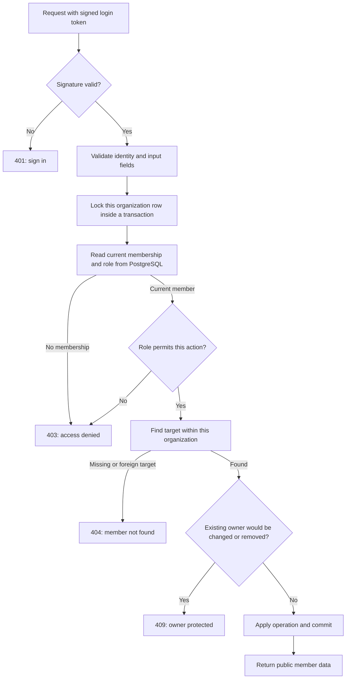
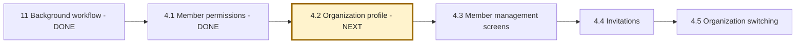

# Phase 4, Step 4.1: who can manage organization members?

Completed and verified locally on **2026-10-25**. Next: **4.2, organization profile API and screen**.

## Why we returned to Phase 4

Phase 11's background document workflow is complete for the documented local scope.
The roadmap deliberately returns to unfinished organization, document-library and
chat features before Phase 12. This step establishes member-management rules before
we build screens that let users perform those actions.

Example: NexaAI has two organizations, North Team and South Team. A North Team member
may see their teammates, but cannot promote themselves or change South Team's members.
An administrator manages regular members; an owner controls elevated roles.

**Input:** a signed login token, the requested operation, and its member ID or email.
**Output:** the permitted operation's result, or a controlled rejection with no change.
The organization comes from the verified token, never an organization ID in the body.

## Authentication and authorization are different

**Authentication** checks who sent the request. Our JWT signature establishes that
the login token came from the application. A **JWT** is a signed token containing
claims such as the user's ID, organization ID and role at the time of login.

**Authorization** checks what that person may do now. Suppose Priya signed in as an
administrator at 9 AM, then an owner demoted her at 10 AM. Her old token still says
ADMIN. The member-management service now reads her actual database membership before
deciding whether to allow a change. The old role claim cannot preserve her authority.
Similarly, a newly promoted owner can use their new permission even if their token
still contains a lower role.

## Permission table

These rules apply to the current organization member APIs:

| Action | MEMBER | ADMIN | OWNER |
| --- | --- | --- | --- |
| View current organization's members | Yes | Yes | Yes |
| Add an existing user as MEMBER | No | Yes | Yes |
| Add an existing user as ADMIN or OWNER | No | No | Yes |
| Change a MEMBER/ADMIN role | No | No | Yes |
| Promote a non-owner to OWNER | No | No | Yes |
| Remove a MEMBER | No | Yes | Yes |
| Remove an ADMIN | No | No | Yes |
| Remove or change an existing OWNER | No | No | No |
| Manage another organization's membership ID | No | No | No |

A person whose membership has been removed cannot even list that organization's
members with an old token. Administrators cannot promote themselves or remove another
administrator. There is no separate self-service leave action in these endpoints.

**Owner protection preserves the existing policy:** all owners are protected, not just
the last one. Multiple owners may be assigned, but these APIs cannot reverse an owner
assignment. Ownership transfer, owner removal and account deletion need a separately
designed workflow; they are not implemented here.

## Request flow



Text route: **verify login -> validate input -> check current membership -> check role
-> find scoped target -> protect owners -> save**. Listing members follows the current
membership check and returns the organization's public member list without a target lookup.

## Why a database lock is needed

Consider two requests at the same instant:

1. An owner promotes Alex from MEMBER to OWNER.
2. An administrator removes Alex after seeing an earlier MEMBER record.

Without coordination, the removal could use the old role and delete the newly promoted
owner. A **row lock** makes member-management operations for the same organization
take turns. A **transaction** keeps the permission check and the change together.

If promotion happens first, removal reads OWNER and is rejected. If removal happens
first, promotion finds no membership and is rejected. The actor's own current role
is also checked after acquiring the lock, protecting against concurrent demotion or
revocation through these APIs. Different organizations lock different rows.

The code uses a small parameterized `SELECT ... FOR UPDATE` because Prisma has no
row-lock method. Normal reads, additions, updates and deletions still use Prisma
methods. This is a short transaction, with no file processing, network AI calls or
other slow work inside it. Future membership-writing paths must use the same protocol.

## Gaps fixed

- Organization mutation routes previously trusted the role stored in the token.
  Services now authorize using the current database membership inside the transaction.
- Administrators could add a user directly as OWNER through the add-member endpoint.
  Adding elevated roles is now owner-only, as are role changes and admin removal.
- A removed user with a valid old token could list members. Listing now checks membership.
- Email, role and member-ID input validation now rejects invalid types and values.
- Missing/foreign targets return 404, forbidden actions 403, duplicate membership and
  protected-owner changes 409, invalid input 400, and missing identity 401.
- Unexpected errors return generic 500 messages rather than raw database exceptions.
- Member responses select public user fields and do not return password hashes.

The add-member endpoint still adds an **already registered** user. Invitations and
acceptance are a later step. This change does not send emails or invitations.

## Code locations

| File | Responsibility |
| --- | --- |
| `src/organization/organization.routes.ts` | Require authentication; delegate current-role decisions to services. |
| `src/organization/organization.controller.ts` | Validate inputs, pass the actor's ID and map safe HTTP errors. |
| `src/organization/organization.service.ts` | Lock, read current membership, enforce roles and owner protection, apply changes. |
| `tests/organization.permissions.integration.test.cjs` | Exercise actual HTTP routes, signed tokens and PostgreSQL fixtures. |

The general `authorize` middleware was not changed. This step replaces token-role
checks for organization member routes only. It is not a claim that every document,
authentication or chat endpoint now checks revoked membership; that wider review
remains in Phase 14.

## Validation and how to repeat it

The backend TypeScript build passed. The permission integration suite reported
**10 tests passed, 0 failed**: nine scenarios plus their parent test.

Verified: safe same-organization listing; regular-member denial despite an OWNER
token claim; admin restrictions; owner role changes and owner protection; immediate
denial after demotion/removal; foreign member IDs and body overrides; malformed
inputs; duplicate additions; and promotion/removal concurrency.

Run from `backend` with local PostgreSQL available:

```powershell
npm.cmd run test:organization-permissions
```

The test creates temporary organizations/users, makes real HTTP requests, and removes
its fixtures afterwards. It uses no Redis, browser, Gemini quota or real member changes.
No database migration was needed. Important permission and transaction code has comments.

## Existing removal behavior to understand before the UI step

The schema already cascades membership deletion to that member's private conversations
and messages in this organization. Removing membership does not delete the user account
or their memberships elsewhere. This step preserves that behavior. The future member
screen must explain the conversation impact before offering removal; changing retention
would require a separate schema/product decision.

## Locate the next step



Step 4.2 will define who may view/edit the organization profile, add its API, and
connect a screen. This step does not add that screen or start member-management UI work.
Use [the main roadmap](../../NEXAAI_ROADMAP.md) as the current phase pointer.
