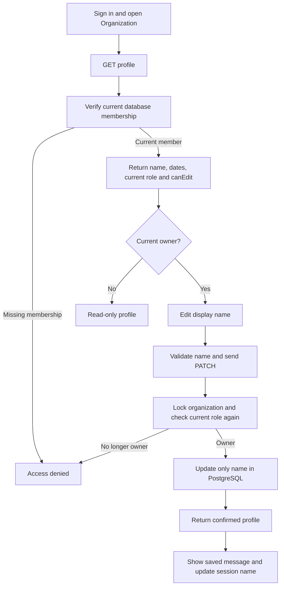
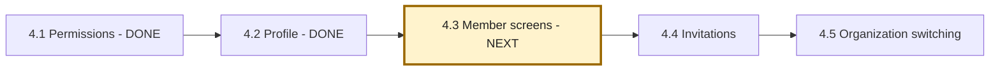

# Phase 4, Step 4.2: organization profile

Implemented on **2026-10-25**. Next: **4.3, member-management screens**.

## What this step gives you

After signing in, select **Organization** in the navigation. The new profile page
shows the organization name, your current role, and its creation date. Owners also
see a form for changing the display name. Administrators and members see a read-only
profile with an explanation of who can edit it.

Example: an owner changes "Demo Team" to "Nexa Support". This renames the existing
organization; it does not create a different organization or move its documents.
After the server confirms the save, the current browser session uses the new name
on Dashboard, Documents and Chat as well.

**Input:** the signed-in identity and, when saving, the new display name.
**Output:** the saved profile and whether the current user may edit it.

| Person | View profile | Change name |
| --- | --- | --- |
| Current member | Yes | No |
| Current administrator | Yes | No |
| Current owner | Yes | Yes |
| Removed member or someone outside this organization | No | No |

## Follow the flow



Plain-text route: **open profile -> check membership -> show details -> owner edits
-> validate -> check owner permission again -> save -> update the screen**.

## Understand the important parts

**GET** reads information. **PATCH** updates selected fields of an existing record.
The new endpoints are:

```text
GET   /api/v1/organizations/profile
PATCH /api/v1/organizations/profile
```

The PATCH body contains only the requested name:

```json
{ "name": "Nexa Support" }
```

The backend gets the organization ID from the verified login token. It does not take
an organization ID from the body. Extra fields such as `slug`, `role` or
`organizationId` are rejected rather than applied to the database.

**The display name is different from identity.** The organization ID is the database
identity connecting members, documents and conversations. The existing slug is also
preserved. Changing a label should not break those relationships. The screen does
not expose ID or slug editing, and this step needs no database migration.

**A visible edit form is not authorization.** Someone could send a PATCH request
without using the screen, or lose owner permission after opening the form. Therefore
the backend checks the current membership and OWNER role on every save, using the
same organization lock as Step 4.1. The browser's `canEdit` flag only controls what
the screen displays; the server makes the permission decision.

**Confirmed state differs from a draft.** Typing a name changes only the input.
Other pages receive the new name only after a successful server response. If saving
fails, the draft remains available, and the screen asks you to reload to check the
saved result. Reload intentionally replaces the draft with the stored profile.

## Validation and failure behavior

- Names must contain 1–100 characters after trimming surrounding whitespace.
- Blank names, non-string values, control characters and extra request fields are rejected.
- Frontend checks provide immediate feedback; backend checks enforce the rules.
- A profile response for a different organization is rejected by the screen.
- A failed load offers Reload profile. A failed save does not claim success or retry automatically.
- If saving returns 403, the edit form disappears and the user is asked to reload.
- Navigating away aborts the browser request and ignores late results. A save already
  accepted by the backend may still finish; revisiting reloads the stored profile.
- Renaming updates the current browser's shared organization name. Other users or
  tabs see it when they load the profile or sign in again; there is no live broadcast.

Only the display name is editable in this step. Descriptions, logos, contact details,
slug editing and ownership transfer are outside this implementation. Simultaneous
owner renames are serialized; the last successful save determines the name.

## Where the code lives

| File | Responsibility |
| --- | --- |
| `src/organization/organization.routes.ts` | GET and PATCH profile routes behind authentication. |
| `src/organization/organization.controller.ts` | Validate name-only input and return controlled errors. |
| `src/organization/organization.service.ts` | Check membership/owner permission, read profile and update only its name. |
| `frontend/src/features/organization/OrganizationPage.tsx` | Load, read-only/edit states, validation, saving and cancellation. |
| `frontend/src/features/auth/AuthProvider.tsx` | Share the confirmed organization name across the current session. |
| `frontend/src/services/api.ts` | Allow authenticated PATCH requests through the existing API client. |

The shared authenticated request callback is stable across profile-name updates.
This prevents a profile refresh from repeatedly starting itself when the session
name changes. Existing session checks still reject responses belonging to an old session.

## Try it yourself

1. Start the backend and frontend as usual, then sign in as an owner.
2. Select **Organization**. Confirm the name, current role and creation date.
3. Enter a different display name and choose **Save organization name**.
4. Wait for **Organization name saved**, then open Dashboard and check the name there.
5. Return to Organization or sign in again; the saved name should still appear.
6. Sign in as a current member or administrator to verify the read-only view.

Use fictional test organizations when experimenting with names. Automated tests create
and remove their own fixtures and do not rename your existing organization.

## Verification

Backend TypeScript and frontend production builds passed. The changed frontend code
passed ESLint after correcting the control-character validation implementation.

- **16 backend tests passed** across profile and existing member-permission suites
  (14 scenarios plus their two parent tests). These use real HTTP, JWT and PostgreSQL.
  They cover role access, stale OWNER claims, removed membership, cross-organization
  attempts, name validation, stable identity and preserved memberships.
- **32 Chrome browser tests passed**, including the five new profile scenarios and
  existing authentication, navigation, documents, chat and history tests. The five
  profile scenarios were rerun after the validation adjustment, including a control
  character case. Browser tests use mocked HTTP responses, not real user accounts.
- No Gemini calls or Redis jobs are needed for this step. A full live browser-to-database
  profile test was not run; backend persistence and browser behavior were verified separately.

Repeat the backend checks from `backend`:

```powershell
npm.cmd run test:organization-profile
```

Repeat the focused browser checks from `frontend`:

```powershell
node node_modules/@playwright/test/cli.js test tests/browser/organization.spec.ts --workers=2
```

## Position in the roadmap



Next we will make the existing member APIs usable through a screen: view teammates,
add an existing user, change permitted roles and remove permitted memberships.
The Step 4.1 permission table remains the authority for those operations. Member removal
currently deletes that membership's private conversations, so its screen must explain
that effect before the user confirms removal. See [the roadmap](../../NEXAAI_ROADMAP.md).
