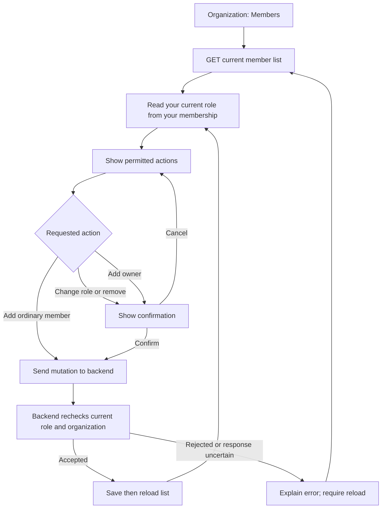

# Phase 4, Step 4.3: manage teammates from the screen

## Where we are

```text
4.1 Permission rules DONE
  -> 4.2 Organization profile DONE
  -> 4.3 Member-management screen DONE (this lesson)
  -> 4.4 Invitations with expiry NEXT
  -> Remaining Phase 4 work in NEXAAI_ROADMAP.md
```

## What problem does this solve?

Previously the backend could manage memberships, but people had no screen for it.
Open **Organization -> Members** to see teammates and the actions your current role permits.

Think of an organization as an office. A **user account** identifies a person;
a **membership** is their access badge for one office. A **role** describes what that
badge allows. The membership ID and the user ID are different: changing a badge
must not change the person's account or their access to another office.

| Your role | View teammates | Add registered account | Change roles | Remove membership |
| --- | --- | --- | --- | --- |
| MEMBER | Yes | No | No | No |
| ADMIN | Yes | As MEMBER only | No | MEMBER only |
| OWNER | Yes | Any role | Non-owner targets only | Non-owner targets only |

Existing owners are protected, even if there are several owners. Assigning OWNER
requires confirmation because the current application cannot reverse that assignment.

## Example: add Ravi to a support team

1. Ravi already has a NexaAI account, using `ravi@example.invalid` in this fictional example.
2. An administrator enters Ravi's registered email and selects MEMBER.
3. The browser sends `POST /api/v1/organizations/members` with the email and role.
4. The backend reads the administrator's current membership, checks permissions,
   finds Ravi's account, and creates a membership in the administrator's organization.
5. The browser reads the member list again. Ravi appears with the saved role.

An **API request** is a message from the screen to the backend. GET reads a list,
POST adds a membership, PATCH changes its role, and DELETE removes it.
The existing backend uses Prisma database methods for these operations; no new raw SQL
was introduced for this screen.



## Why check permissions twice?

The screen hides actions using the latest member list, which makes it understandable.
The backend enforces permissions, which makes it secure. Someone could modify a browser,
or an owner could demote an administrator while their page is open. An old login token
does not overrule the current database membership.

Responses from a different organization, malformed member records, duplicate identities,
and lists missing your own membership are rejected before displaying the list.
An empty list is invalid here: a person allowed to view an organization must themselves
be a member. A failed load offers Reload members.

## What removal means

Removing Ravi's membership deletes his private conversations, messages and associated
message sources **in this organization**, through existing database relations.
It leaves his user account and memberships in other organizations intact.
The screen names the target, explains the deletion, and requires confirmation.
Cancel sends no DELETE request. Use disposable test memberships when practicing removal.

If a request loses its response, the server might already have saved the change.
The screen therefore does not retry automatically. Reload first to see the actual state.
Buttons are disabled during a write; leaving the page cancels the browser's wait and
ignores late results. Cancelling that wait does not guarantee rollback on the server.

## Try the screen

1. Sign in, open Organization, then Members. Check your current role and teammates.
2. With an owner/admin account, add another registered test account as MEMBER.
3. As an owner, change that test membership to ADMIN and confirm; check the refreshed role.
4. Open its removal confirmation and choose Cancel. Verify the person remains listed.
5. Only for a disposable membership, confirm removal and check the refreshed list.
6. Sign in as a regular member: the list is visible and management controls are absent.

## Implementation and validation

Verified on 2026-10-25: frontend production build, backend TypeScript build, lint
on changed TypeScript files, all 39 browser tests (7 new member-screen scenarios),
and all 16 backend organization tests passed. Two existing retry tests now keep
their mock failure active until explicit retry, so repeated mount reads cannot
consume the intended failure. Browser checks use mocked HTTP; backend checks use
the real database. A combined live browser-to-backend member journey was not run.

- `frontend/src/features/organization/MembersPage.tsx`: fresh role checks, forms,
  confirmations, scoped response validation, reload and error handling.
- `frontend/src/features/organization/OrganizationPage.tsx` and `frontend/src/App.tsx`:
  link and protected route.
- `frontend/src/services/api.ts`: DELETE support through the existing authenticated client.
- `frontend/tests/browser/members.spec.ts`: browser checks using mocked HTTP responses;
  these exercise the screen without deleting real memberships.
- Existing backend organization integration tests exercise actual HTTP/JWT/database
  permission enforcement using isolated fixtures.

This step adds existing accounts directly. It does not email anyone, let users switch
organizations, or implement invitation acceptance. Step 4.4 will introduce an invitation
that a recipient can accept before it expires.
