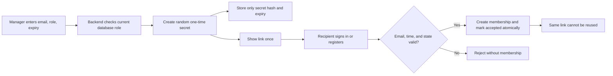

# Phase 4, Step 4.4: expiring organization invitations

## Where we are

```text
4.1 Permission rules DONE
  -> 4.2 Organization profile DONE
  -> 4.3 Member-management screen DONE
  -> 4.4 Expiring invitations DONE (this lesson)
  -> 4.5 Organization switching NEXT
```

## Why invitations are different from adding a member

Step 4.3 can add an account that already exists. An invitation gives one named email
address time to decide whether to join. It also works when the recipient needs to create
their account.

Example: an administrator invites `ravi@example.invalid` as MEMBER for seven days.
NexaAI produces a link, but does not email it. Ravi opens it and either signs in with
that exact email or creates an account. Acceptance creates the organization membership.



## New terms

- A **token** is the random secret inside the invitation URL. It is 32 random bytes,
  encoded as 43 URL-safe characters, so guessing it is impractical.
- A **hash** is a one-way fingerprint. PostgreSQL stores the SHA-256 fingerprint,
  not the token. List APIs never return either value. The original link is shown once.
- **Expiry** is the deadline after which acceptance returns `410 Gone`.
- **Atomic** means account/membership creation and token consumption succeed together.
  A partial failure cannot leave a new account without the invited membership.

## Permission rules

| Current database role | Create MEMBER invite | Create ADMIN/OWNER invite | List/revoke invites |
| --- | --- | --- | --- |
| MEMBER | No | No | No |
| ADMIN | Yes | No | Yes |
| OWNER | Yes | Yes | Yes |

The backend reads the current membership under the organization lock. An old JWT that
claims OWNER does not restore removed permissions. The invitation is bound to one
normalized email and one organization. Another signed-in email receives 403.

An active duplicate invitation is rejected. A manager may revoke an unused invite.
Expired, revoked, and accepted links cannot create memberships. A database row lock
ensures that two simultaneous acceptance clicks create exactly one membership.

## Existing and new recipients

An existing user signs in, returns to the invitation URL, and accepts. Their current
workspace remains open because selecting between multiple memberships is Step 4.5.

A new user follows **Create account**. The registration form does not ask for an
organization name. It creates the account directly in the invited organization and
signs in there. Registration also consumes the invitation, so no second acceptance is needed.

## What was implemented

- `OrganizationInvitation` table plus migration, foreign keys, indexes, normalized-email
  and expiry constraints.
- Create, list, revoke and accept APIs, plus invitation-specific registration.
- Organization -> Members -> Invitations screen with role and expiry selection,
  one-time link display, recent state, and revocation.
- Public acceptance landing page that preserves the token through sign-in or registration.
- Comments beside token hashing, transaction locking, auth return validation, and
  atomic registration code.

The app does not send an email. Copying the created link to the recipient is still a
manual action; connecting an email provider would be a separate external integration.

## Validation evidence

Verified on 2026-10-25 with the real PostgreSQL database:

- The additive migration applied successfully to local `nexaai`.
- Backend TypeScript build passed.
- 22 backend organization tests passed, including 5 invitation scenarios.
- Frontend production build and changed-file lint passed.
- Four invitation browser scenarios passed with mocked HTTP: create, revoke,
  existing-account acceptance, and direct invited-account registration.
- All 43 browser regression tests passed.

The test users and invitations are isolated fixtures and are deleted after testing.
