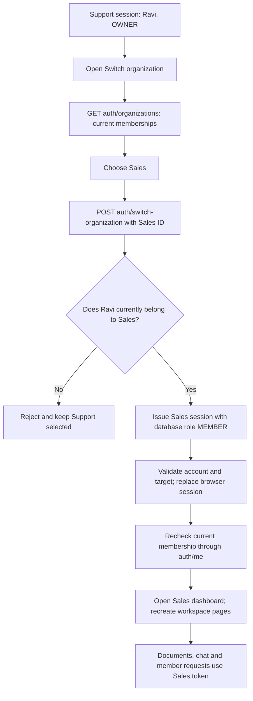

# Phase 4, Step 4.5: switch between organizations

## Where we are

```text
4.1 Permission rules DONE
  -> 4.2 Profile DONE
  -> 4.3 Members DONE
  -> 4.4 Invitations DONE
  -> 4.5 Organization switching DONE (this lesson)
  -> Phase 5, Step 5.1: document library NEXT
```

## The problem, using an example

Ravi has one account and two memberships:

| Account | Organization | Role | Data Ravi should see while selected |
| --- | --- | --- | --- |
| Ravi | Support | OWNER | Support documents and Ravi's Support conversations |
| Ravi | Sales | MEMBER | Sales documents and Ravi's Sales conversations |

The account identifies Ravi. The selected organization decides which workspace his
requests belong to. His role can differ between teams. Being an owner in Support
does not make him an owner in Sales.

Previously login selected one membership and there was no screen to select another.
Open **Switch organization** in the navigation to see current memberships and choose
a team. The list includes only teams the signed-in account belongs to.

## What a scoped session means

The login token is a signed statement containing `userId`, `organizationId`, and `role`.
The browser sends this token with API requests. Changing a name or selected dropdown
in the browser cannot change the signed statement.

Switching asks the backend to check a target membership and issue a new token. The
backend takes the target role from PostgreSQL. It does not copy the previous role or
accept a role supplied in the switch request.



## Why both browser cleanup and backend checks matter

The backend prevents reading another organization's records. The frontend must also
stop showing data it already loaded from the previous team. When the session changes,
the app recreates route pages. Selected chats, upload results and drafts therefore
belong to one workspace and are discarded on leaving it.

Requests capture the session that started them. If a response arrives after logout
or after a different session takes over, it is ignored. Leaving the switch screen
aborts its browser request; a late switch response cannot sign the user back in.
Repeated switch clicks are disabled while a request is pending.

Saved conversations remain in their original organization. Switching does not move
or delete them. Switching also does not cancel a document job already queued for
the old organization; the job retains its original organization ID.

## Current membership and concurrency

The switch operation locks the selected organization's row before checking the
membership, using the same lock convention as member removal and role changes.
That prevents overlapping changes from making conflicting permission decisions.
Prisma methods read the membership and build the response; the small parameterized
`SELECT ... FOR UPDATE` exists because Prisma has no equivalent row-lock method.

`GET /auth/me` now reads the current membership role too. A removed membership returns
401, and an outdated role in an old token does not overrule that database lookup.
The account-level list/switch endpoints can still select a remaining membership
using a valid account token even if its previously active membership was removed.

An unknown target and an organization belonging to someone else both return the same
404 response. The switch body accepts only `organizationId`; account and role overrides
are rejected.

## Connection to invitations

After an existing account accepts an invitation, the acceptance page links to the
switcher. Reload the list if a new membership was added while the switcher was open.
New accounts created from an invitation already start inside the invited organization.

## Try it yourself

1. Use a test account with memberships in two organizations (add or invite it first).
2. Open Switch organization. Check each team and its role.
3. Select the other organization. Confirm its name and role on the dashboard.
4. Open Chat: only saved conversations for this account and this team appear.
5. Open Organization or Members and check the selected team's details.
6. Switch back. Saved conversations for the first team remain available there.

## Implementation and evidence

- `backend/src/auth/auth.service.ts`: list current teams, issue target session, and
  make initial login choice deterministic by membership creation time and ID.
- `backend/src/auth/auth.protected.route.ts`: account-scoped list/switch APIs, strict
  input checks, and current membership verification for `/me`.
- `frontend/src/features/organization/SwitchOrganizationPage.tsx`: selection, reload,
  pending state, controlled errors and request cleanup.
- `frontend/src/features/auth/AuthProvider.tsx`: validate switched identity and prevent
  old responses replacing another session.
- `frontend/src/App.tsx`: navigation and page reset when organization changes.

Verified on 2026-10-25: both production builds, changed-file lint, 28 backend organization
tests, and 5 new browser scenarios passed. Backend tests use real HTTP/JWT/PostgreSQL,
then use the selected JWT identity with the actual document/history services to verify
isolation. Browser tests use mocked HTTP to verify token replacement, role display,
draft/history reset, reload, stale membership rejection, logout during a switch,
verification gating and mobile layout. All 48 browser regression tests passed.

## Limits to understand

The selected organization is kept in memory, as is the existing login. Refreshing
requires signing in again. Login selects the oldest current membership; the app does
not yet remember the last selected organization across logins.

Switching replaces the browser's active token. It does not revoke previous signed
tokens or sessions in other tabs. Each token remains scoped to its own organization
until expiration, and supported permission checks continue to use current memberships.
Global token revocation is separate work.

Phase 4's planned steps are now complete. Step 5.1 adds a paginated document library,
so earlier uploaded documents can be listed with their latest preparation status.
