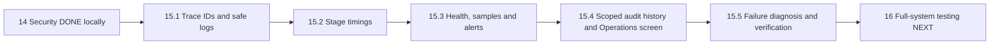
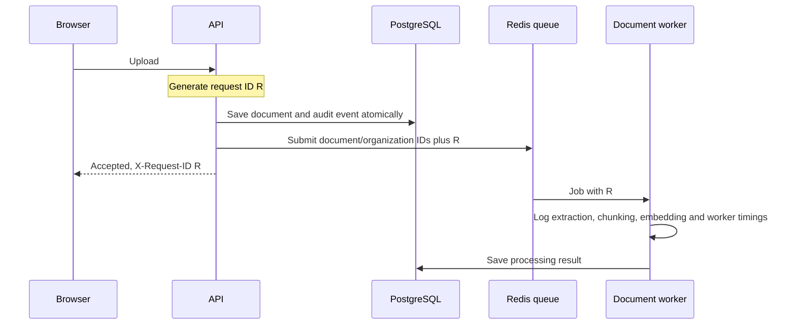
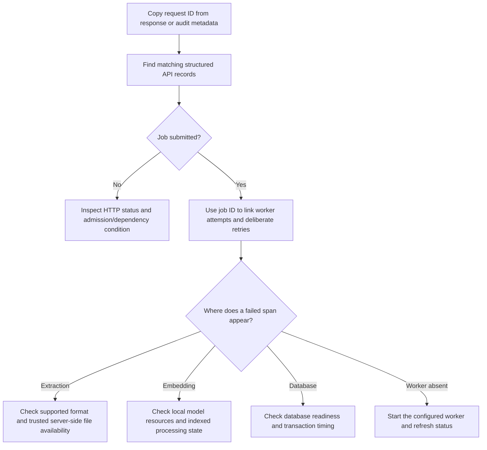

# Phase 15: monitoring, diagnosis and organization audit history

Implemented as one phase on **2026-10-27**. Changes are organized by the roadmap's
15.1–15.5 topics so they can be reviewed and committed separately later. No commits
are created by this implementation.

## Understand the two different records

Suppose Asha uploads a handbook and it fails to process.

**Monitoring logs** help the operator follow the request and worker attempts:
which stage ran, how long it took, and whether it failed. **Audit history** answers
who performed an important organization action, on which object, and when.
They have different purposes and retention. Neither needs a copy of the handbook,
question, password, invitation token or model response.



## 15.1: connect a request and its job

Each request receives a new server-generated UUID in `X-Request-ID`. A caller's
supplied ID is ignored, so they cannot impersonate another request's trace.
The header is exposed to the allowed browser origin. Safe browser `ApiError`
objects retain a valid UUID for support; arbitrary header text is discarded.

`AsyncLocalStorage` is Node's way to keep a small context attached to asynchronous
work. Two overlapping requests can await database/model work without swapping
their IDs. The context records validated user/organization IDs after authentication.
It is not an authentication mechanism; ordinary permission checks still apply.

New queue submissions persist an optional `requestId` alongside document and
organization UUIDs. The worker restores that context, adds job ID and current
attempt number, and emits its timing records. Jobs already in Redis without the
new field still work: they get a fresh worker trace and retain their stable job ID.



The HTTP receipt confirms queue admission, not successful extraction. A queue job
ID is stable for that document/organization while retained. Deduplicated submissions
and deliberate retries may have a new HTTP request ID while the job retains its
original request ID. `job_submitted` links the new request to that same job ID.
Attempt numbers are within the current BullMQ retry budget, not globally unique.

Structured records are JSON objects containing a timestamp, fixed event/stage
names, outcome, duration, status and approved identifiers. Logging uses a runtime
field allowlist, not a spread of request/error objects. It records static route
patterns such as `/:documentId/status`, not raw URLs, query strings or headers.
Unmatched routes use a fixed label. Aborted HTTP requests are distinguished from
completed responses. A throwing log sink cannot repeat/fail an accepted operation.

Logs go to stdout; this change does not build a private log-reading HTTP endpoint.
Some older fixed-text startup/error notices remain alongside the JSON records.
Third-party diagnostics are outside this logger's field contract. Protect access
to collected logs: UUID metadata is still operational data.

## 15.2: understand timings

| Stage | What it measures |
| --- | --- |
| `database` | Instrumented vector SQL, organization mutation transaction, operations reads, readiness query and worker document lookup |
| `retrieval` | Question embedding/cache lookup plus scoped vector retrieval for RAG |
| `embedding` | Query embedding/cache lookup, or worker chunk embedding |
| `generation` | RAG answer generation/validation or agent selection; empty-evidence fallback can be very fast |
| `extraction` | Reading/parsing a document into text |
| `chunking` | Preparing/persisting document chunks |
| `queue` | Queue-state inspection, or elapsed time from original job creation to worker start |
| `worker` | The whole processing attempt |

Durations use a monotonic clock where applicable and are milliseconds. Nested
spans overlap: do not add retrieval and embedding time together as independent
costs. Queue time from job creation includes elapsed retries/delays, so it is not
an isolated measurement of each retry's waiting time. These are selected useful
spans, not instrumentation of every Prisma statement or a full distributed APM
system. Redis/job metadata bridges the separate API and worker processes.

## 15.3: health is more than one green light

| Endpoint | Meaning |
| --- | --- |
| Existing `/api/v1/health` | Preserves its database-health contract |
| `/api/v1/health/live` | Process can answer HTTP; returns 200 without requiring dependencies |
| `/api/v1/health/ready` | Actual database query and Redis ping through the queue connection; returns 200 or 503 |
| `/api/v1/operations/summary` | Current-manager-only organization metrics, sampled queue states and alert conditions |

Readiness exposes dependency booleans only, never connection strings or exception
details. It does not spend an AI allowance. The DB probe response has a 5.5-second
outer deadline; existing queue connection/operation deadlines still apply. An outer
deadline does not cancel a command already submitted to a database driver.

Readiness does not require a worker: the API can accept queued work while a worker
is restarting. Worker availability is a separate observation. A failed worker
inspection is reported as **unknown**, rather than claiming no worker exists.

The Operations summary counts this organization's current non-deleting documents
and failed documents in PostgreSQL. It inspects queue states for the **50 newest**
eligible documents, marks partial samples, and groups states without returning
job payloads, stacks or document text. Missing retained jobs appear as `unknown`;
that alone does not mean a completed document failed. Document and queue statuses
are separate observations. Workers serve a shared queue; their availability is
service-level metadata, not a count of another organization's activity.

Alert conditions evaluated on each Operations read:

- `QUEUE_UNAVAILABLE`: a usable queue connection could not be confirmed.
- `NO_DOCUMENT_WORKER`: queue inspection succeeded and found zero workers.
- `WORKER_STATUS_UNAVAILABLE`: the queue responds but worker inspection failed.
- `DOCUMENT_FAILURES`: saved failed documents exist in this organization.
- `QUEUE_FAILURES`: failed jobs exist in the inspected sample.
- `BACKLOG_HIGH`: at least 20 sampled jobs are waiting/delayed.
- `JOB_STATES_UNAVAILABLE`: one or more sampled states could not be checked.

These are local actionable conditions, displayed on refresh. There is no email,
Slack notification, scheduled alert evaluator or hosted monitoring service in this
phase. Production notification delivery and threshold tuning need deployment/load
experience. A clean sample is not proof that an entire large queue is healthy.

## 15.4: organization audit history

The additive `AuditEvent` table stores event ID, organization UUID, actor UUID,
fixed action name, target UUID, optional request UUID and creation time. It has
organization/time indexes and an organization foreign key with cascading deletion.
Actors/targets are snapshots, not membership foreign keys: removing a membership
does not erase that organization's record of who changed it.

Audited database actions:

- Organization profile updates.
- Member addition, role changes and removal.
- Invitation creation, revocation and acceptance, including invited registration.
- Document persistence, deletion intent and completed deletion.
- Claiming a confirmed agent document retry request.

These events identify actions and objects; they are not full before/after snapshots
and do not store names, emails, invitation secrets, file paths or role descriptions.
No-op member role assignments do not create a role-change event. Retry events say
**requested**, not **processed**: the claim commits before Redis submission, which
can still fail or become uncertain. Existing agent execution receipts track that
separate outcome. Direct retry diagnosis also uses request/job logs; not every
read/authentication attempt has an audit event.

An audit write participates in the same transaction as its corresponding database
change. If it fails, that database change rolls back. PostgreSQL, Redis and files
cannot share that transaction: a committed deletion intent may remain while
external cleanup is pending, and request metadata cannot promise external delivery.

`GET /api/v1/operations/audit` returns at most 20 events, ordered by time and ID,
with an optional scoped cursor. There is no audit create/edit/delete HTTP API.
Only current OWNER/ADMIN members can read it, regardless of a stale JWT role.
Foreign cursors and missing cursors have the same response. The summary rechecks
manager access after Redis work. The audit list uses a transaction snapshot for
its membership and rows. This is application authorization, not tamper-proof
storage against a database administrator.

### Use the new screen

1. Sign in and open **Operations** in the workspace navigation.
2. As a current owner/admin, review document counts, queue/worker status and alerts.
3. Scroll to audit history. Actor, target and request IDs let an authorized operator
   link metadata without displaying private content.
4. Use **Load more audit events** for older pages (at most 200 loaded in the screen).
5. Use **Refresh operations** to discard old observations and verify access again.

All members can navigate to this route, but the server denies the data to ordinary
members. This avoids trusting a stale browser role to decide authorization. On
demotion, a fresh request clears previously displayed observations. In-flight
reads are cancelled on navigation/workspace changes. The screen does not push
live access changes to a browser that makes no further request.

## Retention and safe maintenance

The maintenance command defaults to **dry-run**, reporting counts only:

```powershell
# From backend; no rows are changed.
npm.cmd run maintenance:retention
```

The implemented policy selects audit events older than **90 days** and token
revocations whose token has already expired. It also identifies old FAILED-document
messages that predate the safe-message policy. Applying maintenance deletes the
selected old audit/revocation rows and replaces legacy failure messages with the
fixed safe category. It never deletes documents or private conversations.

Only an operator deliberately choosing to apply maintenance runs:

```powershell
npm.cmd run maintenance:retention -- --apply
```

No global cleanup was applied during implementation/testing. Nothing prunes on
API startup or viewing a page. Schedule the command through deployment operations
after reviewing retention needs and its dry-run counts. Until it is run, older
rows can remain. Redis queue retention remains its existing lazy policy: completed
jobs up to one day/1,000 entries and failed jobs up to seven days/1,000 entries,
pruned as jobs finish. Stdout collection/rotation is the deployment platform's
responsibility; this application does not create an unlimited log file itself.
Earlier Git history is not changed by retention.

## 15.5: diagnose a failed job

Example: a document references a missing local file. The verification submits it
through the real API, reads the resulting job's request ID, starts a real worker,
and observes three attempts ending in failure.



For collected stdout logs, an operator can use `rg '<request UUID>' api.log worker.log`
and then search the stable job ID for retries with different request IDs. Do not
paste document contents or credentials into support messages. The log tells which
stage failed, not arbitrary parser/driver details. A failed extraction spans both
file access and parsing; it is not a claim that every extraction failure is a
missing file. Check the trusted server environment when narrowing the cause.

The automated test verifies the same request ID on submission and worker records,
attempts 1/2/3, failed extraction timings, queue-failure alerts, and absence of a
private content/path/password canary and the session token from captured records.
Additional tests cover concurrent trace isolation, arbitrary-field rejection,
throwing sinks, atomic audit rollback, bounded/cross-tenant pages, late demotion,
dependency failure/unknown worker status, and retention dry-run preservation.

## Validation and scope

Run `npm.cmd run test:observability` for the focused backend checks, or
`npm.cmd run test:security` for the expanded regression gate. Chrome checks include
an actual profile rename appearing as an audit event with the response's request
ID, real manager demotion, mobile layout, controlled pagination, malformed data and
late responses. Fixture data and private queues are cleaned up without flushing
shared Redis or deleting developer documents.

The expanded backend regression gate passed **321 tests**. The focused observability
checks passed after final refinements, including a real worker failure across three
attempts. The Chrome regression passed 116 cases with one pagination fixture failure;
that fixture was corrected to page by cursor, and all four Operations cases then
passed (117 distinct browser cases covered across these runs). Twelve utility tests,
both production builds, changed-file lint and browser-test type checks passed.
This is a combined regression/focused result, not a claim of one clean 117-case run.
The migration has been applied locally and the Prisma client regenerated. In a
fresh environment, run Prisma generation and migration deployment before starting
this version. Logs are not an authorization mechanism or an exact-once delivery
ledger. There is no cross-process metrics aggregation, historical latency chart,
live semantic evaluation, secret rotation or production paging integration here.

## Next phase

**Phase 16, as a whole:** consolidate full-system verification, browser-to-backend
journeys, recovery/concurrency scenarios, live model quality evaluation and scoped
performance measurements. The roadmap retains its step labels for understanding
and later commits; implementation proceeds one complete phase at a time.
