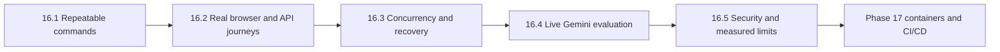

# Phase 16: full-system verification

Phase 16 answers a practical question: can we run one known set of checks before a
release and understand what passed, what failed, and what was never tested?

The phase does not add a user feature. It connects the existing unit, API,
PostgreSQL, Redis, browser, recovery, security, live-model and performance checks
into a repeatable release workflow.

## New terms in plain language

- A **fixture** is temporary, known test data. For example, a fictional handbook
  belonging to a random test organization. Cleanup removes only those exact IDs.
- A **regression gate** is one command that reruns behavior we already depend on.
  A later code change must not silently break login, upload, queueing or isolation.
- A **concurrency test** starts work at nearly the same time. It checks that five
  upload requests create one queue instruction rather than five duplicate jobs.
- A **recovery test** deliberately removes a test worker or connection and verifies
  that saved state can be understood and retried safely.
- **Median** is the middle measured response. **p95** is a useful slow-end sample:
  95 percent of the measured requests were no slower than that value. Twelve local
  requests are a smoke baseline, not enough to predict production capacity.

## 16.1: one repeatable command structure

The repository root now provides these commands:

| Command | Purpose |
| --- | --- |
| `npm run test:phase16:backend` | Build the backend and run every ordinary backend `*.test.cjs` file once. |
| `npm run test:phase16:frontend` | Build, lint, run browser utilities, then run the complete Chrome suite. |
| `npm run benchmark:phase16` | Measure bounded readiness and scoped-search fixtures. |
| `npm run verify:phase16` | Run both local gates and the benchmark in order. |
| `npm run evaluate:phase16:live` | Opt-in Gemini routing and RAG quality checks using synthetic data. |

The backend runner discovers ordinary test files and fails if discovery becomes
implausibly small or duplicated. Live tests are explicitly excluded from the normal
gate because a repeatable local regression should not unexpectedly spend Gemini
quota. Live evaluation remains a named release action.

## 16.2: browser to backend journeys

The 117-case Chrome run includes real shipped React pages. Integrated cases proxy
browser requests to isolated Express fixtures; authentication, current membership,
PostgreSQL, scoped Redis counters/queues and application routes remain real. The
provider text is controlled in ordinary browser tests so UI failures are repeatable.

Examples include:

1. Login, current-role verification and organization switching.
2. Agent document counts, cited answers, retry proposals and explicit confirmation.
3. Dashboard and Operations values from real scoped database records.
4. Upload, processing-state polling, library retry, chat history and deletion UI.
5. Demotion, membership removal, late responses and mobile containment.

The existing opt-in Phase 11 journey remains the deepest browser upload -> worker ->
Gemini -> saved-history check. Phase 16 did not repeat that paid journey merely to
inflate the normal browser count.

## 16.3: failures and recovery

The consolidated backend gate now includes the previously separate queue, worker,
pipeline and recovery suites. They prove:

- five concurrent submissions for the same organization/document create one job;
- a saved upload with an unavailable producer can be retried without uploading again;
- a lost enqueue acknowledgement does not cause an automatic duplicate submission;
- a killed test worker rolls back partial work, Redis redelivers it, and a deliberate
  retry succeeds after stalled attempts are exhausted;
- a disconnected producer can be replaced, and a later request recovers after failed
  startup;
- concurrent document processing, membership changes, invitation acceptance,
  conversation writes and confirmations remain bounded by database rules.

Every queue has a random test-only name. Cleanup verifies that name before removing
it and never flushes shared Redis or deletes developer documents.

## 16.4: live Gemini evaluation

The agent evaluation sends seven synthetic requests to the configured
`gemini-3.1-flash-lite` model. All seven passed:

- knowledge question -> `knowledge_answer`;
- current failed-document count -> `document_counts`;
- unsupported date/person filters -> clarification;
- one explicit document ID -> retry proposal selection with the ID bound by server code;
- retry by filename without an ID -> clarification;
- destructive/email action -> unsupported;
- prompt/SQL/other-organization attack -> unsupported.

No tool is executed by this selector evaluation. Local authorization tests prove
that a selection still cannot grant permission or confirm a write.

The RAG evaluation uses real HTTP, JWT validation, PostgreSQL/pgvector retrieval,
local embeddings and Gemini with fictional documents. Its four final cases passed:
supported answer with source, unrelated question without a provider call, partial
answer that states missing carry-over evidence, and conflicting 18/25-day evidence
with both sources. A 99-day distractor in another organization never entered the
evidence sent to Gemini.

Reports are written to [agent-evaluation-latest.json](agent-evaluation-latest.json)
and [rag-evaluation-latest.json](rag-evaluation-latest.json). They contain synthetic
test material and generated fixture IDs, not credentials or user documents.

## 16.5: security gate and measured local limits

The final backend gate passed **343 tests from 45 test files**. It includes tenant
isolation, current permissions, session revocation, request boundaries, safe errors,
rate limits, cache scope, audit access, queue payloads and private-data canaries.

The full Chrome gate passed **117/117** cases in one run. Frontend build, lint and
**13/13** utility tests also passed.

The local performance profile measured one Node API with local PostgreSQL/pgvector
and Redis, controlled provider output, and a warm deterministic embedding fixture:

| Operation | Samples | Median | p95 |
| --- | ---: | ---: | ---: |
| Dependency readiness | 12 | 15.95 ms | 31.12 ms |
| Scoped document search | 12 | 29.11 ms | 37.61 ms |

Five concurrent scoped searches completed in **319.85 ms**, and repeated searches
used one query-embedding inference. Every measured request had a five-second safety
deadline. The machine-readable result is in
[phase-16-performance-latest.json](phase-16-performance-latest.json).

These numbers do not establish user capacity. The sample is small, local networking
is faster than production, provider generation is controlled, and the run does not
measure large organizations, large PDFs, many workers, storage latency or sustained
load. Phase 17 will make checks reproducible in containers/CI; Phase 18 will measure
the selected production environment.

## What was corrected during validation

The existing RAG evaluator still sent an `organizationId` body override. The strict
API correctly rejected that obsolete field with HTTP 400, so the evaluator now lets
the verified JWT supply organization scope. A partial-answer wording check also
accepted `carry` but not the valid phrase `carried over`; the expression now accepts
both. These were test-harness corrections, not relaxed application boundaries.

## Manual release checklist

1. Ensure local PostgreSQL/pgvector and Redis are running.
2. Run `npm run verify:phase16` from the repository root.
3. Review the performance report against its documented local profile.
4. When live-model evidence is needed and quota is acceptable, run
   `npm run evaluate:phase16:live` and inspect both reports.
5. Confirm fixture cleanup completed and `git status` contains only intended work.
6. Record environmental limitations instead of presenting a local pass as production readiness.

Phase 16 is complete for this documented local environment. The next complete phase
is Phase 17: application containers, local multi-service startup, CI checks, required
configuration validation, migration and rollback procedures.
