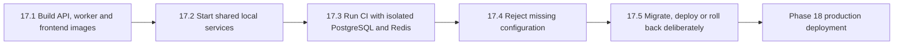
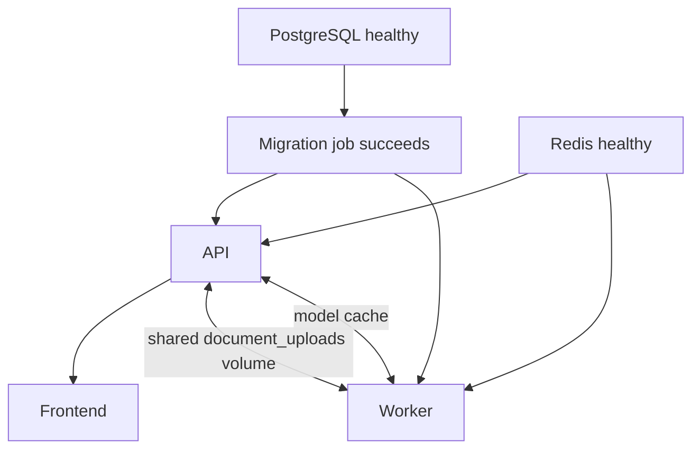

# Phase 17: containers and automated delivery checks

Phase 17 makes a verified checkout reproducible. A container is a packaged process
with its runtime files. CI (continuous integration) runs checks automatically after
a push or pull request. CD here means a documented, approved delivery path; this
phase does not deploy NexaAI to a public host.



## 17.1: what each image contains

The backend Dockerfile uses several stages:

- `build` installs locked dependencies, generates Prisma Client and compiles TypeScript;
- `migration` retains the Prisma CLI and migrations for one controlled schema job;
- `runtime` contains production dependencies, compiled code and generated client;
- the same runtime image starts either the API or the document worker with a different command.

The runtime uses the unprivileged `node` account and has no source, tests, local env
files or uploaded documents baked into it. The frontend image validates the public
API URL, builds static files and serves them from an unprivileged Nginx image with
single-page route fallback and browser security headers.

The final local images were approximately 2.15 GB for API/worker, 711 MB for the
migration runner, and 74 MB for the frontend. The backend image is large because the
local embedding stack includes ONNX and native image libraries. The migration target
has its own small dependency manifest so it does not also carry that stack. Image-size
optimization remains useful before selecting and paying for a Phase 18 registry/host.

`VITE_API_BASE_URL` is public browser configuration. `GEMINI_API_KEY`, database URLs
and JWT secrets belong only in API/server configuration and must never use a `VITE_`
name.

## 17.2: local multi-service flow

The original `docker-compose.yml` still starts only PostgreSQL and Redis. The
`docker-compose.app.yml` overlay adds migration, API, worker and frontend services.



Copy `.env.container.example` to the ignored `.env.container`, replace every
placeholder, URL-encode special database-password characters in `DATABASE_URL`, then:

```powershell
npm run containers:config
npm run containers:build
npm run containers:up
npm run containers:smoke
```

Open `http://localhost:8080`. The API is on `http://localhost:5000`. `--wait` returns
only after the API readiness probe and frontend are healthy. Inspect bounded logs
with `npm run containers:logs`; stop containers with `npm run containers:down`.
That command intentionally preserves PostgreSQL, Redis, uploads and model-cache
volumes. Removing volumes is a separate destructive operation and is not part of
normal shutdown.

`containers:smoke` creates a disposable organization, account and TXT document to
prove worker processing. Use it with a disposable database when you want a clean
environment afterward; it does not call Gemini or print the generated credentials.

If those host ports are already in use, change `API_PORT`, `FRONTEND_PORT`,
`POSTGRES_PORT`, and `REDIS_PORT` in `.env.container`. The service-to-service URLs
still use `postgres:5432` and `redis:6379`; only access from the host changes.

The `document_uploads` volume is essential: the API writes the accepted file and the
worker reads the same path. This local-disk pattern works only when both processes
share storage. Phase 18 replaces it with object storage before independently scaled
hosts are considered.

Transformers.js stores downloaded local embedding models in the `model_cache` volume.
Without that writable path, a read-only worker would try to write under `node_modules`
and document preparation would fail. Local non-container runs use the ignored
`backend/.cache/transformers` directory, so `npm ci` no longer deletes the model.

## 17.3: automated GitHub checks

`.github/workflows/verify.yml` runs on pull requests, pushes to `main`, and manual
dispatch. It grants read-only repository permission and cancels an older run for the
same branch.

The application job creates isolated pgvector/PostgreSQL and Redis services, installs
locked dependencies, generates Prisma Client, applies migrations, runs the 343+
backend gate, installs Chrome, then runs the complete frontend gate. Live Gemini
evaluation is deliberately excluded: CI uses a synthetic unused key and cannot spend
provider quota. A second job builds the backend runtime/migration targets and frontend
image, catching Dockerfile or build-context failures.

A branch-protection rule can require this workflow before merging. Configuring that
GitHub repository setting is an external administrative action and is not performed
by this local implementation.

## 17.4: configuration and secret boundaries

API startup now rejects missing or malformed database/Redis URLs, short or placeholder
JWT secrets, missing provider keys, invalid ports, invalid usage limits, and missing
production origins. The worker requires only database and Redis settings; migrations
require only the database URL. Stable errors do not print secret values.

Useful checks:

```powershell
npm --prefix backend run config:check:api
npm --prefix backend run config:check:worker
npm --prefix frontend run config:check
```

Compose receives secrets at container start. Dockerfiles and images never copy
`.env*`. Git ignores `.env.container` while retaining the placeholder-only example.
For production, use the selected host's secret manager rather than committing or
placing long-lived secrets in a Compose file.

## 17.5: migration, release and rollback procedure

Before a release:

1. Back up the database and record the currently running image/tag.
2. Build immutable versioned images and run CI against the exact commit.
3. Run `npm --prefix backend run migrate:status` with the target database URL.
4. Run the one-off migration image/job. Do not start new API/worker containers if it fails.
5. Start the API, wait for `/api/v1/health/ready`, then start workers and frontend.
6. Verify login, one isolated upload/worker result, one cited question, Operations,
   and organization isolation before directing normal traffic to the release.

Prisma migrations are forward history. Never run `prisma migrate reset` against a
shared or production database. Rollback depends on what changed:

- For application-only failure, redeploy the previous image tag.
- For an additive/backward-compatible migration, keep the migrated schema and run
  the previous compatible image while preparing a forward fix.
- For an incompatible/destructive migration, stop writes, follow a reviewed manual
  recovery migration or restore the pre-release backup. Test that restoration first.

Deleting a migration file, manually editing Prisma's migration table, or deleting
volumes is not a rollback plan. Database restore credentials, retention and recovery
time targets are Phase 18 infrastructure decisions.

## Validation and limits

Validation completed on 2026-10-27:

- all three production images built and ran as non-root users;
- Compose started isolated PostgreSQL/pgvector, Redis, migration, API, worker and
  frontend services and reported them healthy;
- all 21 database migrations applied on a new empty database;
- the smoke script registered an account, loaded a nested frontend route, uploaded a
  TXT document, and observed the separate worker produce real embeddings and `READY`;
- the isolated containers, network and disposable test volumes were removed afterward;
- production npm audits reported zero known vulnerabilities for backend, migration
  and frontend dependency trees;
- the backend gate passed 346/346 tests from 46 files; frontend utilities passed
  15/15 and Chrome passed 117/117 after build and lint.

The workflow file is locally reviewable and its image/service behavior was exercised
through Compose, but its first hosted GitHub Actions run remains external evidence.

The container workflow is local/development packaging. Redis is unauthenticated inside
the private Compose network and PostgreSQL uses a local secret. There is no TLS proxy,
public domain, cloud database, backup schedule, object storage, image registry,
production secret manager, hosted CI result or deployment approval automation yet.
Those belong to Phase 18 and the chosen host.
