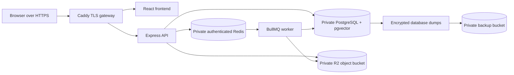

# Phase 18: production deployment

Phase 18 turns the verified containers into a small real-user deployment. The
repository implementation is complete; creating paid accounts, changing DNS and
running the live checks require the operator's domain and provider credentials.



In simple terms, the browser can reach only Caddy. Caddy provides HTTPS and
forwards a request to the correct container. Redis is the worker's durable to-do
list: the API adds a document-processing job and the worker takes it. R2 is the
shared locked file cabinet: the API puts the uploaded file there and a worker can
read it even if the processes run on different machines later.

## 18.1 Hosting, expected usage and cost boundary

The starting design targets a pilot of 1-20 people, up to 10 GB of documents,
up to 100 uploads per day, and one document worker. Use one x86 Hetzner CX43 in
Germany or Finland for the API, worker, frontend, PostgreSQL, Redis and Caddy.
The current listed server price is EUR 15.99/month before VAT and IPv4; Hetzner
server backups add 20% and retain seven daily slots. Set an infrastructure alert
at EUR 25/month before tax and a separate Gemini alert at USD 10/month. Stop and
resize or split services if sustained memory exceeds 75%, disk exceeds 70%, the
queue repeatedly reaches 20 waiting jobs, or API latency materially misses the
measured Phase 16 baseline.

Cloudflare R2 Standard currently includes 10 GB-month, one million Class A and
ten million Class B operations monthly, then charges by storage and operations
without egress fees. Gemini 3.1 Flash-Lite currently has a free tier; paid text
pricing is USD 0.25 per million input tokens and USD 1.50 per million output
tokens. Prices and quotas can change, so review the linked primary pages before
purchase:

- [Hetzner June 2026 cloud prices](https://docs.hetzner.com/general/infrastructure-and-availability/price-adjustment/)
- [Hetzner backup behavior and retention](https://docs.hetzner.com/cloud/servers/backups-snapshots/overview/)
- [Cloudflare R2 pricing](https://developers.cloudflare.com/r2/pricing/)
- [Gemini API pricing](https://ai.google.dev/gemini-api/docs/pricing)

This low-cost layout has one failure domain. It is suitable for a pilot, not a
high-availability promise. Growth should move PostgreSQL to a managed pgvector
service first, then Redis, while retaining the S3-compatible storage contract.

## 18.2 PostgreSQL and recovery

PostgreSQL 16 includes pgvector, stores data in a named volume and has no public
port. Only containers on the internal `data` network can connect. Use a random
database password, allow SSH only from the operator's IP in the cloud firewall,
and expose only TCP 80/443 publicly. Enable the provider's daily server backups.

`npm run production:backup` performs a second independent backup:

1. `pg_dump` writes a private custom-format dump.
2. `pg_restore --list` proves that the archive is readable.
3. Restic encrypts it and uploads it to a separate private R2 bucket.
4. Restic retains seven daily, four weekly and six monthly snapshots, prunes old
   data, then checks repository integrity.

Schedule it daily from root's cron after choosing a quiet UTC time:

```cron
17 2 * * * cd /opt/nexaai && /usr/bin/npm run production:backup >> /var/log/nexaai-backup.log 2>&1
```

Run `npm run production:restore-drill` monthly. It downloads the latest encrypted
snapshot, restores it into the fixed temporary `nexaai_restore_drill` database,
checks pgvector, Prisma migration history and a core table, then drops the drill
database. A backup is not proven until this drill succeeds.

## 18.3 Redis queue

Redis has a random password, no host port, append-only persistence with one-second
fsync, and `noeviction`. That last setting matters: deleting old keys to save memory
could silently remove BullMQ jobs. The API and worker use the authenticated
`redis://:password@redis:6379/0` URL. Redis is queue durability, while PostgreSQL
remains the final source of document status and saved answers.

## 18.4 Shared object storage

Set `DOCUMENT_STORAGE_DRIVER=s3` and the private bucket settings from
[`.env.production.example`](../../.env.production.example). The implementation:

- validates the file in memory before storing it;
- uses `documents/<organization UUID>/<document UUID>.<extension>` keys;
- never sends bucket credentials or object URLs to the browser;
- downloads at most 10 MiB to a mode-0600 temporary worker file;
- removes that temporary file after parsing;
- validates tenant ownership before reads or deletion;
- preserves a stored object when a database commit result is uncertain, then
  lets the existing recovery flow reconcile it.

Cloudflare R2 exposes an S3-compatible HTTPS API, so the same code supports S3 or
another compatible provider by changing configuration. Create a private document
bucket and a separate private backup bucket. Give the application key access only
to document objects and the backup key access only to the Restic bucket.

## 18.5 API, worker, migrations and images

GitHub's `Publish release images` workflow publishes runtime, migration and
frontend images tagged with the exact commit SHA after a version tag or manual
dispatch. Configure the repository variable `PRODUCTION_APP_DOMAIN` before the
frontend image is built. On the server:

1. Install Docker Engine with the Compose plugin and clone the verified commit to
   `/opt/nexaai`.
2. Copy `.env.production.example` to ignored `.env.production` and replace every
   placeholder. Keep three immutable image tags from the same commit.
3. Run `npm run production:config`.
4. Run `docker login ghcr.io`, then `docker compose -f docker-compose.production.yml --env-file .env.production pull`.
5. Run `npm run production:backup` before an upgrade when a database already exists.
6. Run `npm run production:up`. The migration job must finish before API/worker start.
7. Inspect bounded output with `npm run production:logs`.

The API readiness endpoint now checks PostgreSQL, Redis and the object bucket.
The worker receives database, Redis and storage settings only; it does not receive
JWT, Gemini or browser-origin secrets.

## 18.6 Domain, HTTPS and browser routes

Point the domain's A/AAAA record to the server. Allow inbound 80/443; Caddy uses
them to obtain and renew certificates. Set all three values to the same origin:

```text
APP_DOMAIN=app.example.com
API_ALLOWED_ORIGINS=https://app.example.com
VITE_API_BASE_URL=https://app.example.com/api/v1
```

Caddy routes `/api/*` to the API and other paths to Nginx. Nginx already returns
`index.html` for routes such as `/documents`, so browser refreshes do not produce
a 404. The browser never connects to database, Redis or storage ports.

## 18.7 Complete live verification

After DNS and TLS are active, run:

```bash
SMOKE_BASE_URL=https://app.example.com npm run production:smoke
```

The command verifies HTTPS health and a nested SPA route, creates two isolated
workspaces, uploads a TXT file, waits for the separate worker, asks a real grounded
Gemini question, reads the saved history, and proves the second workspace cannot
read the document or conversation. It intentionally retains the two audit fixtures;
record their returned document/conversation IDs, then remove them through normal
authorized application controls if desired.

## 18.8 Monitoring, release and rollback

Use an external HTTPS monitor against `/api/v1/health/live` every minute and
`/api/v1/health/ready` every five minutes. Alert on two consecutive readiness
failures. Review the owner/admin Operations screen for `QUEUE_UNAVAILABLE`,
`NO_DOCUMENT_WORKER`, `DOCUMENT_FAILURES` and `BACKLOG_HIGH`. Review container
restart counts, disk/memory use and the daily backup log. Never include request
bodies, tokens, storage keys or connection URLs in alerts.

For an application failure, set the three image variables back to the previous
SHA and run `npm run production:up`. Additive migrations normally remain. For an
incompatible schema failure, stop API/worker writes, restore the pre-release dump,
then deploy the matching images. Never use `prisma migrate reset`, delete volumes,
or edit `_prisma_migrations` as a rollback.

Production completion evidence must contain the deployed SHA, provider region,
backup snapshot ID, restore-drill timestamp, HTTPS smoke JSON, and a redacted
readiness response. Local tests and a homepage alone do not complete Phase 18.

## Current validation boundary

The repository validates TypeScript, storage tenant/path rules, local storage
lifecycle, all 349 backend tests, 15 frontend utility/config tests, production
Compose configuration, the non-root runtime image, release image definitions and
script syntax. The production dependency audit reports zero known vulnerabilities.
Actual R2 credentials, DNS, certificates, registry publication, server firewall,
off-site backup and the HTTPS journey need external accounts. Those actions must
be recorded after provisioning; no paid resource was created by this change.
