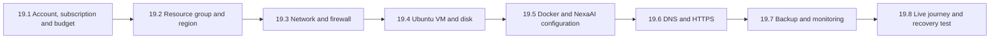
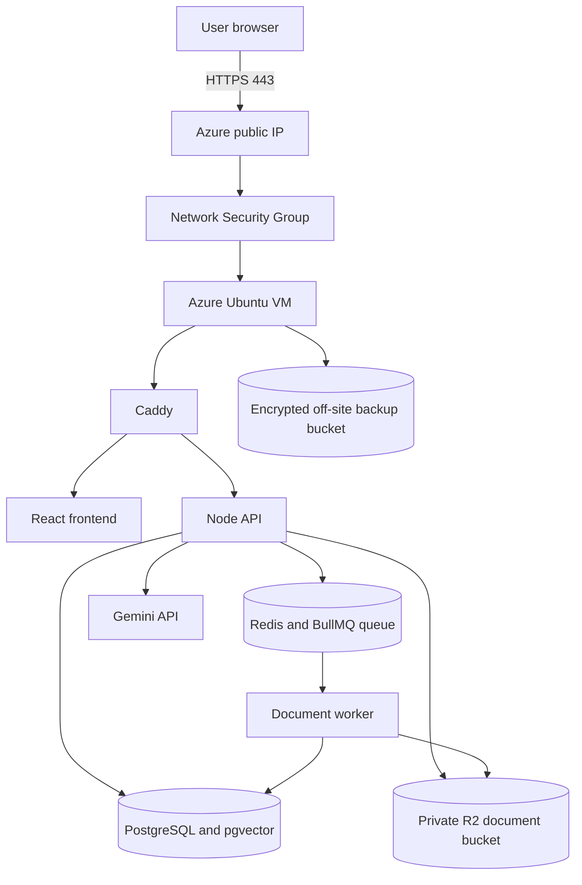

# Phase 19: Azure learning deployment

Phase 19 deploys NexaAI to Microsoft Azure while teaching the purpose of each
Azure resource. Phase 18 prepared a provider-independent production stack;
this phase applies that stack to Azure and records the live evidence.

## Complete learning flow

The steps are ordered this way so cost control exists before a billable resource
is created, network access is designed before the server starts, and recovery is
tested before the deployment is called complete.

## Architecture selected for the first Azure deployment

All application containers run on one VM. This is intentionally simple for the
first Azure deployment and closely matches the production Compose configuration
already verified locally. PostgreSQL and Redis remain private Docker services;
only SSH, HTTP and HTTPS can reach the VM from outside.

Later learning phases can replace one component at a time with Azure Database for
PostgreSQL, Azure Managed Redis or Azure Blob Storage. Doing that after the first
deployment makes the purpose and cost of each managed service easier to compare.

## Selected pilot size and cost boundary

The free Azure B2ats/B2pts virtual machines have too little memory for the API,
worker, PostgreSQL, Redis and container images together. Start with these targets:

| Setting | Initial choice | Why |
| --- | --- | --- |
| VM | Linux, 2 vCPU and 8 GiB RAM | Enough room for the small pilot and document worker |
| Architecture | x86-64 | Matches the current release-image workflow |
| OS | Ubuntu Server 24.04 LTS | Supported Docker host with a long maintenance window |
| OS disk | 64 GiB Standard SSD | Holds the OS, images, database and Redis volumes |
| Users | 1-20 | Matches the Phase 18 pilot boundary |
| Worker concurrency | 1 | Prevents simultaneous document jobs exhausting memory |
| Public ports | 80 and 443; restricted 22 | Web traffic plus operator-only SSH |

Azure prices vary by region and subscription currency. Before creating the VM,
use Azure Cost Management to create a monthly budget and alerts at 50%, 80% and
100%. A budget sends warnings; it does not automatically stop resources. Enable
VM auto-shutdown during learning if NexaAI does not need to remain available all
day. Deallocated VM compute stops billing, while disks and some networking
resources can continue to cost money.

## 19.1 Account, subscription and budget

**What this teaches:** an Azure account identifies the person, a subscription is
the billing and quota boundary, and a budget watches spending inside that boundary.

1. Sign in to the Azure portal and identify the subscription name and ID.
2. Confirm that the subscription can create resources in the selected region.
3. Create a monthly Cost Management budget before provisioning infrastructure.
4. Configure budget alerts for an operator email address.
5. Install Azure CLI locally, run `az login`, and select the same subscription.

**Completion evidence:** subscription ID recorded without secrets, budget name,
currency, limit and alert thresholds recorded, and `az account show` identifies
the expected subscription.

## 19.2 Resource group and region

**What this teaches:** a resource group is a lifecycle container for related Azure
resources. Deleting it deletes the resources inside it, so NexaAI receives its own
group rather than sharing one with unrelated projects.

Use a name such as `rg-nexaai-learning` and choose one region close to the expected
users where the selected VM size is available. Put the network, VM, disk, public
IP and network security group in this resource group.

**Completion evidence:** resource group name, region and tags are recorded.

## 19.3 Network and firewall

**What this teaches:** the virtual network is NexaAI's private Azure network, a
subnet is the VM's address range inside it, and the Network Security Group (NSG)
is the cloud firewall.

Create one virtual network and one application subnet. Allow:

- TCP 22 only from the operator's current public IP;
- TCP 80 from the internet so Caddy can redirect HTTP and obtain certificates;
- TCP 443 from the internet for NexaAI HTTPS traffic.

Do not expose PostgreSQL 5432, Redis 6379 or API 5000. Docker's internal networks
already keep those connections between containers.

**Completion evidence:** effective NSG rules show only the intended inbound paths.

## 19.4 Ubuntu VM and disk

**What this teaches:** the VM supplies CPU and memory; the managed disk preserves
the operating system and Docker data; the public IP and DNS label let an operator
and browser reach the server.

Create the VM with SSH-key authentication and no password login. Use an x86-64
size with 8 GiB RAM when available. Configure auto-shutdown while learning and
enable boot diagnostics. Do not paste application secrets into cloud-init, tags,
resource names or portal notes.

After connecting over SSH, verify memory, disk space, outbound HTTPS and the
Ubuntu security-update status.

**Completion evidence:** VM size, image, disk type, public IP and successful SSH
key login are recorded. No private key is committed to this repository.

## 19.5 Docker and NexaAI configuration

**What this teaches:** Azure provides the machine; Docker packages and connects
the application components consistently.

1. Install Docker Engine and the Compose plugin from Docker's official repository.
2. Clone the exact NexaAI commit into `/opt/nexaai`.
3. Publish immutable backend, migration and frontend images for that commit.
4. Create the ignored `.env.production` file on the VM.
5. Run `npm run production:config` before starting anything.
6. Run `npm run production:up`; migrations must finish before the API and worker.
7. Check readiness and bounded container logs.

Keep R2 for document and encrypted backup storage during this phase. The existing
backend supports its S3-compatible API and the credentials remain server-only.

**Completion evidence:** deployed Git SHA, redacted Compose service status and a
redacted successful readiness response are recorded.

## 19.6 DNS and HTTPS

**What this teaches:** DNS maps a name to the Azure public IP; Caddy proves control
of that name and automatically obtains an HTTPS certificate.

Point the application domain to the Azure public IP. Set `APP_DOMAIN`,
`API_ALLOWED_ORIGINS` and the frontend build's `VITE_API_BASE_URL` to the same
HTTPS origin as described in Phase 18. Caddy is the only public application entry.

**Completion evidence:** DNS resolves to the VM, the browser trusts the certificate,
HTTP redirects to HTTPS and refreshing a nested frontend route succeeds.

## 19.7 Backup and monitoring

**What this teaches:** monitoring detects a problem; a backup provides recovery;
a restore drill proves that the backup can actually be used.

Schedule the existing encrypted Restic database backup daily. Configure an
external monitor for liveness and readiness, review Azure VM CPU/disk/network
metrics, and keep cost alerts active. Do not enable additional paid monitoring
features until their retention and expected cost are understood.

Run one restore drill into the temporary drill database. Never use the production
database as the restore target.

**Completion evidence:** backup snapshot ID, successful restore-drill timestamp,
monitor checks and current cost/budget view are recorded.

## 19.8 Live journey and recovery test

**What this teaches:** infrastructure is complete only when the real application
and its failure paths work through the public HTTPS boundary.

Run the production smoke command against the deployed domain. It must verify:

1. signup and login;
2. document upload to private object storage;
3. Redis queue delivery to the separate worker;
4. document extraction and pgvector storage;
5. a grounded Gemini answer with citations;
6. saved conversation history;
7. denial of cross-organization access.

Then restart the VM and confirm Docker restores the database, Redis queue, API,
worker, frontend and HTTPS gateway without manual data repair.

**Completion evidence:** redacted smoke result, restart recovery result, deployed
SHA and final monthly cost estimate are recorded.

## Phase completion rule

Phase 19 is complete only after the HTTPS smoke journey, backup restore drill and
VM restart recovery pass. Creating a VM or seeing the login page is not sufficient.

Current status: **19.1 PREPARED, awaiting an Azure account/subscription and local
Azure CLI installation. No Azure resource has been created.**
