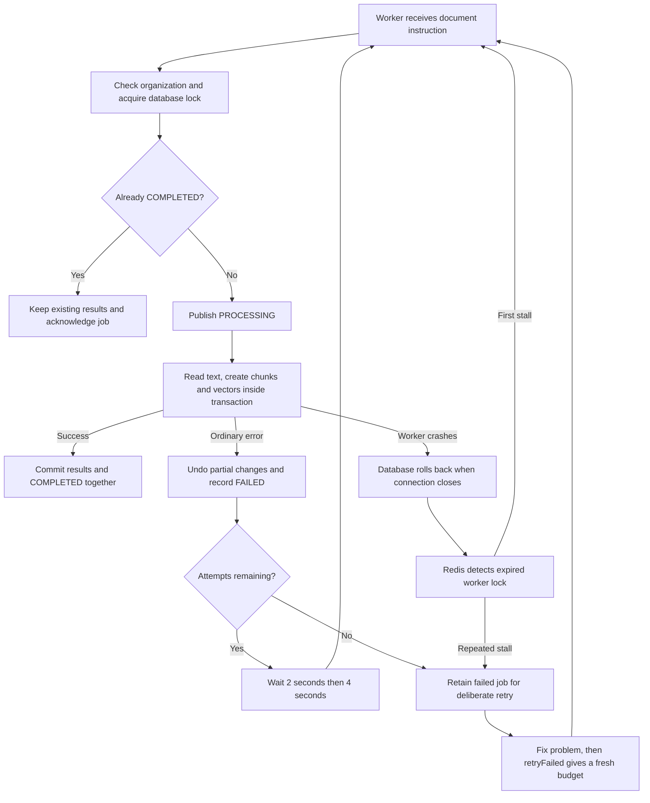

# Phase 11, Step 11.4: recovering interrupted document work

Verified locally on **2026-10-24**. Next: **11.5, connecting uploads and status UI**.

Historical note: the connection described as future work below is now implemented
in [Step 11.5](redis-step-5-background-uploads.md). This guide records the 11.4 checkpoint.

## The problem, using a handbook

Suppose you upload a handbook containing "Employees receive 18 annual leave days."
The worker reads the text, creates chunks, and starts creating searchable vectors.
Then its process stops. The database still says PROCESSING, but nobody is working.

Before this step, that label prevented a replacement worker from continuing.
Now a replacement can safely try again. Finished documents are also recognized:
if the results were saved just before the crash, we keep them instead of rebuilding.

**Input:** a queue instruction containing documentId and organizationId.
**Successful output:** one committed set of chunks/vectors and a COMPLETED document.
**Failure output:** a FAILED document and a delayed retry, or a retained failed job
when its retry budget has been used. An authorized server caller can retry it later.

## Terms in plain language

| Term | Meaning | Handbook example |
| --- | --- | --- |
| Retry | Try the same task again. | Try reading the handbook again after a temporary failure. |
| Backoff | Wait between attempts. | Wait 2 seconds, then 4 seconds, rather than retry continuously. |
| Stalled job | A worker stopped renewing its Redis ownership lock. | Its process crashed before reporting success. |
| Database lock | Permission held by one processing attempt at a time. | Another worker cannot save the same handbook simultaneously. |
| Transaction | A group of changes that become permanent together. | Save all chunks, vectors and COMPLETED together, or discard the changes. |
| Rollback | Undo uncommitted changes. | Remove the half-written replacement chunks after a crash. |
| Savepoint | A checkpoint inside a transaction. | Undo chunk changes while retaining the lock to safely record FAILED. |
| Idempotent processing | Repeating a completed instruction does not rebuild its results. | A second delivery preserves the handbook's existing chunk IDs. |

## Follow the flow



Text version: **instruction -> ownership check -> prepare -> save everything together**.
On an ordinary error: **undo -> FAILED -> wait -> retry -> stop after three attempts**.
On a crash: **undo -> Redis detects stalled work -> replacement worker**.
On repeated crashes: **failed job -> reconcile document to FAILED -> deliberate retry**.

## What the code now does

1. `document.queue.ts` gives new jobs **three total attempts**, with exponential
   backoff starting at **2 seconds**. Invalid jobs and unavailable organization-scoped
   documents are unrecoverable and do not consume three processing attempts.
2. `document.processing.ts` obtains a PostgreSQL transaction advisory lock. A lock is
   tied to the actual transaction, unlike the PROCESSING label. A crash releases it
   when PostgreSQL detects the closed connection. Every processing entry point uses
   this protocol, including the existing synchronous upload/reprocess APIs.
3. Chunk replacement, vector writes, and COMPLETED use the same transaction client.
   An expired attempt cannot resume writing through a new connection. Ordinary errors
   roll back to a savepoint, record FAILED while still holding the lock, then commit
   that failure before returning the error. A dead transaction cannot save any result.
4. COMPLETED documents are skipped on redelivery. This also works after Redis has
   removed a completed job and the same instruction is submitted again.
5. The worker uses a **30-second Redis lock** and a **30-second stalled check interval**.
   Recovery is not instantaneous. BullMQ allows one stalled recovery; a second stall
   exhausts that crash budget. This is separate from the ordinary failure budget.
6. Failed-job callbacks reconcile an abandoned PROCESSING document to FAILED. They
   take the same database lock, so they cannot overwrite a live attempt or COMPLETED.
   Graceful shutdown waits for pending reconciliation callbacks.
7. `producer.retryFailed({ documentId, organizationId })` retries a retained failed
   job. Missing, waiting, active and completed jobs are rejected. BullMQ atomically
   decides the winner if two callers retry simultaneously. This is a server method;
   no new public HTTP endpoint or retry button has been added in this step.
8. Completed job records are retained up to **1 day / 1,000 records**, failed records
   up to **7 days / 1,000 records**, whichever limit is reached first. BullMQ performs
   cleanup when jobs finish, so age is not an exact expiry timer. This removes Redis
   job history, not uploaded files or database documents. Waiting/active jobs are not
   covered by these terminal-history limits. Removed IDs lose Redis deduplication;
   the database completion check still protects finished documents.

**Why some raw SQL?** Prisma methods still handle ordinary document/chunk changes.
PostgreSQL advisory locks and savepoints need database-specific commands, so those
small operations use parameterized raw SQL. Vector writes already need PostgreSQL's
vector cast. We do not build SQL by joining user-supplied strings.

**BullMQ compatibility detail:** installed BullMQ 6.3.12's `job.retry()` can reset
attempt counters but retains its deferred stall-failure marker. A small Redis Lua
operation clears that marker and stall count only while the job is still in the failed
set, then `job.retry()` atomically requeues it. Keep the repeated-crash test when
upgrading BullMQ because those metadata fields are library internals.

## Validation performed

- TypeScript build passed.
- Recovery/worker/queue/processing/reprocess suites: **19 reported tests passed**.
- Actual child worker killed after writing uncommitted chunks: outsiders saw no partial
  chunks; a second attempt was refused while the original database lock was held.
- Redis delivered the stalled job to a replacement child worker. Killing that child
  too exhausted the stall budget; the job and document became FAILED. Explicit retry
  then completed successfully with one set of chunks.
- A completed Redis job was removed and re-enqueued. Database results, timestamps and
  chunk IDs remained unchanged. A later simulated embedding failure restored the
  prior committed chunks rather than leaving replacements half-written.
- A missing-file job used all three attempts. Creating its fictional file and manually
  retrying succeeded with a reset attempt count. Completed-job retries were rejected.
- Existing tenant isolation, concurrent reprocessing, safe queue errors and graceful
  shutdown checks passed. Worker tests used real local 384-dimensional embeddings.
- Existing synchronous upload pipeline also passed, producing three real vectors.
  The crash test uses deterministic text/vectors to focus on recovery; no Gemini calls.

All fixtures used unique organizations and Redis queues and were cleaned up.
Retention settings were asserted; we did not wait seven days to test expiry.

## Validate this step yourself

With local PostgreSQL and Redis running, open PowerShell in `backend` and run:

```powershell
npm.cmd run test:document-recovery
```

This builds first and runs isolated tests; it deliberately kills only child workers
created by the crash test. Look for **19 passed, 0 failed**. You do not need to upload
your own handbook or stop the normal application worker.

Use [the main roadmap](../../NEXAAI_ROADMAP.md) to locate **11.4 DONE -> 11.5 NEXT**.

## Boundaries and next step

The transaction has a **three-minute limit** and holds a database connection while
extraction/embedding runs. Publishing progress briefly needs another connection.
This is a conservative local implementation for the current single-job worker;
large documents/high concurrency require revisiting resource limits and transaction
design. A database outage can also prevent failure-status reconciliation: the worker
logs that failure; retry after restoring service can reclaim the document. This step
does not add a durable cross-system reconciliation service or guarantee exactly-once
execution. A stopped worker must be restarted before Redis work can recover.

Existing retained jobs keep their old options. New enqueue defaults do not rewrite
old jobs. A retry needs a retained failed job; after retention removes it, the server
must submit a new instruction following its authorization/document-state checks.

**Real uploads and the existing HTTP reprocess endpoint are still synchronous.**
The new queue policy has been verified in isolation. Step 11.5 connects upload/retry
submission and status display, including distinguishing a delayed retry from a final
failure. The document can currently say FAILED while Redis has an automatic retry
scheduled; the UI integration must account for both statuses.

Official references: [automatic retries](https://docs.bullmq.io/guide/retrying-failing-jobs),
[manual retries](https://docs.bullmq.io/guide/jobs/retrying-job),
[stalled jobs](https://docs.bullmq.io/guide/jobs/stalled),
[retention](https://docs.bullmq.io/guide/queues/auto-removal-of-jobs),
[PostgreSQL locks](https://www.postgresql.org/docs/17/explicit-locking.html).
