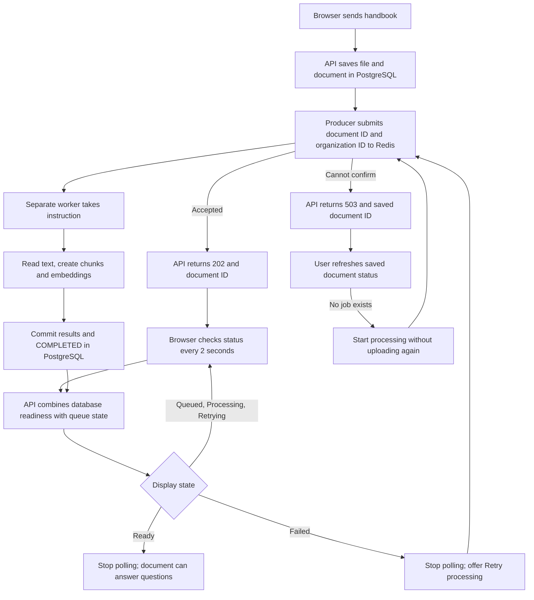

# Phase 11, Step 11.5: uploads now use the background worker

Completed locally on **2026-10-24**. Next: **11.6, full user-journey verification**.

## What changed, and why?

Previously, the upload request did all the work: save the handbook, read its text,
split it into chunks, generate embeddings, and return a result. The browser waited
for every operation. A slow embedding step could make that request time out.

Now the API saves the handbook and asks Redis to hold an instruction for the worker.
Once Redis accepts the instruction, the API returns **202 Accepted**. The worker
does the preparation separately. The browser checks progress until it is finished.

Example: your handbook contains "Employees receive 18 annual leave days."
Uploading it produces an ID and a **Waiting for processing** message. The worker
reads the handbook and saves searchable chunks. The page changes to **Ready for
questions**. Only then should you ask how many annual leave days employees receive.
This step prepares documents; Gemini still handles answering questions separately.

**Input:** the selected file, plus your signed-in organization context.
**Initial output:** the saved document's ID and a queued result, or an explicit
submission error containing the saved ID when available.
**Later output:** the status endpoint reports readiness, automatic retry, or failure.

## New terms in simple language

| Term | Meaning | Example |
| --- | --- | --- |
| 202 Accepted | The server accepted work that will finish later. | The handbook is queued, not yet ready for questions. |
| Polling | Ask for updated information at intervals. | The page asks for the handbook's status every two seconds. |
| Background worker | A separate running program that performs queued work. | It creates the handbook's chunks while the API handles other requests. |
| Acknowledgement | Confirmation that another service received an instruction. | Redis confirms the handbook job was saved. |
| Ambiguous submission | Confirmation was lost, so acceptance is uncertain. | Redis may have saved the job even though the API received a timeout. |

## Where we are in the flow



Plain-text version:

```text
Upload -> save file -> queue instruction -> return Accepted
                             |
                             v
                       Worker prepares document -> database Ready
                                                          |
Browser <- status endpoint <- database + Redis status <----+
```

The worker must be running. If it is stopped, an accepted document stays queued.
The queue makes the request shorter; it does not make the preparation itself instant.
Very small documents may finish between two polls, so you may not see every label.

## Understanding the labels

| Screen label | What it means | What you do |
| --- | --- | --- |
| Waiting for processing | Redis holds the instruction. | Wait; ensure the worker is running. |
| Processing | A worker has taken the job. | Wait. |
| Retrying automatically | An attempt failed and BullMQ scheduled another. | Wait; do not upload again. |
| Ready for questions | PostgreSQL contains a COMPLETED document. | Ask questions about it. |
| Processing failed | Redis reports a failed job with no scheduled retry. | Fix the cause, then use Retry processing. |
| Saved — processing not queued | The file exists but Redis has no instruction. | Use Start processing for this saved document. |
| Processing status temporarily unavailable | The API cannot confirm queue state. | Refresh or wait for automatic checks to resume. |

The database status can say FAILED between automatic attempts. The API therefore
adds `processingState` and `canRetry` to the existing response. A delayed Redis job
becomes RETRYING, not a final failure. A committed COMPLETED document is always READY,
even if Redis is unavailable or has removed the job's history.

The page polls every two seconds **after the last response**, so requests do not pile
up. UNAVAILABLE responses use a five-second interval. A request error pauses polling
and offers manual refresh. Ready, failed, and not-queued results stop automatic checks.
Leaving the page cancels browser requests/timers, but does not cancel server work.

## Handling submission failures without duplicate uploads

PostgreSQL and Redis are separate systems. Saving a document does not guarantee that
its Redis job was saved. A timeout also does not prove that Redis rejected the job.

If saving succeeded but queue confirmation failed, the API returns **503**,
`DOCUMENT_QUEUE_UNAVAILABLE`, and a safe snapshot containing the saved document ID.
The page keeps that document and asks you to refresh its status. If Redis already
has the job, you see its progress. If it has no job, **Start processing** submits the
same document ID. Neither path uploads another copy or rewrites a worker's status.

`POST /documents/:id/reprocess` now returns **202** and queues work too. It first
checks organization ownership. It refuses completed or already queued/active/delayed
work. A retained failed job uses the Step 11.4 retry mechanism; a missing job gets
a new instruction. The worker's database lock and completion check still protect
against duplicate execution. This is a change from the earlier synchronous 200 result.

## Run and validate it yourself

Keep PostgreSQL and Docker Redis running. From the repository root, Redis alone can
be started with `docker compose up -d redis`. The API and worker need the same backend
environment and access to the same local upload directory.

Open these terminals separately. Do not start duplicate copies if they already run.

**Terminal 1 — API, in `backend`:**

```powershell
npm.cmd run build
npm.cmd start
```

**Terminal 2 — worker, also in `backend`, after the build succeeds:**

```powershell
npm.cmd run worker:documents
```

**Terminal 3 — browser app, in `frontend`:**

```powershell
npm.cmd run dev
```

1. Sign in and open **Documents**.
2. Upload [the fictional employee handbook](../../samples/nexaai-employee-handbook.txt).
3. Watch the status change automatically to **Ready for questions**. No repeated
   Refresh clicks should be needed during normal processing.
4. To observe queuing clearly, start with the worker stopped, upload once, and then
   start the worker. You should first see Waiting for processing, then Ready.
5. Locate **11.5 DONE -> 11.6 NEXT** in [the main roadmap](../../NEXAAI_ROADMAP.md).

The next step will verify the entire browser-to-answer journey, including asking
"How many paid annual leave days do employees receive?" and reopening its saved answer.

## Code and validation evidence

| Location | Responsibility |
| --- | --- |
| `document.controller.ts` | Upload and retry submission; 202 acceptance and recoverable 503 responses. |
| `document.service.ts` | Organization-scoped status, combining database and queue state. |
| `document.queue.ts` | Bounded Redis state lookup alongside enqueue/retry. |
| `document.queue.runtime.ts` | Share one producer; recreate after disconnection; close on API shutdown. |
| `src/app.ts` | Warm the producer and close it after HTTP requests drain on shutdown. |
| `frontend/src/features/documents/DocumentsPage.tsx` | Polling, status labels, manual retry, and cancellation. |
| `frontend/src/services/api.ts` | Preserve validated recovery data from the specific queue error response. |

Validation completed:

- Backend TypeScript and frontend production builds passed; changed frontend code
  passed ESLint. No database migration was needed.
- **29 backend tests passed** across upload pipeline, status, retry, producer lifecycle,
  queue, processing, worker and crash recovery suites.
- The pipeline returned 202 with no worker running and zero chunks. After starting
  the worker, all three fictional uploads became COMPLETED with real local embeddings.
  It covered an unavailable producer and a lost acknowledgement after actual enqueue.
  Failures were injected at the producer boundary; no shared Redis outage was induced.
- Status tests distinguish delayed retries, final failures, missing jobs, and outages;
  completed documents stay ready without Redis. Ownership checks and concurrent retry
  protections passed. Producer lifecycle tests use controlled clients to verify reuse,
  reconnection and shutdown without touching the application's queue.
- **9 Chrome browser tests passed** with mocked HTTP responses: actual multipart bytes,
  polling/retry labels, saved-upload recovery, manual retry, polling errors, expired
  authentication, validation, and late-response cancellation. Windows sandbox teardown
  needed the temporary test Vite process stopped; the runner then exited successfully.
- **10 frontend utility tests passed**, including safe recovery data and request behavior.

To repeat the focused backend checks from `backend`:

```powershell
npm.cmd run test:document-background
```

This focused command reports 16 tests. The wider 29-test run additionally included
the existing queue, processing, worker and crash-recovery tests. Fixtures use isolated
organizations and random Redis queues and are removed afterwards. No Gemini calls.

## Current boundaries

The page still shows only its latest upload while mounted. It is not a document library.
If the entire upload response is lost, the browser may not receive the saved ID; a
future library/recovery flow is still needed for that case. An API crash between saving
and enqueueing is not automatically repaired by a durable outbox in this implementation.
Saved documents with known IDs can be resubmitted through the scoped retry endpoint.

The latest-upload retry button is implemented; retry controls for older documents
remain part of the future library work. There is no invented percentage or ETA.
Step 11.4's transaction and resource limits still apply. Full live browser/API/worker/
Gemini verification remains **11.6**; Phase 11 is not yet marked complete.

Reference: [React effect cleanup](https://react.dev/reference/react/useEffect) explains
why polling needs cancellation when the view changes; [BullMQ state getters](https://docs.bullmq.io/guide/jobs/getters)
describe the queue-state reads used alongside database readiness.
