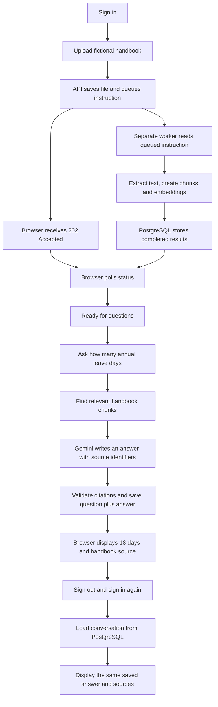

# Phase 11, Step 11.6: the complete live journey

**Verified on 2026-10-24. Phase 11 is complete for the local workflow described here.**
The next planned step is **4.1**, returning to unfinished organization-management work
before starting Phase 12. See [the main roadmap](../../NEXAAI_ROADMAP.md).

## Why this step matters

Earlier tests checked individual parts or supplied example HTTP responses to the
browser. Those tests are useful, but a working worker and a working screen do not
by themselves prove that the screen can follow a real worker's progress.

An **end-to-end test** follows the connections from the user's action to the final
result. This test used real Chrome, the actual React frontend, actual Express routes,
Redis, a worker in another Node.js process, PostgreSQL, local embeddings, and Gemini.
It did not intercept browser requests or replace generated answers with test answers.

Example: an employee uploads a handbook, asks about annual leave, signs out, and
later returns. We need to verify both that the answer is based on the handbook and
that it is saved correctly. Seeing an answer once does not prove it survives a login.

**Input:** the fictional [employee handbook](../../samples/nexaai-employee-handbook.txt).
**Question:** "How many days of paid annual leave do full-time employees receive per calendar year?"
**Expected result:** 18 days, with a citation to that handbook, and the same saved answer
available after a fresh login.

## Follow the two activities



Text route: **upload -> queue -> worker -> Ready -> question -> retrieval -> Gemini
-> save -> display -> new login -> load saved conversation**.

Preparing the handbook and answering a question are separate activities:

- The **worker** reads the file and makes it searchable. It does not generate chat answers.
- An **embedding** is a list of numbers representing meaning. The uploaded handbook
  produced three chunks, each with 384 numbers. Search uses these to find relevant text.
- **Retrieval** finds useful chunks for the question. Those passages are supplied to Gemini.
- A **citation** connects an answer to a returned source. The test checks that the
  cited source includes the actual uploaded handbook.
- **Saved history** reads stored messages. Reopening an answer should not need another
  Gemini call and should not produce different wording.

## What passed

| Check | What happened | Why it matters |
| --- | --- | --- |
| Real browser login | A temporary account signed in through the UI and authenticated routes. | The journey used the normal browser session flow. |
| Acceptance before processing | With no worker running, upload returned 202; Redis held the job and PostgreSQL had zero chunks. | The API really queued work instead of processing inside the upload request. |
| Separate worker and polling | A child worker started; the handbook gained three real 384-dimensional vectors; the browser automatically showed Ready. | The browser/API/Redis/worker/database connection works. |
| Real processing failure | A nonempty file containing only whitespace used all three attempts and showed Processing failed. | The screen can distinguish terminal failure from work still pending. |
| Retry from the UI | The test repaired that temporary file and clicked Retry processing; the same document became Ready. | Retry reuses the saved document rather than creating another upload. |
| Document isolation | Another organization received 404 for status and reprocess; search returned no chunks from the owner. | Changing a document ID does not grant access. |
| Live generated answer | One Gemini request returned an answered response containing 18 days and a citation to the handbook. | Retrieval, generation, validation and source rendering work together. |
| Saved history | After sign out and fresh login, the browser reopened the identical answer and sources. Generation request count remained one. | History comes from stored records rather than another generation call. |
| Conversation isolation | Another organization could not list, read or append to the conversation; its two messages remained unchanged. | Conversation access respects the organization boundary. |
| Cleanup | Temporary accounts, organizations, uploads, chunks, conversation/messages and random queue were removed. | The verification did not leave test data in the project. |

The successful live scenario took approximately **76 seconds**. This is test duration,
not a promised upload or response time. It includes setup, failure retries, browser
interaction, local model loading, generation and cleanup.

## What changed in this step

- Added `tests/phase11.live.browser.test.cjs`, an opt-in live browser scenario.
- Added `tests/fixtures/live-document-worker.cjs`, which runs the actual worker on a
  uniquely named test queue in a separate process. It supports controlled shutdown
  without stopping the normal application worker.
- Added `npm run test:phase11-live` to build and invoke the scenario.
- Updated the earlier `conversation.live.e2e.test.cjs` for 202 acceptance, an isolated
  queue/worker, status polling and cleanup. Its earlier synchronous-upload assumption
  was outdated. Its two-answer live scenario was not separately rerun in this step;
  the new browser journey provides the live generation/history evidence above.
- Updated the roadmap and added this explanation. No application behavior or database
  schema change was needed to make the live journey pass.

Code comments explain test ownership, what each assertion proves, and cleanup limits.

## Repeat the automated verification

Prerequisites: local PostgreSQL with pgvector, local Redis, backend environment settings
including the configured Gemini key/model, installed backend/frontend dependencies,
the local embedding model, and Chrome. Run from **backend** in PowerShell:

```powershell
$env:RUN_LIVE_PHASE11_TEST = '1'
npm.cmd run test:phase11-live
Remove-Item Env:RUN_LIVE_PHASE11_TEST
```

The test starts its own temporary API, frontend server and worker. It uses one actual
Gemini answer request with fictional text and the configured account's quota. It does
not print credentials, alter `.env`, or submit messages to other people.

Look for **1 passed, 0 failed, 0 skipped**, followed by the checkpoint diagnostics.
Without the environment flag, the live test is skipped. We verified that both live
test files skip normally, so routine test runs do not unexpectedly call Gemini.

The backend TypeScript build and JavaScript syntax checks passed. The live scenario
passed with real services; the ordinary opt-in check reported two intentionally
skipped live tests. A skipped test is not counted as a passing live verification.

## Validate the idea manually

With your normal API, worker and frontend running:

1. Sign in and upload the sample handbook from Documents.
2. Wait for **Ready for questions**. The screen checks automatically.
3. Open Chat and ask the annual-leave question above.
4. Confirm that the answer says **18 days** and lists the handbook as a source.
5. Sign out, sign in again, open Chat, and select that saved conversation.
6. Confirm that the answer and source are still present.

You do not need to corrupt your own document to test retries. The automated scenario
uses a temporary file for that check and removes it afterwards.

## Completion scope and what comes next

Phase 11's local core flow is verified. This is not a production load test or a claim
that every PDF, DOCX, model response, or service-outage sequence has been tested.
This live run used TXT and one annual-leave question. Earlier recovery suites cover
crashed workers and duplicate execution; Phase 16 includes broader system evaluation.

Existing limits remain: the page shows only its latest upload while mounted, the
worker must be running, uploaded files are local, and a lost response can prevent the
browser from learning a saved document's ID. Phase 11.4's resource/transaction limits
and Phase 11.5's recovery limitations also remain documented.

Next is **Phase 4, Step 4.1: review organization member permissions**. We return to
this earlier unfinished phase deliberately, as planned in the roadmap. For example,
we will check whether an ordinary member can change another person's role, and what
an owner versus an administrator may do. We have not started that implementation here.
