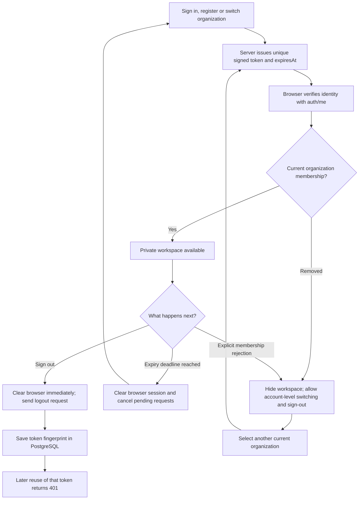
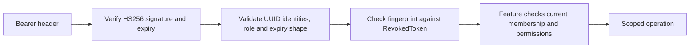

# Phase 14, Step 14.1: session expiry, sign-out and current membership

## What problem are we solving?

Signing in gives the browser a temporary entry pass. We call that pass a **token**.
When it expires, the browser should stop showing private pages. When you sign out,
the server should reject later use of that credential. When an owner removes your
membership, a token issued earlier must not restore the old organization's access.

Before this step, NexaAI already verified signed tokens and checked current
membership in its document, chat, agent and dashboard services. The browser kept
the session in memory and discarded it on refresh/sign-out. This review found:

- An idle browser only noticed expiry after another API request failed.
- Sign-out cleared the browser but did not invalidate that token at the server.
- The generic role middleware trusted the role saved when the token was issued.
- A membership removed during session verification was reported as an expired
  session, hiding the distinction between account identity and organization access.

## A few terms in plain language

| Term | Meaning in NexaAI |
| --- | --- |
| JWT | A token containing signed identity, organization, issuance and expiry information. |
| Signature | Lets the server detect a token it did not issue or that someone changed. |
| `exp` | The token's expiry time, in UTC seconds. |
| `jti` | A random identifier making each newly issued token unique. |
| Fingerprint / SHA-256 digest | A fixed representation used to recognize a token without storing the token itself. |
| Revocation | Recording that a previously issued credential must no longer be accepted. |
| Current membership | The database's present user/organization relationship and role. |

A signature proves issuance and integrity. It does not prove that the user still
has the same role or membership. Those decisions require the current database.

## The session lifecycle



## Example: one person, two browser sessions

Suppose Asha signs in twice, once in each browser. Each login gets its own random
`jti`, even if both happen in the same second. This prevents the two tokens from
being identical.

Asha clicks Sign out in browser A:

1. Browser A immediately clears its in-memory token and private views, and aborts
   its pending authenticated requests. It does not wait for a network response.
2. It sends `POST /api/v1/auth/logout`, authenticating with that credential.
3. The server saves the token's SHA-256 fingerprint, owning user ID and original
   expiry in `RevokedToken`. It does not save the raw token.
4. A later attempt to reuse browser A's token fails with `SESSION_REVOKED` and 401.
5. Browser B's separately issued token still works. This is per-credential logout,
   not “sign out every device.”

If the logout request fails or times out, browser A stays signed out and says:
“Signed out on this browser. Server sign-out could not be confirmed.” It does not
claim the server revoked a credential without confirmation. An invalid/expired/
already-revoked token is already unusable, so a logout 401 needs no extra notice.
A late logout failure cannot overwrite the state of a newer login.

## Example: expiry while the dashboard is idle

The server returns `expiresAt` along with credentials and verified `/auth/me`
identity. Its value comes from the token the server issued/verified.

Once verified, the browser schedules a timer for that deadline. At expiry it clears
the session and returns to sign-in, without waiting for another dashboard request.
It also checks the deadline on focus/visibility changes and before API requests,
because browsers can delay timers in sleeping tabs.

The server independently verifies expiry on every authenticated request. Changing
the browser clock cannot extend a token's server-side validity. The browser deadline
controls the display; the server controls access. New tokens use the configured
`JWT_EXPIRES_IN`, defaulting to one day when unset.

The frontend accepts an absent expiry field for a rollout against an older API;
in that case it continues to rely on server 401 responses. New backend issuance
always includes expiry, and backend authentication rejects tokens without `exp`.
No refresh-token or “remember me” mechanism is added. Refreshing the page still
loses the in-memory session and requires sign-in.

## Example: demotion or removal while a token remains signed

An OWNER token contains `role: OWNER`. If the database role changes to MEMBER,
the generic `authorize()` middleware now reads current membership and denies an
admin-only operation. Returning to ADMIN enables only the permissions that role
currently has. Existing feature services retain their own scoped checks.

If membership disappears, `/auth/me` returns 403 with
`ORGANIZATION_ACCESS_REVOKED`. The frontend shows “Organization access changed,”
hides the previous workspace and retains only account-level recovery access.
The existing dashboard/agent membership codes enter the same restricted state.

Account identity still permits listing that account's remaining organizations,
switching to one of them, and signing out. The switch endpoint checks the target
membership and issues fresh credentials. An ordinary 403 for a prohibited action
does not automatically sign out a valid member; only explicit membership errors
trigger the restricted view.

No background membership polling is added. The UI detects removal when identity
verification or a membership-checked operation reports it. Existing saved content
is hidden once that signal arrives; expiry has its own timer. Every feature's
server checks still protect new reads/actions while the browser is idle.

## What is checked on each authenticated request?



Invalid/expired credentials fail with 401. A revocation-store outage returns a safe
503 and denies the request; it does not grant access or claim the token expired.
Token parsing errors/payloads are not logged. Authenticated responses and public
credential responses carry `Cache-Control: no-store`.

The `/logout` body/query cannot choose another user or token. It acts only on its
verified credential. Upsert prevents duplicate concurrent submissions from creating
duplicate records. Once revoked, another logout attempt may return 401, which the
browser treats as already signed out.

The new table survives API restarts. Its primary key is the fingerprint; expiry and
user indexes support future maintenance. Deleting a user cascades its revocation
records. Automatic expired-record pruning remains part of retention/operations
work in Phase 15. Expired records cannot authorize anything and are not exposed by
an API. Revocation adds a database read per authenticated request; its production
load has not been benchmarked.

Cancelling a browser request does not undo a database write or queued action that
already committed. Similarly, revocation denies requests checked after it commits;
it does not roll back work whose authentication check already passed. Previously
issued organization-switch credentials and other browser sessions are independent
credentials and remain subject to their own expiry, revocation and membership checks.

## Files and migration

`auth.tokens.ts` centralizes unique token issuance and fingerprints. Login,
registration, invitation registration and organization switching all use it.
`auth.middleware.ts` checks expiry/shape/revocation. The protected auth router adds
logout and authoritative identity expiry, and the role middleware reads membership.

The frontend's `AuthProvider` manages the timer, pending-request cancellation,
logout receipt and explicit membership restriction. `ProtectedRoute` and the
navigation expose the recovery view. Comments explain the purpose of each guard.

Migration `20261026110000_token_revocation` adds `RevokedToken` and its user cascade.
The schema/client must be updated before deploying the new backend. It is additive;
it does not reset or rewrite existing users, memberships, documents or conversations.

From `backend`, apply/generate when setting up a checkout:

```powershell
node node_modules/prisma/build/index.js migrate deploy --config prisma7.config.ts
node node_modules/prisma/build/index.js generate --config prisma7.config.ts
npm.cmd run test:sessions
```

From `frontend`, build and run browser checks:

```powershell
npm.cmd run build
node node_modules/@playwright/test/cli.js test --workers=3 --reporter=line
```

Tests use isolated records, temporary signing secrets and fictional credentials.
Some old HTTP fixtures signed tokens without expiry; their legitimate sessions now
include a five-minute lifetime to meet the strengthened contract. Invalid-token
tests continue to check rejection. Removed membership has a distinct 403 contract.

## Validation and next step

**Completed on 2026-10-26.** Prisma schema validation, client generation, the
additive migration and migration-status check passed. Both production builds,
changed frontend file lint and new browser-test type checks passed.

`npm.cmd run test:sessions` reported **114 passing backend tests**, including eight
new session checks and their enclosing test. The suite also covers agent HTTP,
dashboard, organization permissions/invitations/switching, document reads/search
and private conversation operations. It verifies actual expiry, unique issuance,
stale-role denial, removed-membership recovery, invalid/logout override rejection,
database-failure behavior, fingerprint storage, replay denial and independent logins.

The full Chrome regression run passed 107 cases and exposed a timing assumption in
the new idle-expiry test: it started counting requests before the initial dashboard
had finished loading. That assertion now waits for the page to settle and counts API
requests. The final focused rerun passed **10/10 browser cases**: seven session
behaviors and three actual auth/API/PostgreSQL dashboard journeys. Together with
the other passing regression cases, all **108 distinct browser cases** were verified.
The real dashboard journey now also asserts that logout returns a receipt and replay
of the same token returns `SESSION_REVOKED`, followed by a successful fresh login.

The JSON-null logout test also found a parser boundary: Express rejects that input
before route middleware. Authentication parser errors now receive safe, uncached
JSON through the application's auth error handler. This is covered in the passing
backend suite; malformed auth requests do not fall through to an HTML stack response.

As in Phase 13, the Windows test-owned Vite process needed an explicit stop after
browser workers exited; the focused runner then reported ten passes and exit code 0.
Fixture account deletion cascades
the test revocations, and the new backend cleanup asserts no fixture revocations remain.

Next is **14.2: consistent input validation, upload limits, safe errors, response
headers and allowed frontend origins**. Rate limits/budgets remain 14.3; the wider
tool/prompt/tenant review remains 14.4. This step does not complete Phase 14.
