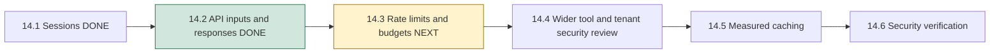
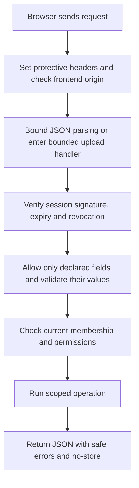
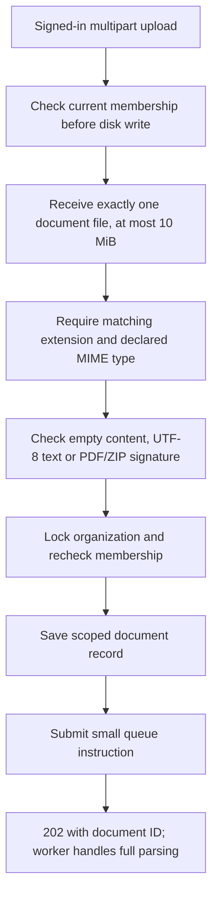

# Phase 14, Step 14.2: API inputs, uploads, safe errors and allowed origins

## What this step means

An API is the application's entrance. The browser's form checks help users, but
someone can send requests directly without using those forms. The server therefore
needs its own rules for request fields, request size, upload format and permissions.

This step checks that entrance before expensive database, model or queue work.
It also controls what the server sends back when something fails.



## Follow a normal request



The order matters. An oversized JSON body is rejected before a controller can use
it. An upload checks membership before writing bytes and again when admitting its
document record. A failed origin check does not perform a login or save a file.

## 1. Only accept fields the endpoint understands

Example of a valid chat request:

```json
{ "question": "How many leave days do we receive?" }
```

Adding `organizationId`, `userId`, `role` or `sources` does not choose a different
identity or supply trusted citations. It now returns **400 INVALID_REQUEST**.
The authenticated session and server retrieval decide those values.

The shared `requestFields()` middleware declares allowed body/query keys, required
fields and UUID URL parameters. Controllers continue to check value types, lengths,
date ranges, pagination cursors, roles and numeric settings. The already strict
Agent and analytics contracts retain their existing validation.

| Endpoint family | Examples of allowed inputs |
| --- | --- |
| Login | `email`, `password` only. |
| Registration | `name`, `email`, `password`, `organizationName`. |
| Organization profile update | `name` only. |
| Member/invitation creation | Their documented email, role and invitation-expiry fields. |
| Chat query | `question`, optional `conversationId`, `topK`, `minSimilarity`. |
| Document search | `query`, optional `topK`, `minSimilarity`. |
| Paginated library/history reads | `limit`, `cursor`. |
| Status/retry/delete routes | Their UUID in the URL; no extra identity or body filters. |
| Dashboard | Paired UTC dates under the existing strict contract. |

Unknown fields used to be ignored in some older endpoints. Their tests now explicitly
assert rejection, then separately verify that the normal scoped operation still works.

JSON request bodies have a **32 KiB** limit. Wrong body media types and compressed
JSON are rejected with 415. Invalid JSON and malformed URL encoding receive safe JSON
errors. Unknown endpoints also return JSON, instead of Express HTML pages.

## 2. Validate authentication values and hide internal errors

Email must be a string in email form, with at most 254 characters. Names and
organization names must contain 1–100 trimmed characters without control characters.
Objects, arrays, invalid primitive types and extra fields are rejected before account
lookup or password hashing.

Passwords are kept exactly as entered; spaces are not trimmed. Registration still
requires at least eight characters. Passwords must fit in **72 UTF-8 bytes** because
the existing bcrypt password algorithm ignores bytes after that boundary.

A byte is a unit of stored text, not always a displayed character. A basic Latin
character normally uses one UTF-8 byte; an emoji often uses four. Twenty four-byte
emoji are 80 bytes even though the password looks shorter than 72 characters.
Both the browser and server reject overly long passwords. A 72-byte password is
accepted by the real-login test. Existing passwords longer than the former unchecked
bcrypt boundary will need a password-policy migration before production use; this
step does not rewrite stored password hashes or add a password-reset flow.

An unknown account and an incorrect password return the same fixed credential
failure. Duplicate registration gets a fixed 409 response. Unexpected database/auth
exceptions return **503 AUTH_UNAVAILABLE**; they are not exposed as SQL, connection
details, credentials or a misleading bad-password response. Raw auth exceptions are
also no longer printed to logs. Broader throttling and timing review remain later steps.

## 3. Admit uploads carefully



| Rule | Behavior |
| --- | --- |
| File field | Exactly one `document` file. Extra form fields/files are rejected. |
| Size | At most 10 MiB; exactly 10 MiB passes, one byte above fails with 413. |
| Names | Bounded display name; stored filename is a generated UUID with a supported extension. |
| Extension/MIME | `.txt`/`text/plain`, `.pdf`/`application/pdf`, `.docx`/Word MIME must match. |
| TXT content | Nonempty UTF-8 text, without binary NUL bytes. |
| PDF content | Starts with the PDF signature `%PDF-`. |
| DOCX container | Starts with the ZIP local-file signature used by DOCX packages. |
| Storage | Organization UUID folder; reject symbolic-link directories and keep generated filenames. |

Renaming ordinary text to `policy.pdf` is rejected because the PDF signature is
missing. Giving a `.txt` filename a PDF MIME type is also rejected. Browser-declared
MIME type alone is insufficient.

These are **admission checks**, not a malware scanner or full document validation.
A ZIP signature does not prove valid Word XML. A PDF signature does not prove the
whole file can be parsed. The existing worker performs actual PDF/DOCX extraction;
invalid or unreadable documents can still fail processing. Archive expansion,
malware scanning and large-file/load evaluation are not certified by this step.

Current membership is checked before receiving bytes. Because membership can change
while bytes arrive, record creation also takes the same organization lock used for
membership changes and checks again. Removed members cannot leave an admitted record
or enqueue work by racing that first check. Document status and direct search now
also check current membership before returning data or generating an embedding.

## 4. Clean rejected files without breaking accepted ones

There are several different outcomes:

| Outcome | File/record behavior and user guidance |
| --- | --- |
| Size/type/content/form rejection | No document accepted; partial/rejected file cleaned, show the specific safe error. |
| Persistence failed and serialized reconciliation confirms no record | Delete only this request's generated regular file. |
| Commit happened but its acknowledgement was lost | Keep the committed file/record and return its recovery ID. |
| Database cannot confirm whether the record exists | Keep the ambiguous file; return `UPLOAD_SAVE_UNCONFIRMED` and refresh-library guidance. |
| Record saved, queue acknowledgement uncertain | Keep the record/file and return the existing recoverable document response. |

Before cleanup after a database exception, reconciliation waits for the organization
lock and reads in a fresh READ COMMITTED snapshot. It therefore waits for an earlier
admission transaction to finish before deciding that its generated document ID is
absent. A failed reconciliation does not count as proof of absence.

Cleanup verifies the exact generated path is a regular file in the expected
organization folder. It does not recursively delete directories. Multipart limits
also exercise Multer's partial-file cleanup. Unresolved/orphan-file reconciliation
and operational retention remain Phase 15 work.

The upload page now distinguishes confirmed admission failures from uncertain saves.
For a renamed PDF it tells you to choose valid content; it does not imply a saved
document. Network/server uncertainty keeps the existing cautious recovery behavior.
Server error messages are never rendered directly; known error codes map to locally
written frontend guidance. Unknown codes cannot access object-prototype properties.

## 5. Allow specific frontend addresses

An **origin** is the protocol, hostname and port of a browser page. For example:

```text
http://localhost:5173
  protocol    host   port
```

**CORS** is the browser protocol that decides whether JavaScript on one origin can
read another origin's response. The API now uses exact allowed origins instead of
allowing every website.

For local development, the defaults allow `localhost` and `127.0.0.1` on ports 5173
and 4173. Other addresses require an explicit comma-separated backend setting:

```dotenv
API_ALLOWED_ORIGINS=http://localhost:5173,http://127.0.0.1:5173
```

Production must explicitly configure `API_ALLOWED_ORIGINS`. Entries must be canonical
HTTP(S) origins without paths, credentials, trailing slashes or wildcards. The literal
`null` origin is rejected. The application fails startup for invalid production
configuration rather than silently opening access. No real environment file was edited.

Allowed preflight requests need no session; the eventual protected request still does.
Responses name only the allowed origin and vary by Origin. Cookie credentials are not
enabled; NexaAI still uses explicit Bearer headers. A disallowed Origin receives 403
before authentication or side effects. Browser JavaScript may see that as a CORS/network
failure because it is not permitted to read the response; check the allowlist when a
frontend is moved to another port or hostname.

CLI/server requests commonly have no Origin header and are allowed to proceed to
authentication. A caller can fabricate Origin, so CORS does not replace session,
membership, role or tenant authorization.

## 6. Protective response headers

| Header | Purpose |
| --- | --- |
| `Cache-Control: no-store` | Avoid retaining private API responses/errors in HTTP caches. |
| `X-Content-Type-Options: nosniff` | Tell browsers to respect the JSON content type. |
| `X-Frame-Options: DENY` and CSP `frame-ancestors 'none'` | Prevent framing an API response. |
| CSP `default-src 'none'; base-uri 'none'` | Disable active content if an API response is opened as a page. |
| `Referrer-Policy: no-referrer` | Avoid forwarding referrer information from API pages. |
| Permissions Policy | Disable camera, microphone and location for API responses. |
| HSTS on directly secure requests | Ask browsers to keep using HTTPS after a secure response. |

Express's identifying `X-Powered-By` header is disabled. These headers apply to the
API; the frontend hosting policy is a separate deployment concern. The application
does not trust arbitrary forwarded HTTPS headers. TLS/proxy/HSTS configuration at the
production edge remains Phase 18 work.

## Implementation and repeatable checks

`src/http/api.boundary.ts` contains shared fields, parsing, origin rules and the safe
fallback. `src/api.ts` builds the real middleware/routes without listening or warming
Redis; `app.ts` remains the runtime entry point. Tests can therefore start the exact
production API on an ephemeral port. `document.upload.ts` holds file admission and
cleanup rules, and comments explain permissions, locks and uncertainty handling.

From `backend`:

```powershell
npm.cmd run test:api-boundaries
```

From `frontend`:

```powershell
npm.cmd run build
node --test tests/api.test.mjs tests/upload.test.mjs
node node_modules/@playwright/test/cli.js test --workers=3 --reporter=line
```

The backend command includes the session/tenant/history regression suites and actual
API admission tests, plus existing upload-pipeline, deletion, retry and RAG journeys.
Real PostgreSQL and local Redis/embedding fixtures are required by those existing
journeys. The new API admission tests use actual auth/database/filesystem behavior
with controlled queue acceptance; they do not execute a document worker.

New Chrome cases use the production API factory for real login, CORS/header checks,
the password-byte limit and a renamed PDF rejection. Test-only fixture controls remain
private IPC messages. Cleanup removes only exact generated records/files, with path
checks before filesystem changes.

## Validation and remaining phases

**Completed on 2026-10-26.** Both production builds, changed frontend file lint,
new fixture/browser-test type checks and whitespace checks passed. No new migration
was required in this step.

Backend validation covered **153 distinct reported tests across the suites and focused
reruns**: 114 session/tenant/history/document/agent regression tests, 18 production API
admission tests, and 21 pipeline/deletion/retry/RAG tests. Stricter field contracts
initially exposed old tests that deliberately sent ignored overrides; they now assert
400 rejection and separately run the normal operation. Corrected retry/RAG cases
passed a 13-test focused rerun. Final admission/organization checks passed 28/28.

The real upload pipeline was also rerun after the persistence/reconciliation change.
It completed TXT extraction, three chunks and three 384-dimensional vectors through
the actual Redis worker, then cleaned its isolated files and records.

Frontend validation passed **10 API/upload utility tests**. Chrome covered **110 distinct
cases across the full regression and focused runs**. The full run passed 109 and found
an actual upload-message issue: a confirmed 415 content rejection was described as an
uncertain save. The page now shows admission guidance directly. A focused upload/library
run passed 16 cases and exposed an overly broad new test selector matching existing
library cards; the test now targets only the Latest upload region. The final two
production-API browser cases passed, including the renamed PDF message and no accepted
latest-upload card. Other focused upload/retry cases remained passing.

The Windows test-owned Vite process required an explicit stop after browser workers
exited, as in earlier steps; the final focused runner then reported two passes and
exit code 0. Fixture cleanup verified the isolated records/files and refused to
recursively remove unexpected content.

Next is **14.3: login/chat/upload rate limits and usage budgets**. A per-request size
limit does not limit how many requests an account can send. Rate limits will address
repetition; model/worker budgets will address expensive work. The broader security
review remains 14.4 and the final Phase 14 verification remains 14.6.
