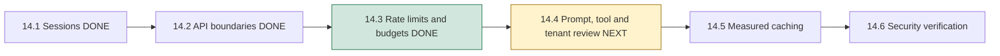
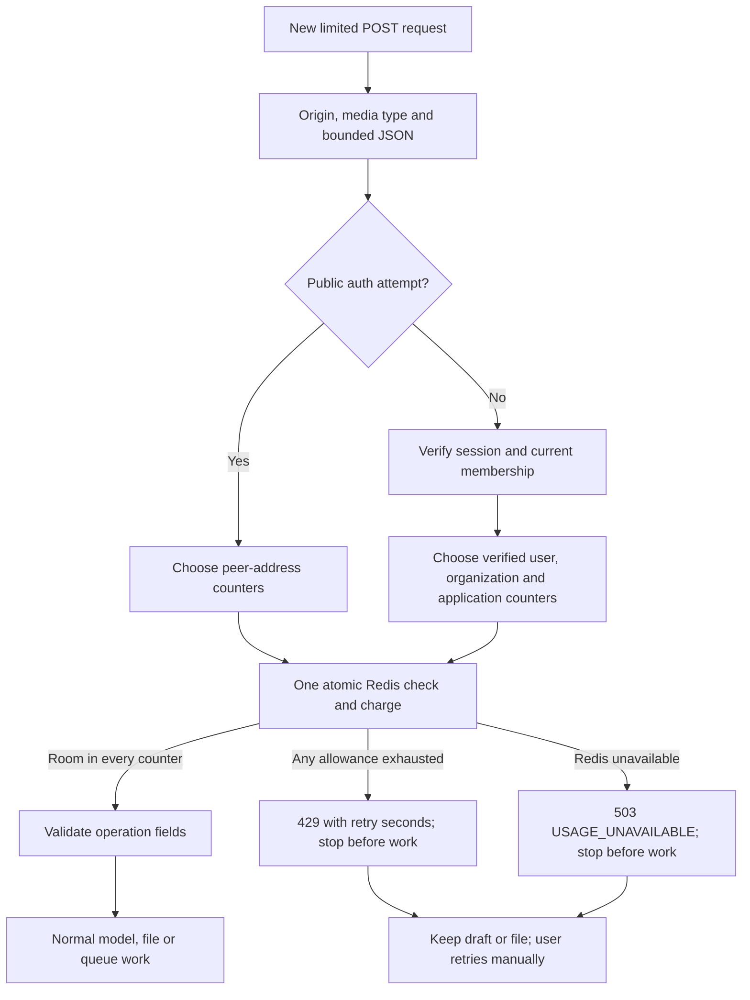

# Phase 14, Step 14.3: rate limits and usage budgets

## The problem, with an example

Imagine Asha clicks **Ask question** 100 times in one minute. Each individual
question can be short and valid, yet answering all of them could overload the
server or use up Gemini's allowance. The size checks in Step 14.2 cannot stop
that repetition. This step counts requests before allowing their expensive work.

A **rate limit** controls how quickly requests arrive, such as 20 requests per
minute. A **usage budget** controls how many requests may enter over a longer
period, such as 500 AI requests per organization over 24 hours. Both limits apply;
passing the minute limit does not override an exhausted 24-hour budget.

These are application admission limits. They do not represent Google's free
quota, money spent, or measured input/output tokens. An admitted request may
fail validation or find no evidence and therefore never call Gemini. It still
uses an allowance. We deliberately do not refund failures: repeatedly sending
bad requests should not give someone unlimited attempts.

## Where this fits



## What Redis does here

Think of Redis as a shared notebook with a counter and an expiry time for each
allowance. Every API process reads the same notebook. Keeping counters only in
JavaScript memory would let restarting the server or using a second API process
reset the allowance.

Redis already supports BullMQ's document queue. They have different jobs:

| Component | Question it answers |
| --- | --- |
| Admission counters in Redis | May this new request start? |
| BullMQ queue, also stored in Redis | Which accepted document job should run next? |
| Document worker | How do we extract, split and embed the accepted document? |

The counters use a separate `nexaai:{admission}:v1` namespace. They do not read or
delete BullMQ jobs. Keys contain hashes of the scope, rather than raw IPs or user
IDs. Hashing reduces direct exposure; it is not encryption or proof of anonymity.
Counter values contain numbers, not prompts, passwords, document text or tokens.

## The implemented defaults

| Shared group | Who shares it? | Allowance |
| --- | --- | --- |
| Login, registration and invitation registration | Same TCP peer address | 20 attempts per minute and 200 per 24 hours |
| Chat, document search and agent requests | Same verified user, across sessions/workspaces | 20 requests per minute |
| Those same AI endpoints | All members of one organization | 60 per minute and 500 per 24 hours |
| Those same AI endpoints | All organizations in this application/Redis namespace | 2,000 per 24 hours |
| Upload, direct document reprocessing and agent retry confirmation | Same verified user, across sessions/workspaces | 5 requests per minute |
| Those same document actions | All members of one organization | 100 per 24 hours |

For each counter, its window starts on its **first admitted request** and expires
after the stated duration. A 24-hour window is not a midnight reset or a continuously
sliding history. Fixed windows can allow bursts around a reset boundary. Denied
requests do not prolong the counter's lifetime or spend other counters.

The public limit uses `req.socket.remoteAddress`. A caller cannot reset it by
inventing an `X-Forwarded-For` header. Behind a reverse proxy, clients currently
share the proxy's peer address. Correct trusted-ingress/IP handling and any edge
limits must be configured and verified during deployment; do not simply trust
arbitrary forwarded headers. This is not comprehensive distributed-abuse protection.

## Walk through Asha's request

Suppose Asha has made 19 AI requests in her current minute. She sends a question.

1. The API checks origin, body type and JSON size as before.
2. It verifies her signed session and checks current organization membership.
3. Redis checks her user counter, her organization's minute/day counters and the
   application's day counter **together**.
4. If all have room, Redis increments all four counters, and the normal controller
   validates fields and runs retrieval/generation. Her user count becomes 20.
5. Her next Chat, search or agent request receives `429 RATE_LIMITED`. Switching
   screens, obtaining a fresh token or changing her selected workspace cannot
   reset the shared user counter.

If the wait is 42 seconds, the API sends `Retry-After: 42` and
`retryAfterSeconds: 42` in safe JSON. The browser displays “Try again in 42
seconds.” It does not resend the request automatically. The wait reflects the
currently exhausted counters; another member's later activity can still consume
remaining shared capacity before Asha retries.



“Atomic” means Redis completes the entire check-and-charge operation before
starting another request's check. Otherwise two simultaneous requests could both
read “one slot left” and both enter. A small Lua script performs that indivisible
operation inside Redis. It first checks every counter, then increments only if
none is exhausted. `PEXPIRE` attaches an automatic expiry to a new counter.

The gate precedes controller writes, Gemini, Multer's disk storage and queue
submission. Identity/membership database reads and bounded JSON parsing still
happen before some gates; this is not an edge-level connection/traffic limiter.

## Uploads, agent actions and outages

An agent can propose retrying a document, but only a separate confirmation can
submit that retry. Confirmation spends the same document allowance as an upload
or direct retry. The agent cannot bypass it by choosing a different route.

An explicit `RATE_LIMITED` or `USAGE_UNAVAILABLE` response proves this gate did not
admit the action. The upload screen keeps the chosen file and shows the safe error.
The agent screen permits a **manual** confirmation retry after that explicit
rejection. A lost response, timeout or unconfirmed queue receipt still blocks
repeating the action and requires the existing status-recovery workflow.

If Redis cannot verify counters, limited endpoints return `503 USAGE_UNAVAILABLE`.
They do not fall back to memory or unlimited access. History, document/proposal
status, cancellation, account/workspace recovery, dashboard, health and logout
are outside this gate. They retain their own authentication/database/queue needs;
being outside admission does not guarantee those dependencies are healthy.

## How the budget bounds work

Chat can generate at most one Gemini answer per admitted request. An agent
request can generate one routing decision and then one knowledge answer: at most
two Gemini calls. Search uses local embeddings, so it consumes the AI-work
allowance without necessarily calling Gemini. There is no automatic Gemini retry
in the current transport. Existing bounds remain: 1,000-character questions/agent
requests, 8,000-character evidence context, 4,096 maximum output tokens per
Gemini response and a default 30-second provider deadline.

Consequently the default application budget admits at most 2,000 such HTTP
requests per application window, with at most 4,000 Gemini calls if every one
takes the two-call agent path. This is an admission upper bound under the current
HTTP execution paths and retained Redis state, not observed usage or a billing
guarantee. Scripts/internal service calls that bypass the HTTP app do not spend it.
Different Gemini API consumers or Redis namespaces do not share this budget.

Each admitted document submission can still have BullMQ's existing three job
attempts. Automatic worker retries do not spend another HTTP allowance. The
10 MiB file cap and single-worker concurrency remain; archive expansion, parsing
CPU/memory, lifetime storage capacity and total backlogs need separate operational
controls. These counters are not storage quotas or worker resource limits.

## Configuration and persistence

Optional server-only settings adjust the three day budgets:

```dotenv
USAGE_AI_ORG_DAILY_LIMIT=500
USAGE_AI_APP_DAILY_LIMIT=2000
USAGE_DOCUMENT_ORG_DAILY_LIMIT=100
```

Values must be whole integers from 1 through 1,000,000. Missing settings use the
defaults above; malformed settings prevent normal app creation. The short limits
are explicit server policy in `usage.admission.ts`. No frontend setting controls
them, and no real environment file was changed in this step. Restart the API after
configuration changes. Existing counters retain their remaining TTL; changing a
limit does not reset the window.

The lazy admission connection uses the existing server-only `REDIS_URL` and is
closed during normal server shutdown. Existing Redis Docker configuration uses
a persistent volume, AOF with every-second syncing, and `noeviction`; no settings
were changed. API restart preserves Redis counters. Redis data loss, flushes,
changed namespaces or recovery from older persisted data can reset/rewind them;
they are not a financial ledger. Do not flush shared Redis to clear a limit.

## Verification

The real Redis/PostgreSQL integration suite covers concurrent admission from two
connections, expiry, reconnecting, key contents, shared public/AI/document limits,
session/workspace changes, organization isolation, application budgets, removed
membership, case/trailing-slash routes, exposed retry headers, and real connection
failure. It checks blocked uploads/actions leave no document, file, agent
execution or queue write. All records and counters use fixture-owned identifiers;
cleanup does not flush databases or queues.

Run `npm run test:usage-limits` from `backend`. Its regression group also checks
API boundaries, sessions, agent HTTP workflows and the Gemini transport. The
existing boundary/dashboard fixtures explicitly control allowance acceptance to
keep their malformed-request exercises independent of the policy suite.

Browser tests exercise safe retry guidance, retained drafts/files, manual agent
retry after explicit rejection, and existing uncertain-response protection.
Their new limit responses are controlled HTTP fixtures; shared Redis behavior
is verified by the backend integration suite. No live Gemini quota is spent.

Validation on 2026-10-26: backend/frontend builds, changed frontend lint/type checks,
64 backend tests and 11 API/upload utility tests passed. The browser regression
run passed 28 cases and found one mock that omitted the browser-visible retry
header. After adding the same CORS exposure used by the API, all five focused
checks passed, including that case: 29 distinct browser cases passed across the
runs. The real API suite separately verifies exposed `Retry-After` headers.

## Next step

**14.4: review prompt injection, tool permissions, organization isolation and
secret handling.** That is a separate step. Rate limits restrict how often an
operation starts; the next review checks what that operation may do with untrusted
document content and tool requests.
