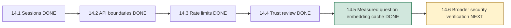
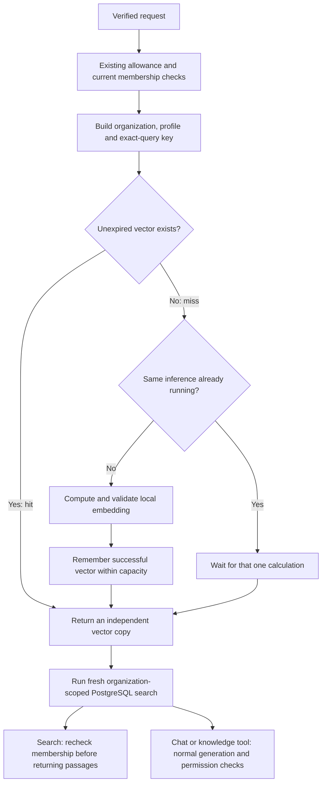

# Phase 14, Step 14.5: measure repeated work and cache question embeddings

## Start with a repeated question

Asha asks, “How many annual leave days do employees receive?” She asks again a
minute later. Before this step, each request performs these operations:

1. Check the session, allowance and current membership.
2. Turn the question into a 384-number embedding using the local model.
3. Search the organization's current indexed passages in PostgreSQL.
4. Build evidence and ask Gemini for an answer when relevant evidence exists.
5. Validate the answer and save the exchange with current permission checks.

A **cache** temporarily remembers a previous calculation. An **embedding** is
the list of numbers that represents text for similarity search. Computing the
embedding for identical question text with the same model/settings repeats work.
It does not depend on which documents are currently stored.

This step reuses that calculation. Every search still reads current documents,
and every admitted answer request still follows the existing generation/save flow.

## Where we are



## Measurement came first

The initial baseline used one synthetic public question and the actual local
embedding model. Loading the model and performing its first inference took
1,037.33 ms. The next 12 repeated computations had a median of **10.56 ms**.
That is a small repeated CPU cost, not evidence that embedding dominates a whole
Chat request. Gemini/network/database work can take much longer.

A comparison after implementing the cache measured:

| Stage | Repetitions | Median | Minimum | Maximum |
| --- | --- | --- | --- | --- |
| Repeated inference with model already loaded | 12 | 10.943 ms | 9.837 ms | 42.830 ms |
| Repeated cache hits after one fill | 12 | 0.040 ms | 0.024 ms | 0.495 ms |

That comparison's model warmup took 900.144 ms and was excluded from both rows.
The cache path performed **one inference for 13 requests**, including its first
fill. These are measurements from this machine and run, with a tiny repeated-input
sample. They are not production load results, typical-user cache-hit rates or
end-to-end answer latency measurements. The first request still pays inference
cost, and a restart loses cached entries.

Reproduce from `backend`:

```powershell
npm.cmd run benchmark:query-embeddings
```

The script reports timings and counts only. It uses a synthetic question and
the local model; it does not call Gemini or read private document records.

## Choosing what to cache

| Candidate | Decision in this step | Reason |
| --- | --- | --- |
| Question-to-vector calculation | Cache briefly | Measured repeat cost; depends on question/model settings |
| Retrieved passages/source metadata | Read PostgreSQL each time | Uploads, processing, renames and deletions change eligibility/content |
| Generated answers | Generate through the existing path | Grounding, source changes, private history and provider behavior need separate treatment |
| Membership/roles/session validity | Check through existing authorization | A cache hit must not revive removed permissions |
| Dashboard counts | Keep current database aggregation | No measurement here justifies caching those results |
| Document-processing chunk embeddings | Keep existing persistence workflow | They already belong to durable indexed document state |

This keeps the optimization narrow enough to verify. It does not change product
answers, request budgets or database write semantics.

## What is a cache key?

A key identifies which calculation an entry represents. Our key is a SHA-256 hash
of a JSON array containing:

```text
[verified organization ID, embedding profile, exact question text]
```

The shared profile names `Xenova/all-MiniLM-L6-v2`, mean pooling, normalized output,
384 dimensions and a version number. The generator uses the same model/pooling/
normalization settings. Bump the version if preprocessing changes. A profile/model
change selects a different key; process restarts also clear the disposable cache.

“Exact text” means the cache does not lowercase, guess that two questions mean the
same thing, or remove extra characters. Existing HTTP validation trims input before
calling search. Two genuinely different strings get different cache entries.

An identical question in a different organization gets a different key. This is
conservative tenant separation even though the text-to-vector calculation itself
does not use document data. The organization comes from verified server context,
not a field supplied by the model or browser.

Hashing avoids retaining plain question text as a lookup key. It is not encryption:
vectors and hashes are derived from user input and remain confidential process
data. Text is still needed while a new inference is running. Nothing is logged
about actual query text, and this cache does not store document passages or answers.

## Follow a cache hit and a miss



A **hit** finds a reusable entry. A **miss** needs a new calculation. If 30 identical
requests arrive together for the same organization while the first calculation
is still running, they share one inference. This is called **single-flight**: one
calculation in flight, with several callers waiting for it. It does not merge the
requests' authorization, SQL searches, provider calls, responses or saved messages.

Each caller receives a separate array copy. Changing a returned vector cannot
corrupt the entry another request will use. Failed, zero, nonfinite or incorrectly
sized embeddings are never cached; a later request can attempt inference again.

## Bounds and expiry

| Setting | Implemented policy |
| --- | --- |
| Location | One cache per API process, in memory |
| Successful entries | At most 128 across all organizations in that process |
| Valid lifetime | Five minutes from successful fill; hits do not extend it |
| Eviction | Remove the least recently used entry when capacity is reached |
| Tracked distinct pending calculations | At most 16 |
| Pending map full | New distinct work computes normally without being cached |
| Redis use | None for this cache |

**TTL** means time to live. A monotonic process clock measures it, avoiding wall
clock adjustments affecting expiry. Expired entries are not reused and are removed
on the next cache access; there is no background deletion timer. Idle expired
arrays can remain in memory until another access or process exit, within the entry
bound. This is not a strict five-minute memory-erasure guarantee.

**LRU** means least recently used. Imagine only two slots: A, B, then access A,
then add C. B is removed because it was used least recently. Our default has 128
slots. One busy organization can cause another's entries to be evicted, affecting
performance but not data scope.

128 vectors contain 49,152 JavaScript numbers: roughly 384 KiB of number slots,
plus array/map/key overhead, temporary copies and pending work. This does not
include model weights or bound total inference CPU/memory. The pending-map limit
bounds bookkeeping, not all concurrent inference. Existing request allowances
still apply, including to warm hits.

Process memory deliberately separates optional, evictable calculations from Redis's
durable BullMQ job data and shared admission counters. Each API process has its
own hit rate and capacity; multiple processes can each compute the same question.
Losing the cache is harmless to correctness. Redis remains necessary for queue/
allowance operations under their existing policies.

## Why document changes need no cache invalidation here

**Invalidation** means stopping reuse when an entry's inputs are no longer valid.
An answer/passages cache would need to react to document changes. This cache
stores only `question + model settings -> vector`, so its calculation remains
valid when a document is renamed, added, processed or deleted.

The SQL search runs after every cache lookup. A pending-deletion document is
excluded, a processing document is excluded, and a newly completed document can
appear immediately in the next query's database view. A completed deletion
disappears from the next search. This avoids a document invalidation scheme by
keeping document-derived results out of the cache.

“Fresh” means the current database view for that query. It does not claim that
concurrent document changes after retrieval can retract already generated/sent
content. Existing snapshot and permission semantics remain.

For example, Asha asks about leave and warms the cache. An administrator then
removes a document. Asha's next request can reuse its question vector but must
search again; it cannot receive that deleted document from this cache. If Asha's
membership is removed, the request is rejected before using the warm entry.

## What was verified

The unit tests cover organization/text isolation, independent vector copies,
exact TTL boundaries, no sliding expiry, LRU capacity, simultaneous requests,
failed inference recovery, invalid vectors, invalid input/configuration and
pending-capacity bypass.

The new production-app integration tests use real JWTs, PostgreSQL and pgvector.
They warm the cache and then change names/content, deletion flags, processing
status, indexed documents and membership. They also test tenant separation,
authentication, admission rejection and two separately generated/saved Chat
exchanges using one cached question vector. Only inference/provider output and
allowance acceptance are controlled in that suite.

The regression group retains real semantic search, agent knowledge/routing,
conversation persistence and the Step 14.4 injection/membership tests. Additional
real worker/RAG checks verify the shared profile still produces usable indexed
vectors and preserves failure/retry behavior. Fixture cleanup targets only its
own records, queue and files; no live Gemini calls are required.

Run `npm.cmd run test:query-cache` from `backend`. The roadmap records the final
validation results. No database migration, Redis configuration or browser UI
change is needed for this step.

Validation on 2026-10-26: the cache regression group passed 61 tests. An additional
run of `document.worker.integration.test.cjs` and `rag.query.integration.test.cjs`
passed 12 tests, including actual local embedding generation, worker extraction,
failure and retry recovery: **73 tests total**. The backend build, benchmark and
whitespace checks passed. The frontend was unchanged; no new browser run was
needed to verify this server-side optimization.

## Next: Step 14.6

We will check the combined security behavior: malformed requests, expired/revoked
credentials, changed roles, cross-organization IDs, limited actions, warm-cache
requests and recovery. The purpose is to verify the pieces together before moving
to Phase 15 monitoring and audit history.
