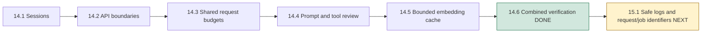
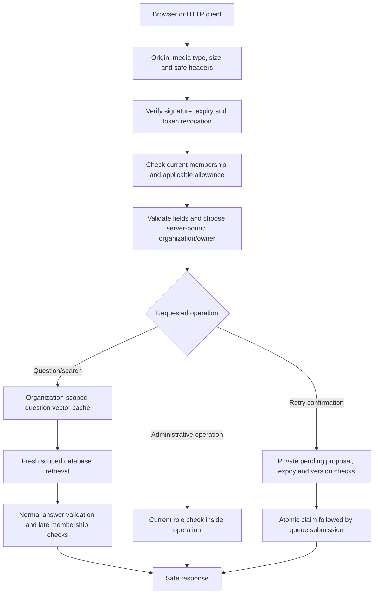
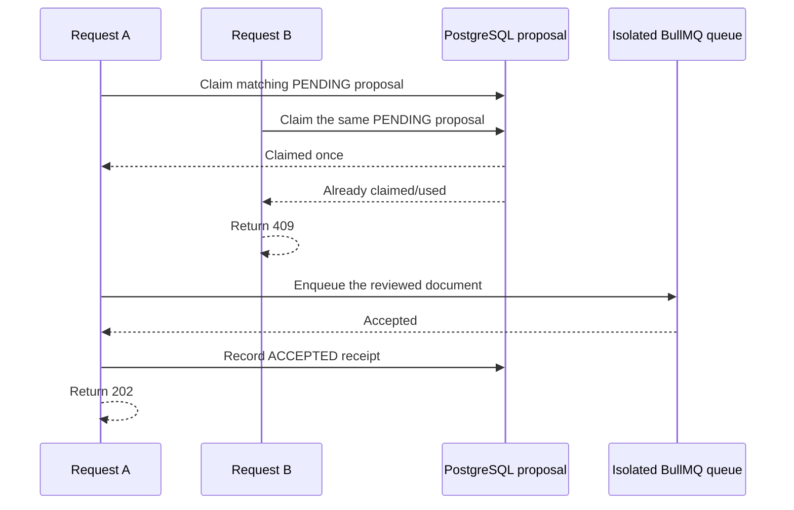

# Phase 14, Step 14.6: verify security controls together

## Why another verification step?

Earlier steps checked individual controls: sessions, request validation, budgets,
tool permissions and caching. A control can work alone yet fail when another
feature changes the path through the application.

For example, Asha asks a question and warms the embedding cache. An administrator
then removes her membership. Asha repeats the question with the same valid token.
The cached calculation still exists, but she no longer has permission to search
that organization. A correct response denies access before returning any passage.

This step verifies those combinations using the shipped application, then runs
the broader regression suite. It adds verification infrastructure rather than
another product feature.

## Phase position



The roadmap records whether the completion gate passed. Completing the local
security phase does not mean deployment, live-model evaluation or production
operations have been completed.

## Follow a verified request



Exact ordering varies by endpoint. Public login uses peer-address counters without
a signed session. Ordinary reads do not spend AI/document submission budgets.
Controllers retain their operation-specific permission checks even after admission.
The cache does not store permissions, retrieved passages or generated answers.

## The new combined test

`security.combined.integration.test.cjs` starts the actual `createApiApp` factory.
It uses real PostgreSQL/pgvector, JWT verification, logout fingerprints, private
Redis admission counters and an isolated BullMQ queue. Embeddings and Gemini
responses are controlled so the security tests do not spend live model quota.

The fixture now has a **full API mode**. Existing focused router tests can retain
their narrower setup. Full mode uses all shipped headers, origins, request sizes,
routes and shared rate policy; it does not replace allowance acceptance with an
always-successful stub. An unreachable, separately configured admission connection
tests safe failure without stopping the developer's Redis server.

The combined scenarios share a warm application cache. Between scenarios, the
test clears only its own counter namespace to keep unrelated scenarios from
consuming each other's allowance. Within the budget scenario, it deliberately
exhausts the real Redis user counter. No shared queue or developer limit is flushed.

| Scenario | Expected behavior and evidence |
| --- | --- |
| Password login followed by repeated search | Valid current member; safe headers; same-organization evidence; one inference for two searches |
| Expired or incorrectly signed token after cache warmup | `401`; no extra inference, model call, message, execution or queued job |
| Foreign document ID | Denied; foreign document remains unchanged; no queue submission |
| Body context override or injected approval | `400`; does not become identity or confirmation authority |
| Hostile browser origin | `403 ORIGIN_NOT_ALLOWED`; request stops before protected work |
| Stale server-signed OWNER role | Current MEMBER role blocks administration; promotion/demotion changes access immediately |
| Another user's proposal | Confirmation denied even when the caller is a member of the same organization |
| Two simultaneous confirmation clicks | One `202`, one `409`, one waiting queue job; later replay also fails |
| Membership removed during generation with a cached question | Generated exchange withheld; no partial saved messages |
| Membership removed before a warm-cache request | Denied; workspace list/switch and sign-out still allow account recovery |
| Logged-out token reused | `401 SESSION_REVOKED`; a separately issued workspace credential remains independent |
| Real Redis user allowance exhausted | Search, Chat and agent requests receive `429` with retry seconds; no extra work |
| Admission connection unavailable | Limited operations receive safe `503`; permitted reads/logout still work; limited requests recover after reconnection |

### Why a denied delete can return 403 or 404

The first focused run expected `404` for every foreign-ID delete. That assumption
was wrong for the existing product policy: an ordinary member has no deletion
permission, so the server returns `403` before checking document existence.

The corrected test checks that both a missing and a foreign ID receive `403` for
a member. It then grants the fixture user the current ADMIN role and verifies a
foreign ID still receives `404`. That separates role permission from tenant scope
without changing correct application behavior.

## Understand the confirmation race

Suppose Asha double-clicks **Confirm retry**, or two tabs submit the same proposal.
The browser prevents ordinary duplicates, but the server must remain correct when
two valid HTTP requests arrive anyway.



Which request wins is not important; exactly one may claim the proposal. The test
checks the two statuses and actual waiting-job count. It does not infer safety
only from a disabled browser button. The existing uncertain-receipt tests also
verify that losing an acknowledgement cannot permit automatic resubmission.

## Browser verification

The existing Chrome agent journey now starts the fixture in full API mode. It
performs real password login, current document counts, cited knowledge, proposal
cancellation, a separately confirmed queued retry, document-status reads and
private proposal recovery after a new login. Redis allowances are real and scoped
to that fixture. The worker is not started in this journey: “accepted” and
“waiting” do not claim processing has finished.

The broader Chrome regression includes session expiry and sign-out, membership
restriction/recovery, role-aware organization screens, validation, bounded uploads,
manual retry guidance, workspace changes and safe Markdown for new/saved answers.
Some are controlled HTTP UI tests; dashboard/boundary/agent integration journeys
use actual isolated authenticated APIs. The combined backend suite supplies the
real Redis/cached-read attack checks that are not simulated through every screen.

## Repeat the gate

From `backend`:

```powershell
npm.cmd run test:security
```

This builds TypeScript and runs a fixed, deduplicated list of 36 suites at two
concurrent test processes. It includes session/organization checks, API boundaries,
real Redis limits, tools and proposals, cache behavior, conversation privacy,
document search/worker/recovery, dashboard scope and provider error handling.
Live-Gemini scripts are excluded from this repeatable gate.

From `frontend`:

```powershell
npm.cmd run build
node --experimental-strip-types --test tests/api.test.mjs tests/upload.test.mjs
node node_modules/@playwright/test/cli.js test --workers=3 --reporter=line
```

The changed integrated browser test is also linted and type-checked. Fixture
records use generated identifiers. Queue removal is guarded by its private queue
name; admission cleanup uses its private prefix; uploads created by worker tests
are removed only from their fixture directory. Existing developer data is retained.

### Reliability changes found by the broad run

The first broad backend run found one timing-sensitive test: its 80 ms Redis
window could expire between two commands on a busy machine. The test now first
verifies denial with a normal window, shortens only its fixture-owned key's TTL,
waits for Redis to report expiry within a bounded deadline, and verifies admission
again. This tests actual expiry without assuming a fast second round trip.

The first broad browser run passed 112 cases and encountered a connection reset in
the full-API agent proxy. The proxy now requests a fresh connection for each
forwarded request, avoiding idle-socket reuse, and requires a successful child
cleanup exit. No failed request is automatically resent. The affected journey
passed three consecutive repeats after the change. These repeats validate the
transport adjustment; they do not establish the unique cause of every possible
connection reset.

### Final validation on 2026-10-26

| Check | Result |
| --- | --- |
| Full backend gate after the TTL test correction | **311/311 passed**, 36 distinct suite files, one complete rerun |
| Browser regression | 112 passed; one agent proxy connection reset, addressed as described above |
| Corrected full-API agent journey | **3/3 consecutive repeats passed**, including successful fixture cleanup |
| Distinct browser cases verified across those runs | **113** |
| API/upload utility tests | **11/11 passed** |
| Backend/frontend builds | Passed |
| Changed browser test lint and type check | Passed |
| Whitespace and changed helper/runner syntax checks | Passed |

The initial focused full-API agent journey also passed before the broad run. It
is not counted as an extra distinct browser case. The gate is complete for the
documented local workflow; Phase 15 implementation has not begun.

## What this completion gate does not certify

This is a local application security regression gate. Controlled model responses
prove deterministic permission/dispatch boundaries; they do not prove that Gemini
always ignores hostile text or that every cited statement follows from evidence.
Live adversarial and answer-quality evaluation remains Phase 16.

Earlier credential/upload copies in Git history and older retained error data are
not erased by these tests. Production credential rotation, TLS/trusted ingress,
least-privilege database configuration, parser/archive resource limits, dependency
assessment, backup/recovery and capacity testing need their separate deployment
and operational work. The previous guides record those specific boundaries.

## Next lesson: Phase 15, Step 15.1

We will introduce safe structured logs and request/job identifiers. Imagine a user
reports “my upload failed.” An identifier lets us connect the HTTP request, saved
document and worker attempt without printing the uploaded text, password or API
key. This step only verifies the security gate; it does not start that logging work.
