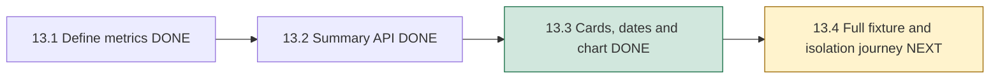
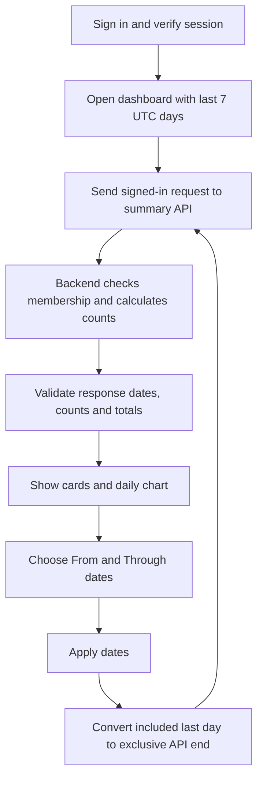

# Phase 13, Step 13.3: dashboard cards, dates and chart

## What we are building in this step

Step 13.1 defined what each number means. Step 13.2 added the backend endpoint
that calculates those numbers. This step connects the endpoint to `/dashboard`,
the page you see after signing in.

An **endpoint** is an address that accepts a request and returns data. A **card**
displays one useful number. A **chart** shows how daily numbers change over time.
The frontend displays the backend's counts; it does not count everyone's records
or ask Gemini to calculate them.



## How it works, one action at a time



1. Sign in normally. The existing session guard still verifies your identity
   before showing workspace pages.
2. The dashboard requests seven days, ending today in UTC. The authenticated API
   helper attaches your session token; organization and user IDs are not filters.
3. While waiting, the screen says “Loading workspace summary.” It shows no old
   cards underneath a new selection, so previous numbers cannot look current.
4. The response is checked before rendering: known definition version, expected
   dates, UTC timezone, 1–90 consecutive daily rows, nonnegative safe integer counts,
   and agreement between status/outcome totals, daily personal activity and cards.
5. Valid data becomes three cards, a daily chart and an expandable values table.
6. Apply dates requests a new summary. Editing a date alone does not fetch; the
   “Showing activity from … through …” text identifies the applied range.
7. “Last 7 days” restores the default selection. “Refresh summary” reads the
   currently applied range again, useful after an upload or a new question.

The welcome heading, account details, document link and chat link remain available.

## Understand each card with an example

Suppose your organization has three retained documents: one completed, one failed
and one uploaded. You asked two chat questions and started four agent requests in
the selected dates. Your teammate asked ten questions.

| Card | Value | Why |
| --- | --- | --- |
| Current documents | 3 | Shared organization documents, excluding pending deletion. |
| My saved questions | 2 | Only your retained USER chat messages in the selected dates. |
| My agent requests | 4 | Only your retained REQUEST records started in the selected dates. |

Your teammate's ten questions do not appear in your personal card, including when
you are an owner or administrator. The document card breaks down all four saved
statuses. The agent card breaks down STARTED, SUCCEEDED, FAILED and UNCONFIRMED;
“Started or interrupted” explains that STARTED can remain after an interruption.

An agent request marked “Succeeded” may have produced a clarification or a proposal.
It does not certify answer correctness or completion of a background document job.

Changing dates changes activity counts. The document card still shows the three
documents that exist now, even when they were uploaded outside the selected range.

## Why does Through differ from the API's to date?

People commonly expect “October 25 through October 26” to include both dates.
The date inputs follow that expectation:

```text
From:    2026-10-25
Through: 2026-10-26 (included)
             |
             v
API query: from=2026-10-25&to=2026-10-27
             |
             v
Include timestamps >= Oct 25 00:00 UTC and < Oct 27 00:00 UTC
```

Adding one UTC day supplies the exclusive API boundary. We use UTC arithmetic,
so an India timezone or a daylight-saving change cannot move a day into a different
bucket. The page labels both controls UTC. A range includes at most 90 days and
cannot end after today's UTC date. Today may be incomplete.

Invalid/inverted/overlong ranges show an explanation without sending another
request. Required date inputs and their maximum also provide browser validation.
The backend remains responsible for enforcing these rules independently.

## Reading the chart

Three lines show retained activity for each UTC day:

- Solid green: uploads by anyone in your organization.
- Dashed purple: your saved chat questions.
- Dotted orange: your agent requests.

Days without activity appear as zeros. One-day selections display points. An empty
range displays “No retained activity in this date range.” Current documents can
still exist when there is no activity in the selected dates.

Choose **View daily values** to see every date and its exact counts. This keyboard
accessible table also avoids depending on color or a visual estimate of line height.
On narrow screens, cards stack and the table scrolls inside its own region.
The chart uses SVG, the browser's native way to draw lines and text; no charting
library or new package is required.

## What happens when something fails?

The dashboard clears old metrics before loading. A failed request shows an error
and a Try again button; it does not substitute zeros. A malformed success response
also shows an error rather than drawing misleading counts. Empty data is a valid
response with actual zeros, and is presented separately from a failure.

If membership has been removed, the page suggests switching organization or signing
in again. An expired session returns to sign-in through the existing auth helper.
Raw server errors are not displayed. Request and response data are not persisted
in local/session storage; the shared client requests with `cache: no-store`.

Leaving the page aborts its pending read. Changing organization recreates the page,
clears old counts/date drafts and uses the new token. An old response cannot restore
private cards after sign-out or an organization switch. Code comments explain these
guards, date conversion, response validation and chart accessibility.

## Files and validation

The page and chart are in `src/features/analytics/DashboardPage.tsx`. Date conversion,
response types and runtime checks are in `dashboard.types.ts`. `App.tsx` connects
the page to the existing protected route; `App.css` supplies its responsive layout.

Browser tests for the new dashboard use controlled API responses in real Chrome.
Existing isolated UI tests share `tests/support/browser.ts` so their fictional
tokens do not reach a developer's actual summary endpoint. Each test can override
that default route. The existing integrated Agent journey keeps its actual API
proxy and imports Playwright directly.

From `frontend`, repeat the focused screen checks with:

```powershell
npm.cmd run build
node node_modules/@playwright/test/cli.js test tests/browser/dashboard.spec.ts --workers=2
```

The browser configuration launches the local Vite server and uses installed Chrome.
It does not need a Gemini key, Redis connection or live database for these mocked
screen checks.

Completed on 2026-10-26: frontend production build, changed-file lint, TypeScript
checks for the new browser test/fixture, and **97 isolated Chrome tests passed**,
including **10 new dashboard checks**. The local test server needed an explicit
stop after the browser workers finished, after which the runner exited successfully.
The new screen's checks cover default/one-day/90-day ranges, exclusive date conversion from an India timezone,
exact cards/table values, invalid input without a request, loading, empty data,
outage recovery, malformed responses, revoked/expired access, mobile fit, keyboard
table access and late responses after sign-out or organization switch.

The backend's real database tests from 13.2 already verify its aggregates and
snapshot permissions. **Step 13.4 remains next**: verify this dashboard against
known saved database fixtures through the actual authenticated summary API, including
another organization and another member. This step's mocked responses demonstrate
frontend behavior; they do not replace that complete journey.

Counts describe retained data. Deletion can reduce earlier daily activity. No token
usage, costs, live Redis status or historical status reconstruction is inferred.
This step does not benchmark a large organization or add automatic polling.
