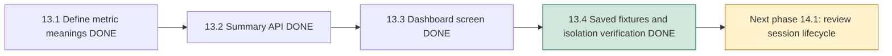
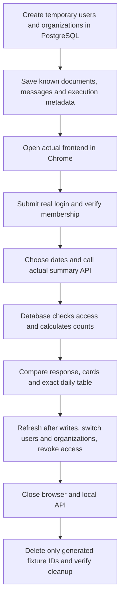

# Phase 13, Step 13.4: verify the dashboard with actual saved records

## What this step teaches

A dashboard can look correct while counting the wrong records. To check its
meaning, start with a small dataset whose answer you can calculate yourself,
then compare that answer with both the API response and the displayed cards.

These known test records are called **fixtures**. They use temporary accounts and
organizations in local PostgreSQL. The browser signs in through the real login
endpoint and displays the actual summary endpoint's response.



## The complete path we checked



The browser test forwards requests to a temporary local API port. This forwarding
is a **transport proxy**: it sends the request to the real Express router and returns
its response unchanged. JWT authentication, password checking, current membership,
organization switching and database aggregation all execute normally.

Documents are seeded as database records; no PDF extraction or processing worker
runs during this check. Saved chat messages and agent metadata are seeded directly.
Reading the dashboard does not require Gemini, embeddings or Redis.

## Calculate the expected answer first

The three-day reporting period starts two UTC days before today and includes today.
Dates are relative to the test run, so the fixtures do not become stale next week.
On 2026-10-26, the selection is October 24 through October 26, and the API's exclusive
end is October 27 at midnight UTC.

The main organization, **Dashboard Support**, contains:

| Saved document | Created | Current status | Counted? |
| --- | --- | --- | --- |
| Owner's old document | Ten days before today | COMPLETED | Yes, current total only. |
| Teammate's document | Two days before today | PROCESSING | Yes. |
| Teammate's document | Yesterday | FAILED | Yes. |
| Owner's document | Today | UPLOADED | Yes. |
| Teammate's old draft | Yesterday | FAILED with deletion requested | No. |

That means **4 current documents**, one of each status. Three uploads fall in the
selected activity dates. The teammate's uploads count because documents are shared
within the organization.

The owner's conversation predates the reporting period. It contains two USER messages
inside the period, plus ASSISTANT replies and boundary records outside it. The message
timestamps decide the question count; the conversation's creation date does not.

The owner has four REQUEST executions inside the period: one SUCCEEDED yesterday and
one each of FAILED, STARTED and UNCONFIRMED today. CONFIRM/CANCEL operations are also
seeded and must not inflate this metric. A request just before the period and one
exactly at the exclusive end must be excluded.

| UTC day | Organization uploads | Owner's questions | Owner's agent requests |
| --- | --- | --- | --- |
| Two days before today | 1 | 0 | 0 |
| Yesterday | 1 | 1 | 1 |
| Today | 1 | 1 | 3 |
| Selected totals | 3 | 2 | 4 |

The three cards therefore show **4 / 2 / 4**. The chart and expandable table must
match each row. The API response must omit private content, storage paths, passwords
and user/organization IDs.

The default seven-day range also includes one older question and one older request.
Its cards show **4 / 3 / 5**. This checks that changing dates changes activity while
current document totals remain the same.

## Check privacy with different people and organizations

The teammate signs into Dashboard Support as MEMBER. They see the same four documents
but **3 questions and 7 agent requests**, all belonging to their own account.
The owner sees their own 2 and 4; an OWNER role does not grant access to private
teammate activity through this API.

The owner also belongs to **Dashboard Sales** as MEMBER. Switching organizations
through the actual UI issues a new token. Sales shows **2 documents / 1 question /
2 requests**. Switching back restores Support's default seven-day values, not the
previous organization's values or date draft.

A third organization, **Dashboard Unrelated**, has another user's records and no
membership for the owner. Its records must contribute to none of the counts.
Direct requests with an organization/user query override return 400 with no data.

## Check that changes and failures mean what they say

| Action in an isolated fixture | Expected behavior |
| --- | --- |
| Select yesterday only | 4 documents, 1 question, 1 request. |
| Select an older empty period | 4 documents, zero personal activity and an empty-activity explanation. |
| Save another document, own USER message and own REQUEST; refresh selected three days | Cards change from 4/2/4 to 5/3/5. |
| Delete the retained failed document and the owner's conversation; refresh | 4/0/5: old questions disappear, retained agent metadata remains. |
| Change current membership from OWNER to MEMBER, then ADMIN, while keeping the original token | Each role receives only the same scoped personal activity. |
| Remove the owner's Support membership while its token is still signed | Refresh returns 403; old cards clear and recovery guidance appears. |
| Switch to the remaining Sales membership | Dashboard recovers with Sales values 2/1/2. |

Writes/removal in these scenarios are fixture controls sent over the parent/child
process channel. No test mutation endpoint is added to the application, and no
arbitrary SQL or caller-selected IDs are accepted by those controls. An acknowledgement
means the database mutation committed before the browser refresh begins.

Deletion here verifies retained-count semantics using direct fixture changes. It
does not rerun the separate document file/queue deletion journey from Phase 5.

## Implementation and reproducibility

- `backend/tests/helpers/dashboard.http-fixture.cjs` creates the isolated local
  auth/analytics API, records, controlled mutations and verified cleanup.
- `frontend/tests/support/dashboard-live.ts` starts/stops that child API and forwards
  browser requests to it.
- `frontend/tests/browser/dashboard-integrated.spec.ts` contains three actual API
  journeys: known counts/changes, user/organization privacy, and revoked-access recovery.

Code comments explain UTC boundaries, committed mutation acknowledgements, real API
forwarding and cleanup safeguards.

Run the backend checks first from `backend`:

```powershell
npm.cmd run test:dashboard-summary
```

Then, from `frontend`:

```powershell
npm.cmd run build
node node_modules/@playwright/test/cli.js test tests/browser/dashboard-integrated.spec.ts tests/browser/dashboard.spec.ts --workers=1 --reporter=line
```

Local PostgreSQL with existing migrations and installed Chrome are required. Keep
database configuration in the backend's existing environment file. The fixture uses
a temporary signing secret and fictional credentials; it never prints real settings.

Each journey deletes only its generated UUIDs. Cleanup checks that its organizations,
users, documents, conversations, messages and execution records are all gone. A
failed cleanup fails the test. There is no table truncation or database reset.

The first journey saves desktop and 360-pixel mobile screenshots under its ignored
`frontend/test-results/dashboard-integrated-*/` output directory. The mobile check
also asserts that the page stays within the viewport; the daily table scrolls inside
its own region. Chrome runs with the Asia/Kolkata timezone while reporting uses UTC.

## Validation result and remaining scope

**PASSED on 2026-10-26.** Both production builds, lint for the new frontend test
and fixture, and TypeScript checks for those files passed. The backend command
reported **23 passing contract/database tests**. The browser command reported
**13 passing Chrome tests**: three new real-API journeys and ten existing dashboard
behavior tests with controlled responses. All three real-API fixture cleanups passed.

Desktop and mobile screenshots were inspected. Counts, scopes and exact daily values
matched the expected records; mobile content remained inside the viewport. On this
Windows run, the browser workers finished but Vite's managed shutdown waited. Stopping
the test-owned Vite process released the runner, which reported 13 passes and exited
with code 0. This was local test-server cleanup, not a dashboard/API failure.

**Phase 13 is complete for the documented local workflow.** No production application
changes or new migrations were needed in this verification step. New code adds test
fixtures and journeys with explanatory comments.

Phase 13's local completion gate is the agreement between known saved records,
actual authenticated API responses, displayed cards/table and isolation checks.
This is a local functional check. Production load, session security review, backups,
deployment and broad model evaluation remain later phases.

The next lesson is **Phase 14, Step 14.1: review session expiry, sign-out and
revoked-membership handling**. We will first explain how a signed-in session starts,
ends and loses access before choosing any changes.
