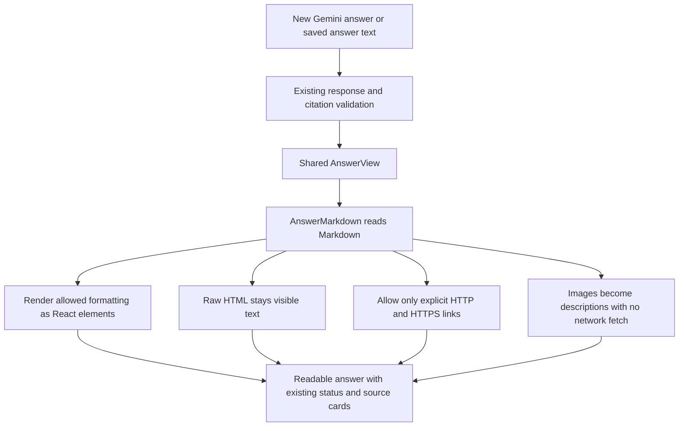

# Phase 9, Step 9.2: readable answers with safe Markdown

## Our position in the project

```text
9.1 Private conversation deletion DONE
  -> 9.2 Safe answer Markdown DONE
  -> Phase 9 planned local scope complete
  -> 12.1 Define agent tools and permissions NEXT
```

## What problem did we solve?

Gemini returns text. It can use Markdown, a simple way to describe formatting with
characters such as `**bold**`, `- list item`, or backticks around code. Previously,
NexaAI showed those characters as ordinary text. Now it displays the formatting.

For example, this answer text:

````text
## Annual leave

Employees receive **18 days** [S1].

1. Ask your manager.
2. Submit a request.

Use `leaveDays` in code:

```js
const leaveDays = 18;
```
````

becomes a heading, a bold number, a numbered list, inline code, and a separate code
block. `[S1]` remains visible, and the existing Sources section still identifies the
document and passage used by the answer.

This changes how an answer looks. It does not change what Gemini knows, pass earlier
turns as context, or make an answer more factually reliable.

## What is a renderer?

A **renderer** turns a representation into something displayed on screen. Here,
`react-markdown` reads Markdown text and creates React elements such as paragraphs,
lists, and code blocks. React then displays those elements in the browser.

The [official react-markdown documentation](https://github.com/remarkjs/react-markdown#security)
describes its default safety behavior and warns that customization can change it.
Our component keeps HTML as escaped text and adds explicit restrictions for links,
images, and supported elements.



The same `AnswerView` handles a new answer and an answer reopened from history.
Both now call `AnswerMarkdown`, preventing different formatting or safety rules
between those two paths. The database keeps the original text; no migration or
rewriting of existing messages is required.

## How do we keep generated content safe?

HTML is the browser's page language. Some HTML can run scripts or load external
content. An answer must not be allowed to supply arbitrary page behavior.

| Input in an answer | What the user sees or can do |
| --- | --- |
| `**18 days**` | Bold text |
| Bullets, numbered lists, quotations, headings | Readable document formatting |
| Backticks and fenced code blocks | Code displayed as text; never executed |
| `<script>alert(1)</script>` or an HTML image | Literal text; no script or image element |
| An explicit `https://` or `http://` Markdown link | Clickable link opening in a new tab |
| JavaScript, data, file, relative, or protocol-relative link | Label displayed as text, with no clickable destination |
| Markdown image | Its description as text; no image is fetched |

Generated web links are ordinary external links, not validated evidence. The Sources
section still comes from backend-validated citations, separately from Markdown.
External links use `noopener noreferrer`, which prevents access to the originating
tab through the opener relationship and omits the referring page URL.

Answer headings start at level three because the page and answer-status headings
already occupy the higher levels. Long code scrolls inside its own box rather than
widening the entire page. Long links wrap on small screens.

Questions, conversation titles, and source filenames remain plain React text. A
filename such as `**handbook**.txt` is displayed exactly as a filename, not as bold
Markdown. Comments in the implementation explain these boundaries.

## What changed in code?

- `src/features/chat/AnswerMarkdown.tsx`: shared Markdown renderer, formatting
  allowlist, URL checks, image descriptions, and heading levels.
- `src/features/chat/ChatPage.tsx`: use the renderer inside the existing answer view.
- `src/App.css`: spacing, code styling, scrolling, and wrapping for Markdown blocks.
- `package.json` and `package-lock.json`: add `react-markdown` 10.1.0 and its resolved
  dependencies, so a clean installation includes the renderer.
- `tests/browser/markdown.spec.ts`: verify new and saved answers, unsafe content,
  source/question text, and small-screen layout.

This step supports standard Markdown. GitHub-style tables, task checkboxes, syntax
highlighting, and executable code are not part of this implementation.

## Validate it yourself

Reload the frontend after installing the updated dependencies if needed.

1. Use a ready handbook document and ask: “Summarize the leave rules as a numbered
   list, with the number of days in bold. Include source citations.”
2. Check that a list and bold text appear if Gemini uses that Markdown syntax.
3. Open another chat, then reopen the saved answer. Formatting should be consistent.
4. Check that its Sources section still shows the document name and passage.
5. On a narrow screen, verify that the page fits. Long code should scroll inside
   its code block.

Gemini may choose different wording or formatting for a live request. The automated
tests use fixed text so every formatting and unsafe-content case is reproducible.
Code blocks are examples to read; the application does not run their contents.

## Verification and limits

The frontend production build and ESLint for changed TypeScript files passed.
The scoped browser command is:

```powershell
node node_modules/@playwright/test/cli.js test tests/browser/markdown.spec.ts tests/browser/chat.spec.ts tests/browser/history.spec.ts tests/browser/conversation-deletion.spec.ts tests/browser/switch.spec.ts --workers=2
```

It covers **25 browser tests**: five new Markdown cases plus 20 chat, history,
deletion, and organization-switch regression cases. These use real Chrome and the
actual frontend with mocked HTTP responses. No new live Gemini or backend changes
are needed for this presentation step. Test results are recorded in the roadmap.

The dependency audit reported four existing high-severity advisories in development
dependencies (`brace-expansion`, `source-map-js`, `vite`, and `zod`). Their versions
are unchanged from the previous lockfile; none is introduced by the Markdown renderer.
The broader dependency/security review remains part of Phase 14.

**Next is 12.1: define agent tools and permissions.** An agent will select among
explicitly allowed tools. For example, a handbook question can use document search,
while an upload-count question can use a restricted data query. We will define
those inputs and boundaries before connecting tool selection to the model.
